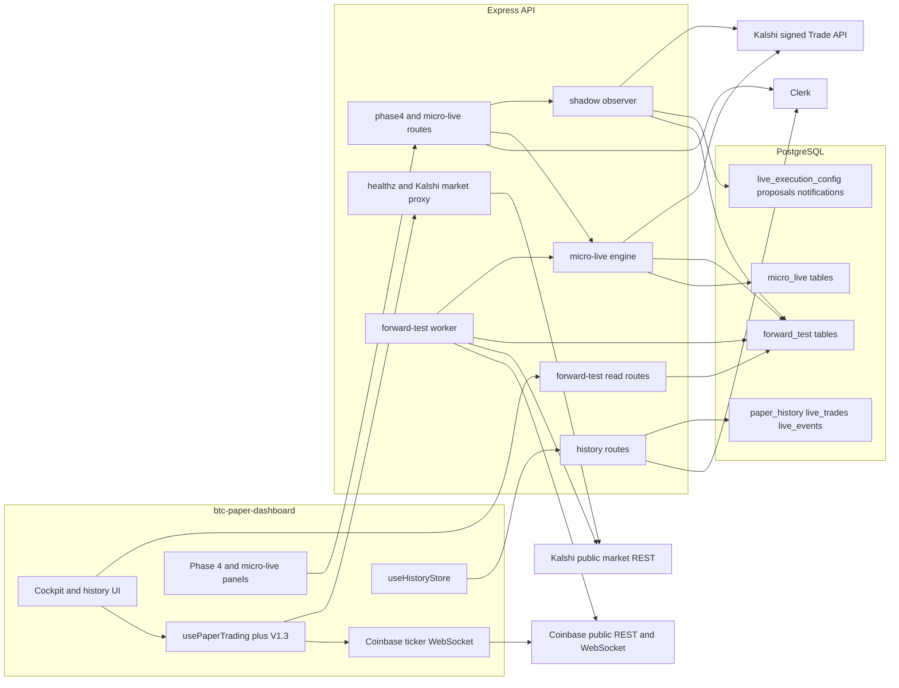
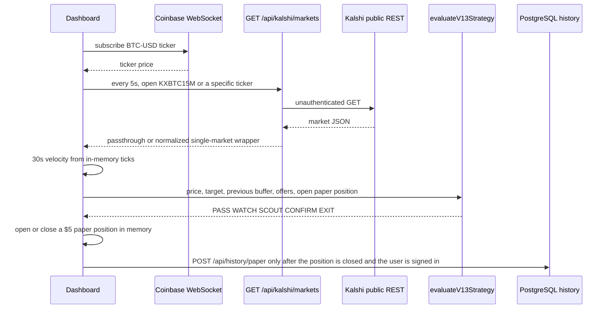
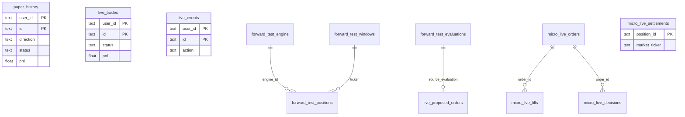

# BTC Kalshi V1.3 — technical handoff

> **Production live-money handoff:** Brit should start with [V13_LIVE_MONEY_HANDOFF.md](./V13_LIVE_MONEY_HANDOFF.md). That document is the authoritative production-executor contract. The existing micro-live commissioning harness remains intentionally bounded and must not be scaled to the production ceiling by changing its small-dollar constants.

> **Strategy tuning/research:** [V13_STRATEGY_RESEARCH.md](./V13_STRATEGY_RESEARCH.md) defines the locked champion, zero-authority challengers, prospective shadow evaluation, and the reviewed promotion process for changing opportunity thresholds without weakening execution/risk controls.
> **Threshold study:** [V13_THRESHOLD_OPTIMIZATION_267.md](./V13_THRESHOLD_OPTIMIZATION_267.md) records the 267-trade bounded optimization, holdout checks, stress tests, and current challenger ranking.
> **Loss forensics:** [V13_LOSS_FORENSICS_267.md](./V13_LOSS_FORENSICS_267.md) explains the remaining C52/53 losses, why hit-rate chasing would sacrifice expectancy, and the new telemetry used to improve signal/execution quality prospectively.
> **Opportunity replay & sizing:** [V13_OPPORTUNITY_REPLAY_AND_SIZING.md](./V13_OPPORTUNITY_REPLAY_AND_SIZING.md) defines rejected-opportunity counterfactual replay and research-only confidence-weighted sizing.
> **First-live champion gate:** [V13_FINAL_CHAMPION_SELECTION.md](./V13_FINAL_CHAMPION_SELECTION.md) designates C52/53 as the launch champion and defines the required final evidence review before live-money approval.

This document describes the application as it exists in this repository. It is a frontend handoff. It does not propose a rewrite, and it does not describe behavior that is not implemented.

`replit.md` and `threat_model.md` are older snapshots. They describe a paper-only app with no accounts and no private Kalshi access. The current code has Clerk sessions, PostgreSQL history, a server paper worker, a shadow-proposal observer, and a heavily gated Kalshi micro-live execution path. Trust the source files cited below over those two documents.

There is no backend WebSocket server. There is no generic “place any order” API. There is no stock broker integration and no cryptocurrency exchange integration. Bitcoin appears only as a public Coinbase BTC-USD reference price used to evaluate Kalshi’s 15-minute Bitcoin contracts.

---

# 1. PROJECT OVERVIEW

This application watches the current Kalshi **KXBTC15M** contract (a 15-minute Bitcoin up/down prediction market) and compares it with the live Coinbase **BTC-USD** spot price. A shared rules engine, V1.3 Early-Bird, decides whether the spot move has crossed the contract’s strike by enough, and whether the contract’s offered price still lags that move.

The product problem it solves is observation and controlled testing of that lag:

- Did BTC cross the Kalshi strike?
- Is the move still in the scout band ($8–$15) or the confirm band ($20 or more)?
- Is the favored contract side still cheap enough for the C52/53 launch champion (at or under 52% for scout, 53% for confirm)?
- Should a hypothetical $5 paper position be opened, exited, or settled?

What trading it currently supports:

| Layer | What it trades | Real money? |
| --- | --- | --- |
| Browser paper cockpit | Hypothetical $5 positions on the current KXBTC15M contract | No |
| Server paper forward-test worker | The same V1.3 rules, persisted independently of the browser | No |
| Manual live-test journal | User-typed scout/add/exit/settlement records against a planned $25 bankroll | No. These rows are a ledger, not Kalshi orders |
| Phase 4 shadow observer | Simulated proposals from fresh server paper triggers, using a Kalshi order book quote | No. The database forbids enabling live execution on this config |
| Micro-live engine | Real Kalshi limit orders, only for a qualified V1.3 action on an armed bounded run | Yes, but only when many independent gates are all open, and order submission itself refuses to run unless `NODE_ENV` is `development` |

What appears complete:

- Public market discovery for the open KXBTC15M contract, proxied through the API because Kalshi’s public REST API does not allow browser CORS.
- Direct browser subscription to the Coinbase BTC-USD ticker WebSocket, with a 3-second reconnect.
- The V1.3 classifier in `lib/v13-strategy`, used by both the browser and the server worker.
- Clerk sign-in and a per-user PostgreSQL history ledger for completed paper tests and manual live-test records.
- A server paper worker on a 5-second cadence, with a database lease so two processes do not both own the engine.
- Admin read APIs for Kalshi account snapshots, shadow state, and micro-live state.
- A large micro-live implementation: fee approval, bounded runs, startup reconciliation, order/fill/settlement ledgers, uncertain-order recovery, and dedicated Kalshi subaccount (“pair”) provisioning.

What appears incomplete or intentionally closed:

- There is no user-facing order ticket. A signed-in user cannot submit or cancel a Kalshi order from a normal trading form.
- `executeQualifiedV13Trigger` blocks with `micro_live_development_only` unless `NODE_ENV === "development"`. Production can run the paper worker and, when flagged, the shadow observer. It does not take the micro-live order path.
- Shadow mode records `PROPOSED` or `BLOCKED` rows. It does not call Kalshi order endpoints. `live_execution_config.live_execution_enabled` is constrained to `false` in the database.
- There is no historical candle API, no full order-book ladder endpoint for the dashboard, and no backend push channel.
- `replit.md` says “never add live order submission.” The code has since added a gated micro-live path. The dashboard footer still says “no orders” for the paper cockpit.
- `artifacts/mockup-sandbox` is a dev preview shell. Its generated module map is empty, so it currently renders no mockup screens.
- `scripts/src/hello.ts` only prints a hello string.
- `pnpm-workspace.yaml` lists `lib/integrations/*`, but that directory is not present.

What the backend is responsible for:

- Proxying public Kalshi market JSON.
- Authenticating users with Clerk and storing their paper/manual history.
- Running the always-on paper forward test when its environment flag is on.
- Optionally scanning fresh paper triggers and recording shadow proposals.
- Holding Kalshi API credentials server-side, signing private Kalshi requests, and exposing admin-only account, shadow, and micro-live operations.
- Reconciling micro-live orders, fills, positions, cash, and settlements. The browser is not the source of truth for real orders.

A frontend currently exists: `artifacts/btc-paper-dashboard`. It is a phone-first React cockpit named “FIFTEEN / PAPER”. It shows BTC, the Kalshi target, the V1.3 readout, a local paper position, a manual live-test panel, and, on the history tab, admin panels for Phase 4, micro-live, and server paper history. `artifacts/mockup-sandbox` is a separate empty design canvas.

Maturity: the paper observation path and its persistence are production-shaped and wired into a Replit deployment. The live-money path is a large, test-heavy, fail-closed subsystem that is still an administrator development workflow, not a general trading product. A new multi-asset trading UI cannot be dropped on top of a generic broker API, because that API does not exist.

---

# 2. TECHNOLOGY STACK

| Technology | Where | What it is used for |
| --- | --- | --- |
| TypeScript 5.9 | Whole workspace | All application source |
| Node.js 24 | `.replit` modules, API runtime | API server and scripts. Root `package.json` scripts assume a Unix `sh` preinstall check |
| pnpm workspaces | `pnpm-workspace.yaml` | Packages under `artifacts/*`, `lib/*`, and `scripts` |
| React 19.1 | `artifacts/btc-paper-dashboard` | Existing dashboard |
| Vite 7 | Dashboard and mockup sandbox | Frontend dev server and production build |
| Tailwind CSS 4 | Dashboard | Styling. Most color is written as utility classes in components, not a separate theme file |
| wouter 3 | Dashboard `App.tsx` | Client routes: `/`, `/dashboard`, `/sign-in`, `/sign-up` |
| TanStack Query 5 | Dashboard and generated API client | Polling authenticated reads |
| Clerk (`@clerk/react`, `@clerk/express`) | Dashboard and API | User sessions. Admin routes compare the Clerk user id with `PHASE4_ADMIN_USER_ID` |
| Express 5 | `artifacts/api-server` | HTTP API |
| Zod 3 (`zod/v4` in schema files) | API validation and Drizzle insert schemas | Request and response parsing. Generated Zod lives in `@workspace/api-zod` |
| Orval | `lib/api-spec` | Generates the React Query client and Zod schemas from `openapi.yaml` |
| PostgreSQL 16 | `.replit` module; `DATABASE_URL` | All durable state |
| Drizzle ORM + drizzle-kit | `lib/db` | Schema, queries, and `pnpm --filter @workspace/db run push` for development schema push. There are no SQL migration files in the repo |
| `pg` | `lib/db/src/index.ts` | Connection pool. The pool is created at import time and throws if `DATABASE_URL` is missing |
| pino + pino-http | API | Structured logs to stdout. Non-production uses `pino-pretty` |
| esbuild | `artifacts/api-server/build.mjs` | Bundles the API to `dist/index.mjs` |
| Node test runner | API `package.json` scripts | Integration and unit tests, bundled with esbuild and often run against an isolated database schema |
| `pdfjs-dist` | Fee-approval code | Reads an administrator-uploaded Kalshi fee-schedule PDF. Not a trading-data parser |
| Coinbase Exchange public WebSocket | Browser `marketData.ts` | BTC-USD ticker |
| Coinbase Exchange public REST | Server `forwardTestFeeds.ts` | `GET https://api.exchange.coinbase.com/products/BTC-USD/ticker` |
| Kalshi public REST | Browser proxy and server paper feeds | `https://api.elections.kalshi.com/trade-api/v2/markets` |
| Kalshi signed Trade API | Account and trading clients | `https://external-api.kalshi.com` when `KALSHI_API_ENVIRONMENT=production`, otherwise `https://external-api.demo.kalshi.co` |
| Replit deployment | `.replit` | VM deployment, Node 24, PostgreSQL 16, pnpm. Post-build runs `pnpm store prune` |

Not present:

- Redis or any other cache
- A job queue (Bull, SQS, and similar)
- A separate worker process. Background loops start inside the API process
- GraphQL
- An ORM other than Drizzle
- A server-side WebSocket library
- Docker, Kubernetes, or a Terraform stack
- Stock or crypto brokerage SDKs

Authentication for the browser is a Clerk session cookie on the same site. The generated client’s `setAuthTokenGetter` can attach a bearer token, but the dashboard does not use it. Cookie sessions are the path that is actually wired.

---

# 3. REPOSITORY STRUCTURE

```text
btc-kalshi-v13-main/
  package.json                 Workspace scripts: build, typecheck. Depends on @replit/connectors-sdk.
  pnpm-workspace.yaml          Workspace globs, shared dependency catalog, supply-chain minimum release age.
  pnpm-lock.yaml               Lockfile.
  tsconfig.json                Solution-style project references.
  tsconfig.base.json           Shared TypeScript compiler options.
  .replit                      Runtime modules and deployment/env flags. No secret values.
  .replitignore
  .npmrc
  .gitignore                   Ignores .env, PEM/key files, local databases, and zip archives.
  replit.md                    Stale product note. See the warning at the top of this README.
  threat_model.md              Stale threat model from the paper-only design.
  btc-source.zip               Local archive. Ignored by git rules for *.zip. Not application source.

  lib/
    v13-strategy/              Pure V1.3 signal function. No I/O.
      src/index.ts
    db/                        Drizzle schema and PostgreSQL pool.
      src/index.ts             Creates the pool and db client. Importing this requires DATABASE_URL.
      src/schema/              One table module per file, re-exported from schema/index.ts.
      drizzle.config.ts
    api-spec/
      openapi.yaml             Contract for the generated client. It does not list every Express route.
      orval.config.ts
    api-zod/                   Generated Zod parsers. Do not edit by hand.
    api-client-react/          Generated TanStack Query hooks plus custom-fetch.ts.

  artifacts/
    api-server/                Express API and all trading/server workers.
      build.mjs
      src/index.ts             Process entry. Listens, then starts background work.
      src/app.ts               Middleware and route mounting.
      src/routes/              HTTP route modules.
      src/middlewares/clerkProxyMiddleware.ts
      src/lib/                 Kalshi clients, paper worker, shadow observer, micro-live engine.
      scripts/                 Isolated test runners.
    btc-paper-dashboard/       Existing React UI.
      src/App.tsx              Cockpit, history, and admin panels.
      src/main.tsx
      src/lib/                 Market data, strategy adapter, paper hook, history, manual live journal.
      src/components/          Feature panels. src/components/ui is a Radix/shadcn kit.
      src/pages/not-found.tsx
    mockup-sandbox/            Dev-only preview host. Generated mockup map is empty.

  scripts/
    src/hello.ts               Placeholder console.log. Not part of trading.
    post-merge.sh

  docs/phase5/                 Design and deployment review notes. Not executed by the app.
  attached_assets/             Pasted planning transcripts. Not imported by the runtime.
  .agents/memory/              Agent working notes. Not imported by the runtime.
  screenshots/                 Present as a directory. No source files were found in it during this scan.
```

### `lib/v13-strategy/src/index.ts`

Pure classifier. Input is a market snapshot and an optional open position. Output is a signal. It does not fetch prices, open positions, or talk to Kalshi.

### `lib/db`

PostgreSQL access. Every table the application persists is defined under `src/schema/`. See section 18.

### `lib/api-spec/openapi.yaml`

Source of truth for the generated hooks in `@workspace/api-client-react`. Routes that exist in Express but are absent here are documented in section 10 from the route files.

### `artifacts/api-server/src/lib` — trading and market backend

| File | Role |
| --- | --- |
| `logger.ts` | pino logger |
| `forwardTestFeeds.ts` | Public Coinbase ticker and public Kalshi market reads for the paper worker |
| `forwardTestRepository.ts` | Engine row, lease, windows, evaluations, paper positions, aggregates |
| `forwardTestWorker.ts` | 5-second paper cycle and the bridge into micro-live |
| `shadowLive.ts` | Phase 4 shadow config, proposal scan, observer interval |
| `productionShadowPreflight.ts` | GET-only Kalshi checks before production shadow config is initialized |
| `kalshiAccountClient.ts` | Signed GET client: balance, orders, positions, fills, settlements, order book, subaccount evidence |
| `kalshiTradingClient.ts` | Signed POST/DELETE/GET client for limit entry, reduce-only exit, cancel, order status, fills |
| `kalshiPairFundingClient.ts` | Development-only exact funding transfer for a dedicated subaccount pair |
| `microLive.ts` | Micro-live state, startup reconciliation, bounded runs, and qualified order execution |
| `microLivePosition.ts` | Pure reconstruction of positions from orders and fills |
| `microLiveEntryFees.ts` | Fee formula and reservation against an approved fee policy |
| `microLiveFeeApproval.ts` | PDF review, approval, revocation, and canonical-source monitor |
| `microLiveFeeArtifact.ts` | Fee-schedule artifact checks |
| `microLiveFeeCap.ts` | Per-run fee-inclusive cap |
| `microLiveFeeVerification.ts` | Durable per-approval verification fence |
| `microLiveRecovery.ts` | Uncertain submission and uncertain-exit recovery |
| `microLiveSettlement.ts` | Settlement reconciliation into `micro_live_settlements` |
| `microLiveOwnership.ts` | Ownership proofs used before treating exchange state as the bot’s |
| `microLiveSettlementOwnership.ts` | Settlement ownership checks |
| `microLivePrimaryCashAccounting.ts` | Primary-account cash baseline and activity checkpoint |
| `microLivePairBoundary.ts` | Dedicated (subaccount N, exchange index 2) lifecycle |
| `microLivePairCollateral.ts` | Collateral proof for that pair |
| `microLivePairFunding.ts` | Funding-attempt orchestration |
| `microLivePairCommissioningApproval.ts` | Commissioning approval for a new pair |
| `microLiveSubaccountCreation.ts` | Create one empty Kalshi subaccount |
| `microLiveBoundedRunTransition.ts` | Bounded-run phase transitions |
| `microLiveFillNormalization.ts` | Fill side/price normalization |
| `microLiveMoney.ts` | Money helpers |
| `generateRestrictedKalshiKey.ts` | Development-only restricted key generation |
| `generatePairRestrictedKalshiKey.ts` | Development-only key generation for the index-2 pair |
| `keyProvisioningAttempt.ts` | Non-secret attempt row for key handoff |
| `microLivePairKeyProvisioningAttempt.ts` | Pair key attempt persistence |
| `verifyProvisioningRecovery.ts` | Recovery verification for a provisioning attempt |

### `artifacts/api-server/src/routes`

| File | Mount |
| --- | --- |
| `index.ts` | Mounts the routers below on `/api` |
| `health.ts` | `GET /api/healthz` |
| `kalshi.ts` | Public market proxy |
| `history.ts` | Per-user paper and manual-live ledger |
| `forwardTest.ts` | Read-only server paper status and history |
| `phase4.ts` | Admin Kalshi account and shadow controls. Also exports `requirePhase4Admin` |
| `microLive.ts` | Admin micro-live controls |
| `keyProvisioning.ts` | Development HTML admin for restricted-key handoff. Mounted in `app.ts`, not in `routes/index.ts` |
| `pairKeyProvisioning.ts` | Development HTML admin for the index-2 key |
| `pairFunding.ts` | Development HTML/JSON admin for the one-shot pair funding transfer |
| `pairCommissioningApproval.ts` | Admin JSON for pair commissioning. Mounted in `app.ts` |

### `artifacts/btc-paper-dashboard/src`

| File | Role |
| --- | --- |
| `App.tsx` | Entire cockpit UI, Clerk shell, history view |
| `lib/marketData.ts` | Kalshi market normalization and Coinbase WebSocket |
| `lib/strategy.ts` | Browser adapter around V1.3. Creates and closes the $5 paper position |
| `lib/usePaperTrading.ts` | Live market state, 5-second Kalshi poll, Coinbase reconnect, in-memory paper position |
| `lib/useHistoryStore.ts` | Authenticated history load/save/import/export |
| `lib/liveTesting.ts` | Manual $25 journal. Does not call Kalshi |
| `components/live-progress-panel.tsx` | Polls `GET /api/forward-test/status` |
| `components/server-forward-test-history.tsx` | Polls `GET /api/forward-test/history` |
| `components/diagnostics-panel.tsx` | Feed and database write diagnostics |
| `components/live-test-panel.tsx` | Manual scout/add/exit/settlement/skip form |
| `components/phase4-account-panel.tsx` | Admin account and shadow panel |
| `components/micro-live-panel.tsx` | Admin micro-live state and actions |
| `components/micro-live-bounded-run.tsx` | Arm, prepare-next, resume-exit |
| `components/micro-live-fee-approval.tsx` | Fee PDF review/approve/revoke |
| `components/stale-accounting-resolution.tsx` | Resolve a specific stale accounting reason |
| `components/key-provisioning-link.tsx` | Dev-only links to the admin HTML pages |
| `components/ui/*` | Shared Radix/shadcn primitives. Not trading logic |

---

# 4. APPLICATION STARTUP

## API process

Entry point: `artifacts/api-server/src/index.ts`.

`package.json` script `dev` sets `NODE_ENV=development`, runs esbuild (`build.mjs`), then `node --enable-source-maps ./dist/index.mjs`. Production start is the same bundled file. Replit’s deployment target is a VM.

Sequence:

1. Importing `app.ts` builds the Express app. Importing route and library modules that import `@workspace/db` constructs a `pg` pool. If `DATABASE_URL` is unset, that import throws and the process never listens.
2. `PORT` is required. A missing or non-positive value throws before listen.
3. `app.listen(port)` starts HTTP.
4. `startFeeArtifactMonitor()` starts a process-local check of the approved fee-schedule artifact. The micro-live route module also calls this at import time unless `MICRO_LIVE_TEST_ISOLATED_SCHEMA` is set.
5. If `NODE_ENV=production`, `SHADOW_LIVE_PRODUCTION_PREFLIGHT_ENABLED=true`, and `SHADOW_LIVE_PRODUCTION_ENABLED` is not `true`, the process runs `verifyProductionShadowReads()`. That is a GET-only Kalshi check. Failure is logged. It does not start the observer.
6. `startShadowObserver()` starts a 5-second interval only when the environment is `development`, or when it is `production` and `SHADOW_LIVE_PRODUCTION_ENABLED=true`. Otherwise it returns immediately.
7. `startServerForwardTestWorker()` starts the paper loop only when:
   - development and `FORWARD_TEST_WORKER_ENABLED=true`, or
   - production and `FORWARD_TEST_PRODUCTION_WORKER_ENABLED=true`.
   The loop acquires a database lease, runs a cycle about every 5 seconds, and, after a successful paper evaluation, calls `processMicroLiveForwardTestCycle`. That call returns without exchange writes unless the micro-live flags, kill switch, account binding, and bounded-run phase all allow it.
8. `reconcileMicroLiveAtStartup()` runs once. If the reason is that environment flags, database flags, or the kill switch are blocking execution, it then runs `auditMicroLiveReadOnly()`. A thrown reconciliation is logged and execution stays blocked.

There is no separate migration step on startup. Schema changes are applied with Drizzle Kit push in development (`pnpm --filter @workspace/db run push`).

## What does not start

- No WebSocket server.
- No message consumer.
- The paper worker does not start just because the process starts. The flag above is required.
- Micro-live does not place an order at startup. Startup only reconciles and audits.
- Key-provisioning routers are mounted only when their development flags say they are enabled. Pair commissioning is mounted unconditionally, but its handlers still require the Phase 4 admin and their own guards.

## Dashboard process

`artifacts/btc-paper-dashboard` is a separate Vite app.

1. `PORT` and `BASE_PATH` are required by `vite.config.ts`.
2. `main.tsx` mounts `App` inside an error boundary.
3. `App.tsx` requires a Clerk publishable key resolved from the hostname or `VITE_CLERK_PUBLISHABLE_KEY`. If that key is missing, the dashboard throws during module init.
4. Routes render the cockpit. Market polling and the Coinbase socket start inside `usePaperTrading` when `Home` mounts. They do not wait for sign-in.
5. History requests start when Clerk has a user id.

The dashboard and API are separate packages. The UI calls relative `/api/...` URLs. On Replit they are expected to share a public origin through the platform router. This repository does not contain a Vite proxy config that forwards `/api` to the API port.

---

# 5. SYSTEM ARCHITECTURE



The browser paper loop and the server paper loop are two independent V1.3 evaluations. They share the classifier package. They do not share the open position. A $5 position on screen is not the row in `forward_test_positions`, and neither is a Kalshi order unless the micro-live gates later act on a **server** evaluation.

---

# 6. DATA FLOW

## A. Browser paper path



Market data enters in two places:

- BTC ticks enter the browser on `wss://ws-feed.exchange.coinbase.com`. The server paper worker does **not** use that socket. It polls Coinbase REST.
- Kalshi markets enter through `GET /api/kalshi/markets/open` and `GET /api/kalshi/markets/:ticker`, which forward to `https://api.elections.kalshi.com/trade-api/v2/markets`.

Processing:

- Prices above 1 are treated as cents and divided by 100. Contract prices are probabilities in dollars, from 0 to 1.
- The strike target is `floor_strike` / `strike` / `target` / `threshold`, or a dollar amount parsed from the title.
- YES/NO bid and ask are kept. The displayed “price” is the bid/ask midpoint when both exist.
- Velocity is the price change over up to 30 seconds, divided by elapsed minutes. The browser keeps at most 180 ticks.

Strategy evaluation is local and synchronous on each tick or market refresh. A qualifying scout or confirm **creates the paper position inside `evaluateStrategy`**. There is no separate signal queue.

Order creation on this path does not exist. Closing the paper position computes:

`contracts = stake / entryPrice`, `payout = contracts * exitPrice`, `pnl = payout - stake`, with stake fixed at $5.

Settlement uses the Kalshi `result` when present (`yes` pays 1 for UP and 0 for DOWN). If the window has expired and no result is present, the exit price is inferred from the sign of the BTC buffer. An EXIT signal closes at the current side price.

The closed position is posted to `/api/history/paper`. The server stores it under the Clerk user id and returns server-computed metrics on the next `GET /api/history`.

## B. Server paper path

Every enabled worker cycle:

1. Renews a 20-second lease. A lost lease throws and the loop must acquire again.
2. Fetches Coinbase REST and the open KXBTC15M market in parallel, with an 8-second timeout. If a paper position is open on another ticker, that ticker is fetched instead.
3. Rejects stale or inconsistent snapshots and writes `last_error` plus signal `PASS`.
4. Inserts the BTC point, deletes points older than 120 seconds, and computes the same 30-second velocity.
5. Calls `evaluateV13Strategy`.
6. Inserts one row in `forward_test_evaluations`.
7. On the first fresh cross of a window, stores crossing key `{ticker}:first`. Later crosses do not rename it.
8. Opens at most one paper position per engine, only on that first cross, only for SCOUT or CONFIRM, stake $5, contracts = 5 / entry offer.
9. Closes it through `paperClose`: Kalshi result, then a fresh expiry inference, then a V1.3 exit at the mark.
10. Updates the engine row: signal, buffer, offers, mark, unrealized paper P&L.
11. Calls `processMicroLiveForwardTestCycle(evaluationId)`.

Unrealized paper P&L is `contracts * mark - stake`, rounded to cents. It is stored on the engine row while the position is open. It is not a Kalshi portfolio value.

## C. Shadow path

The observer, every 5 seconds, selects fresh qualifying SCOUT/CONFIRM evaluations (15-second freshness). For each new `(ticker, crossingKey, trigger)` it reads the authenticated Kalshi order book, sizes a simulated contract count from shadow capital and displayed size, and inserts `live_proposed_orders` as `PROPOSED` or `BLOCKED`. A proposal does not create a Kalshi order. Risk reasons include exhausted shadow capital, stale quote, quote above the V1.3 cap (0.60 scout, 0.68 confirm), and quote above the paper entry offer.

## D. Micro-live path

This path consumes the **server** paper evaluation. It does not consume the browser position.

1. `processMicroLiveForwardTestCycle` returns immediately unless both environment flags are true, both database flags are true, the kill switch is off, the account binding matches, accounting is resolved, and the bounded run is in `ENTRY_OPEN` or `EXIT_ONLY`.
2. A new entry is considered for a fresh qualifying **SCOUT or initial CONFIRM** while the run is `ENTRY_OPEN` and the evaluation is newer than `armedAt`. Exactly one live buy is permitted for the run.
3. If one live position is already open, the engine re-runs V1.3 against that position (`qualifyMicroLivePositionEvaluation`). EXIT can proceed through the live exit path; a position-sourced CONFIRM does **not** authorize an additional buy.
4. `executeQualifiedV13Trigger` refuses unless `NODE_ENV` is `development`.
5. Before POST, the trading client requires a dedicated `(subaccount N, exchange_index 2)` authorization proof. Primary-account mode can be configured and reviewed, but the POST/DELETE guard in `createKalshiTradingClient` rejects mutations unless account mode is `exclusive`, the subaccount is greater than 0, and `exchange_index` is 2.
6. Entry is an immediate-or-cancel limit buy on `POST /trade-api/v2/portfolio/events/orders`. Any unfilled remainder is canceled rather than left resting after the signal edge moves.
7. Exit is a reduce-only immediate-or-cancel sell.
8. Fills are read back and stored in `micro_live_fills`. Positions are not a separate table. They are reconstructed from orders, fills, and settlements.
9. If a POST response is uncertain, the order stays `unknown` until an admin calls the reconcile endpoint. The engine does not guess that an empty list means rejection.
10. Settlement is recorded only by the admin reconcile endpoint after ownership checks, into `micro_live_settlements`.

P&L for micro-live is integer cents plus exact micros. `realizedPnlMicros` stays null when a required fee or trade value is unknown. The API does not invent a fee.

There is no frontend push at the end of this flow. Admin panels poll `GET /api/micro-live/state` every 8 seconds and the account snapshot every 8 seconds.

---

# 7. KALSHI INTEGRATION

Two different Kalshi hosts are used on purpose.

| Use | Host | Auth |
| --- | --- | --- |
| Public market lists and single markets for the dashboard and the paper worker | `https://api.elections.kalshi.com/trade-api/v2/markets` | None |
| Private account reads and order mutations | `https://external-api.kalshi.com` or `https://external-api.demo.kalshi.co` | RSA-PSS signature |

## Authentication

Private requests send:

- `KALSHI-ACCESS-KEY`: the key id
- `KALSHI-ACCESS-TIMESTAMP`: current unix milliseconds as a string
- `KALSHI-ACCESS-SIGNATURE`: base64 RSA-PSS SHA-256 signature over `timestamp + METHOD + path`

The signed string is the path only. Query strings are not included in the signature. The private key is a PEM in an environment variable. A one-line PEM with literal `\n` sequences is turned back into newlines before `createPrivateKey`.

Credential sets, all server-side:

| Variable pair | Used for |
| --- | --- |
| `KALSHI_API_KEY_ID`, `KALSHI_API_PRIVATE_KEY` | Trading and account reads for the selected bot key |
| `KALSHI_VERIFIER_API_KEY_ID`, `KALSHI_VERIFIER_API_PRIVATE_KEY` | A separate key that checks the trading key’s scopes |
| `KALSHI_PROVISIONING_API_KEY_ID`, `KALSHI_PROVISIONING_PRIVATE_KEY` | Development-only key generation |
| `KALSHI_INDEX2_API_KEY_ID`, `KALSHI_INDEX2_PRIVATE_KEY` | The dedicated exchange-index-2 key after it is installed |
| `KALSHI_MICRO_LIVE_API_KEY_ID`, `KALSHI_MICRO_LIVE_PRIVATE_KEY` | Referenced by provisioning tests and recovery checks as the restricted micro-live key slot |

`KALSHI_BOT_SUBACCOUNT` selects the subaccount number. `0` is the primary account. `1`–`63` are subaccounts. `MICRO_LIVE_ACCOUNT_MODE` is `exclusive` (default) or `primary_nonexclusive`.

`getKalshiCredentialsState()` returns `CONFIGURED` only when both the trading key id and private key are non-empty. It does not prove the key works.

## Market discovery

`GET /api/kalshi/markets/open` forwards:

`/markets?series_ticker=KXBTC15M&status=open&limit=100`

The dashboard picks the open or active market with the soonest future close time. The server feed does the same.

There is no general event search and no multi-series browser. The series ticker `KXBTC15M` is hard-coded in the proxy and in `forwardTestFeeds.ts`.

## Contract discovery

A KXBTC15M market **is** the contract. The code does not model a separate instrument master. Identity is the Kalshi `ticker`. The strike is the numeric target. YES is the UP side. NO is the DOWN side.

`GET /api/kalshi/markets/:ticker` fetches one market and, if Kalshi returns `{ market }`, wraps it as `{ markets: [market] }` so the dashboard parser can stay uniform.

## Market data, prices, and order books

Public market fields used after normalization:

- ticker, title, status
- target
- open/close or expiration time
- yes/no bid and ask
- last price
- result `yes` or `no`

The authenticated order book is `readKalshiOrderbook(ticker)` in `kalshiAccountClient.ts`. It returns best yes/no bid and ask in dollar strings, available size at those asks, and `observedAt`. It is used by the shadow scanner and by micro-live quoting. It is **not** exposed as its own HTTP route. The dashboard’s UP/DOWN offers come from the public market payload, not from this order book.

There is no full depth ladder and no public-trade tape in this repository.

## WebSockets

Kalshi is not subscribed to over a WebSocket anywhere in this repo. All Kalshi I/O is HTTP.

## Orders

| Action | Client method | Kalshi path | Notes |
| --- | --- | --- | --- |
| Limit buy entry | `createKalshiTradingClient().createLimitOrder` | `POST /trade-api/v2/portfolio/events/orders` | `time_in_force=immediate_or_cancel`, `post_only=false`, `reduce_only` omitted, `exchange_index=2` |
| Reduce-only exit | `createReduceOnlyExit` | same POST path | `time_in_force=immediate_or_cancel`, `reduce_only=true` |
| Cancel resting exit | `cancelReduceOnlyExit` | `DELETE /trade-api/v2/portfolio/events/orders/{orderId}` | Requires a one-time cancellation capability and a fresh GET of the resting order |
| Order status | `getOrder` | `GET /trade-api/v2/portfolio/orders/{orderId}` | |
| Fills | `getFills` | `GET /trade-api/v2/portfolio/fills` | One page, limit 100, filtered by selected subaccount |

YES outcome maps to book side `bid` on entry and `ask` on exit. NO is the opposite. Prices on the wire for the V2 event-order endpoint are YES dollars. A NO price is converted to the complement rounded to 0.0001.

`authorizeKalshiSubmission` and `authorizeKalshiCancellation` are internal capability gates. Callers cannot satisfy them by passing a plain `{ databaseEnabled: true }` object. The trading client comment says that object is intentionally not proof.

Mutations are rejected unless the dedicated pair proof passes: exclusive mode, subaccount greater than 0, exchange index 2, a run id, and a market ticker.

## Positions, balances, settlements

Account reads allowed by `isAllowedGetPath`:

- `/trade-api/v2/portfolio/balance`
- `/trade-api/v2/portfolio/subaccounts/balances`
- `/trade-api/v2/portfolio/subaccounts/transfers`
- `/trade-api/v2/portfolio/intra_exchange_instance_transfers`
- `/trade-api/v2/portfolio/orders`
- `/trade-api/v2/portfolio/positions`
- `/trade-api/v2/portfolio/fills`
- `/trade-api/v2/portfolio/settlements`
- `/trade-api/v2/historical/orders`
- `/trade-api/v2/historical/fills`
- `/trade-api/v2/api_keys`
- `/trade-api/v2/markets/{ticker}`
- `/trade-api/v2/markets/{ticker}/orderbook`

`readKalshiAccount()` returns balance, open orders, positions, recent fills, and truncation flags. Page caps are 20 pages and 1,000 records, with a 15-second timeout. Truncation is reported. It is not treated as a complete book.

`readKalshiSettlements()` returns settlement rows including market result, yes/no counts and costs, revenue, fee, and time.

`readKalshiAccountActivity()` merges current and historical orders and fills for the selected subaccount. `exclusiveControlVerified` is hard-coded `false`. The code does not claim that a snapshot proves no other key can trade.

Dedicated pair evidence (`readKalshiDedicatedPairEvidence`, `captureCleanPairSnapshot`) is the long evidence model for subaccount N on exchange index 2: balances, history classification (`pair`, `elsewhere`, `ambiguous`), funding anchor, and fee evidence. Ambiguous records freeze the pair.

## Kalshi-specific models

See `KalshiAccountSnapshot`, `KalshiOrderbook`, `KalshiOrder`, `KalshiFill`, and `KalshiDedicatedPairEvidence` in section 12. Files:

- `artifacts/api-server/src/lib/kalshiAccountClient.ts`
- `artifacts/api-server/src/lib/kalshiTradingClient.ts`

---

# 8. TRADING ENGINE

There are three engines, and they must not be collapsed into one.

1. **Browser paper engine** — `usePaperTrading` + `evaluateStrategy`. Starts when the cockpit mounts. In memory, except completed trades posted to history.
2. **Server paper engine** — `startServerForwardTestWorker`. Starts at API boot when flagged. Persists evaluations and $5 paper positions. Engine id is `v1.3-paper`.
3. **Micro-live engine** — functions in `microLive.ts`, invoked at the end of each server paper cycle and by admin routes. Real orders.

Shadow mode is a recorder on top of engine 2. It is not an execution engine.

## How strategies are loaded

There is one strategy. `evaluateV13Strategy` is imported directly. There is no plugin registry, no strategy id list, and no runtime upload. The database checks force `strategy_version = 'V1.3'`.

## How signals are generated

See section 9. The server stores every evaluation. The browser keeps a short in-memory activity list and does not POST signals.

## How trades are created and executed

| Engine | Creation | Execution |
| --- | --- | --- |
| Browser paper | `evaluateStrategy` builds a `PaperPosition` when `qualifyingTrigger` is true | Local only. Closed positions go to `POST /api/history/paper` |
| Server paper | Insert into `forward_test_positions` inside the lease transaction | Local only |
| Manual journal | User presses scout/add/exit/settlement/skip in `LiveTestPanel` | `POST /api/history/live` |
| Shadow | Insert into `live_proposed_orders` | None |
| Micro-live | `executeQualifiedV13Trigger` inserts `micro_live_orders`, then the trading client POSTs | Kalshi, development only, dedicated pair only |

Micro-live entry sizing is not the paper $5 stake. Config defaults are a $25 bankroll (`maxLiveBankrollCents = 2500`), $5 max single-order risk, $2.50 max scout stake, $2.50 max additional confirm stake, and one open position. The per-run cap defaults to 1,000,000 micros ($1) and the fee approval schema allows up to 5,000,000 micros ($5). Actual submitted size is whatever the fee and collateral checks allow inside those caps. Do not assume a fixed contract count without reading the current run.

## Order state

`micro_live_orders.status`: `pending`, `unknown`, `partial`, `rejected`, `canceled`, `filled`, `closed`.

`unknown` means the POST outcome was not proven. Recovery is an admin action, not an automatic retry of the same POST.

Orders are idempotent on `action_key`, `client_order_id`, and, for scout/confirm, `(market_ticker, crossing_key, trigger_type)`.

## Positions

`reconstructMicroLivePositions` in `microLivePosition.ts` replays orders and fills. States include `entry_pending`, `entry_partial`, `entry_filled`, `confirm_pending`, `confirm_partial`, `confirm_filled`, `exit_requested`, `exit_partial`, `settled`, `closed`, `canceled`, `rejected`, `unknown`.

Anomalies block further trading. The engine will not trade through a ledger it cannot reconstruct.

Paper positions are separate rows with status `OPEN`, `CLOSED`, or `SETTLED`. One open paper position per engine.

## Balances

- Manual journal bankroll is a formula: $25 starting bankroll plus realized P&L minus exposure of the first open manual trade. It is not a Kalshi balance.
- Phase 4 account balance is the string `availableCashDollars` from Kalshi, plus a nullable portfolio value.
- Micro-live reports `availableBankrollCents` from config and `availableKalshiBalance` when a fresh read exists.
- Dedicated pair cash is tracked in integer micros, including a funding anchor of exactly 2500 cents ($25) and baseline `25000000` micros when that pair mode is fully populated.
- Shadow remaining capital is a simulated number on `live_execution_config`. Production shadow initialization uses a $25 shadow budget, $5 max stake, 1 open simulated position, and $25 max simulated loss, and it does not reset remaining capital on restart.

## P&L

- Paper: `(contracts * exitPrice) - stake`, rounded to cents. Wins are P&L greater than 0. Losses are P&L less than or equal to 0. Server history metrics for the user ledger follow that rule and treat null paper P&L as zero.
- Manual live journal: completed means `status=closed`, non-null P&L, and non-null `closedAt`. Wins and losses use strict positive and negative P&L. Max drawdown is computed server-side in `liveMetrics`.
- Server paper unrealized: `contracts * current side mark - stake` on the engine row.
- Micro-live realized: from reconstructed fills and settlements, in cents and micros. Unknown fees force null micros.

## Errors, failed orders, reconnects, concurrency

- Paper feed failures set the engine signal to `PASS` and store `last_error`. They do not open a position.
- Browser Kalshi failures set `marketError` and the model explanation holds WATCH when the spot feed is down. A signed-buffer mismatch forces PASS with `dataError` and blocks scout/confirm.
- Kalshi private errors are typed: `NOT_CONFIGURED`, `INVALID_CREDENTIALS`, `NETWORK_ERROR`, `HTTP_ERROR`, `INVALID_JSON`, `INVALID_RESPONSE`, and for trading `MUTATION_GUARD_REJECTED`. HTTP handlers collapse most of these to 502 or 503 JSON. They do not return the upstream body.
- A failed mutation guard throws before `fetch`. A network error on POST leaves the local order in the uncertain path rather than marking it rejected.
- Coinbase browser reconnect waits 3 seconds after `closed` or `error`. There is no Kalshi socket to reconnect. Private HTTP calls use a 15-second `AbortSignal` timeout. The paper cycle uses 8 seconds.
- The paper worker has one lease owner and a 20-second expiry. Losing the lease clears the micro-live worker-lease registration.
- The shadow observer skips a tick if a scan is already running.
- Micro-live startup recovery freezes a non-pristine bounded run on process restart (`process_restart_requires_explicit_exit_resume`) unless a still-unused entry run can be recovered. Exit-only resume is an explicit admin POST.
- Database unique indexes are the idempotency mechanism for paper positions, shadow proposals, and micro-live orders.

## Major functions

### `evaluateV13Strategy`

- File: `lib/v13-strategy/src/index.ts`
- Purpose: classify one snapshot.
- Inputs: `V13Input` (ticker, BTC price, target, previous signed buffer, velocity, up/down offers, freshness, optional open position).
- Outputs: `V13Decision`.
- Side effects: none.
- Called by: `evaluateStrategy`, `runForwardTestCycle`, and the micro-live position qualifier.
- Calls: `calculateSignedBuffer`.

### `evaluateStrategy`

- File: `artifacts/btc-paper-dashboard/src/lib/strategy.ts`
- Purpose: browser wrapper that also opens and closes the $5 paper position and applies settlement rules.
- Inputs: market, latest BTC price, previous buffer, velocity, current paper position, cross id, optional now.
- Outputs: `StrategySnapshot`.
- Side effects: none inside the function. The caller stores the returned position.
- Called by: `usePaperTrading`.
- Calls: `evaluateV13Strategy`.

### `usePaperTrading`

- File: `artifacts/btc-paper-dashboard/src/lib/usePaperTrading.ts`
- Purpose: own the cockpit’s live market state.
- Inputs: the history store, used to persist closed paper trades.
- Outputs: `PaperTradingState`.
- Side effects: 5-second Kalshi polling, Coinbase socket, saving closed paper positions.
- Called by: `Home` in `App.tsx`.
- Calls: `fetchOpenKxbtc15mMarket`, `fetchKxbtc15mMarketByTicker`, `createCoinbaseSocket`, `evaluateStrategy`, `savePaper`.

### `publicForwardTestFeeds.btc` and `.market`

- File: `artifacts/api-server/src/lib/forwardTestFeeds.ts`
- Purpose: public reads for the worker.
- Inputs: optional ticker and abort signal.
- Outputs: `BtcObservation` or `MarketObservation`.
- Side effects: HTTP only.
- Called by: `runForwardTestCycle`.
- Calls: Coinbase and Kalshi public REST.

### `runForwardTestCycle`

- File: `artifacts/api-server/src/lib/forwardTestWorker.ts`
- Purpose: one paper evaluation and optional paper position change.
- Inputs: lease owner, epoch, optional engine id, feeds, abort signal, optional now.
- Outputs: `{ evaluationId, signal, marketTicker, positionId, error }`.
- Side effects: writes engine, window, BTC points, evaluation, and maybe a position.
- Called by: the worker loop.
- Calls: feeds, `evaluateV13Strategy`, repository lease helpers, `paperClose`.

### `startServerForwardTestWorker`

- File: `forwardTestWorker.ts`
- Purpose: own the loop and the lease.
- Inputs: optional feeds. Production uses the public feeds.
- Outputs: `{ running, stop }`.
- Side effects: lease rows, cycles, and `processMicroLiveForwardTestCycle`.
- Called by: `index.ts` on listen.
- Calls: `runForwardTestCycle`, `processMicroLiveForwardTestCycle`.

### `scanShadowOnce` and `startShadowObserver`

- File: `shadowLive.ts`
- Purpose: turn fresh paper triggers into simulated proposals.
- Inputs: none for the scan. Observer interval defaults to 5000 ms and must be at least 1000.
- Outputs: scan counts, or a timer handle.
- Side effects: `live_proposed_orders`, notifications, simulated capital decrement.
- Called by: `index.ts` and `POST /api/phase4/shadow/scan`.
- Calls: `readKalshiOrderbook`, `calculateShadowContractCount`.

### `readKalshiAccount`, `readKalshiOrderbook`, `readKalshiSettlements`, `readKalshiAccountActivity`

- File: `kalshiAccountClient.ts`
- Purpose: signed GETs and normalization.
- Inputs: ticker where relevant. Subaccount comes from the environment.
- Outputs: the snapshot types in section 12.
- Side effects: none in the database.
- Called by: Phase 4 account route, shadow scan, micro-live reconciliation.
- Calls: signed `fetch`.

### `createKalshiTradingClient`

- File: `kalshiTradingClient.ts`
- Purpose: the only object that POSTs and DELETEs orders.
- Inputs: a required `fetch` implementation, plus optional test verifiers.
- Outputs: `{ createLimitOrder, createReduceOnlyExit, cancelReduceOnlyExit, getOrder, getFills }`.
- Side effects: Kalshi mutations, and authorization reads against the database.
- Called by: micro-live execution and recovery.
- Calls: `authorizeKalshiSubmission`, `authorizeKalshiCancellation`, signed HTTP.

### `processMicroLiveForwardTestCycle`

- File: `microLive.ts`
- Purpose: decide whether a paper evaluation may become a live action.
- Inputs: paper evaluation id, optional dependency overrides (tests inject readers).
- Outputs: `MicroLiveDecision` or null when the gates are closed.
- Side effects: may freeze a run, reconcile, or call `executeQualifiedV13Trigger`.
- Called by: the paper worker after each saved evaluation.
- Calls: lease lookup, `qualifyMicroLivePositionEvaluation`, `executeQualifiedV13Trigger`, `reconcileMicroLiveAtStartup`.

### `qualifyMicroLivePositionEvaluation`

- File: `microLive.ts`
- Purpose: re-run V1.3 with the reconstructed live position, using the latest paper feed row as market evidence only.
- Inputs: local position id.
- Outputs: `{ evaluationId, reason }`. The evaluation id is a new `micro_live` sourced row when the position is proven.
- Side effects: can insert a live-sourced evaluation. Does not itself POST.
- Called by: `processMicroLiveForwardTestCycle` when one position is open.
- Calls: `reconcileMicroLiveAtStartup`, `reconstructMicroLivePositions`, `evaluateV13Strategy`.

### `executeQualifiedV13Trigger`

- File: `microLive.ts`
- Purpose: turn one already-persisted qualified evaluation into a blocked decision or a Kalshi order.
- Inputs: evaluation id.
- Outputs: `MicroLiveDecision` with status `blocked`, `submitted`, `unknown`, `rejected`, `partial`, or `filled`.
- Side effects: decision row, order row, Kalshi POST when every gate passes.
- Called by: `processMicroLiveForwardTestCycle`.
- Calls: fee, collateral, account, and trading-client checks, then `executeQualifiedLiveExit` for a proven EXIT evaluation.

### `reconcileMicroLiveAtStartup`

- File: `microLive.ts`
- Purpose: prove local orders against the exchange before any new trading. Fail closed.
- Inputs: optional readers.
- Outputs: `{ ready, reason }`.
- Side effects: can update local order/fill state and readiness memory. Does not place orders.
- Called by: process startup, the forward-test cycle, and qualification.
- Calls: account, activity, order status, and ledger reconstruction.

### `getMicroLiveState`

- File: `microLive.ts`
- Purpose: the admin JSON document.
- Inputs: none.
- Outputs: `MicroLiveState`.
- Side effects: reads. Startup readiness is in-memory and is not a database table.
- Called by: `GET /api/micro-live/state`.

### `armBoundedMicroLiveRun`, `prepareNextBoundedMicroLiveRun`, `resumeBoundedMicroLiveExitOnly`, `emergencyStopMicroLive`

- File: `microLive.ts`
- Purpose: the only operator controls that change whether a run may enter or must stop.
- Inputs: arm and resume take no user sizing parameters. Prepare-next takes actor id, prior run id, and a reason. Emergency stop takes no sizing.
- Outputs: `{ status, reason }` or the micro-live state for emergency stop.
- Side effects: `micro_live_config` phase, kill switch, decision rows.
- Called by: the matching POST routes.
- Development-only for arm, prepare-next, and resume-exit. Those routes return 404 when `NODE_ENV` is not `development`.

### `reconstructMicroLivePositions`

- File: `microLivePosition.ts`
- Purpose: pure ledger replay.
- Inputs: orders, fills, optional settlements and a sell-side mark.
- Outputs: positions, anomalies, reserved risk, exposure, realized and unrealized P&L.
- Side effects: none.
- Called by: micro-live qualification, state, and execution gates.

### `reviewFeeSchedulePdf`, `approveFeeSchedule`, `revokeFeeApproval`, `feeApprovalView`

- File: `microLiveFeeApproval.ts`
- Purpose: standing fee policy. Execution will not reserve fees without a verified approval.
- Called by: `/api/micro-live/fee-*` routes and the execution path.

### `reconcileUncertainSubmission`, `recoverAndCancelUncertainMicroLiveExit`

- File: `microLiveRecovery.ts`
- Purpose: bind an uncertain local order to exchange evidence, and for exits, check cancel.
- Called by: the two reconcile POST routes.

### `reconcileMicroLiveSettlement`

- File: `microLiveSettlement.ts`
- Purpose: record one owned settlement.
- Called by: `POST /api/micro-live/reconcile-settlement`.

---

# 9. STRATEGIES AND ALGORITHMS

## V1.3 Early-Bird

- Name: V1.3 Early-Bird. Stored value `V1.3`.
- Files: `lib/v13-strategy/src/index.ts`. Browser behavior around it is `strategy.ts`. Server behavior around it is `forwardTestWorker.ts`.
- Purpose: detect a fresh BTC cross of the Kalshi strike while the contract offer has not fully repriced.
- Required data: market ticker, BTC price, numeric target, previous signed buffer, 30-second velocity in dollars per minute, up offer (yes ask), down offer (no ask), and whether a position is open.
- Freshness: the caller sets `current` or `data-error`. Data-error means the signed buffer does not match `btcPrice - target`. The classifier returns `PASS` and does not qualify.

Signed buffer = BTC price minus target. Positive means BTC is above the strike (UP). Negative means below (DOWN).

Fresh cross:

- Up cross: previous buffer `<= 0` and current buffer `> 0`.
- Down cross: previous buffer `>= 0` and current buffer `< 0`.

Entry:

- **Scout** when there is a direction, absolute buffer is from 8 through 15 inclusive, velocity points the same way as the cross, and the favored offer is at or under 0.60. Qualifying.
- **Confirm** when the cross is fresh, absolute buffer is at least 20, current velocity still supports that side, and the favored offer is at or under 0.68. Qualifying.
- If the buffer is large enough but the offer is above those caps, the signal is `PASS` (“too expensive” / “already repriced”).
- If absolute buffer is under 8 and nothing else qualifies, the signal is `PASS` (“near the target”).
- Otherwise, with no open position, the signal is `WATCH`.

The server paper engine only opens a position on the **first** cross of a market window, and only when the signal is SCOUT or CONFIRM. The browser strategy can advance a cross id whenever the classifier says `advanceCrossId`. Those two entry gates are not identical. The server is the stricter one.

Exit, when a position is open:

- Wrong-side recross: UP position and buffer `<= -8`, or DOWN position and buffer `>= 8`.
- Momentum invalidated: UP position and velocity `<= 0`, or DOWN position and velocity `>= 0`.
- Either condition returns `EXIT` with `positionExitReason` `Wrong-side recross` or `Momentum invalidated`.
- If neither is true, an open position stays open. A confirm-quality snapshot while open returns `CONFIRM` with `qualifyingTrigger` true. Micro-live uses that to consider an add. The browser paper path does not add contracts. The stake stays $5.

Settlement is outside the pure classifier. Browser and server both prefer the Kalshi result, then infer from the final buffer if the window has just expired, then apply EXIT at the side mark.

Risk controls inside the classifier: the offer caps above, the buffer bands, the velocity direction test, and the data-error halt. There is no position-size input. Sizing is the caller’s job.

Configuration: the thresholds 8, 15, 20, 0.60, and 0.68 are constants in source. They are not environment variables and they are not editable at runtime.

Completeness: the classifier is complete and covered by `strategy.self-test.ts` and `strategy.parity-test.ts`. It is not a multi-strategy framework.

## Shadow sizing

`calculateShadowContractCount(spendable, price, availableContracts)` returns `min(floor(spendable / price), floor(availableContracts))`, or 0 when any input is not a positive finite number. It is a simulator. It does not submit.

## Fee formula

Micro-live fee reservation uses a verified “standard quadratic 0.07” formula version stored on the fee approval. The execution path refuses to trade if the approved artifact no longer matches the canonical source. The exact arithmetic lives in `microLiveEntryFees.ts` and is tied to an approved policy digest. A frontend must display fee-approval status from `GET /api/micro-live/fee-approval`. It must not reimplement the formula as the source of truth.

## Manual live-test policy

Not an algorithm that reads the market by itself. `liveTesting.ts` constrains what a person may record:

- Starting bankroll $25.
- Scout size up to $2.50, add size up to $2.50, max exposure $5.
- One open manual trade.
- Prices must be between 0 and 1.
- Actions: `scout`, `add`, `exit`, `settlement`, `skip`.

This journal never reaches Kalshi.

---

# 10. API DOCUMENTATION

Base path: `/api`.

Session auth means a Clerk session cookie. The dashboard sends `credentials: 'same-origin'` for history. Generated hooks use the same origin unless `setBaseUrl` is called. Admin routes also require `getAuth(req).userId === process.env.PHASE4_ADMIN_USER_ID`. A missing admin id fails closed with 403.

Error bodies are usually `{ "error": "message" }`. History validation errors may include `details` from Zod. This API does not use a standard problem+json envelope.

## Public

### GET `/api/healthz`

- Purpose: liveness.
- Auth: none.
- Source: `artifacts/api-server/src/routes/health.ts`
- Response:

```json
{ "status": "ok" }
```

### GET `/api/kalshi/markets/open`

- Purpose: proxy the open KXBTC15M market list.
- Auth: none.
- Query parameters accepted by this server: none. The upstream query is fixed.
- Source: `routes/kalshi.ts`
- Success: Kalshi’s JSON body and Kalshi’s status code. The dashboard expects:

```json
{
  "markets": [
    {
      "ticker": "KXBTC15M-EXAMPLE",
      "title": "Bitcoin price up in next 15 mins?",
      "status": "open",
      "floor_strike": 64000,
      "close_time": "2026-10-04T23:15:00Z",
      "yes_bid_dollars": "0.4200",
      "yes_ask_dollars": "0.4500",
      "no_bid_dollars": "0.5500",
      "no_ask_dollars": "0.5800"
    }
  ]
}
```

Field names vary. The normalizer accepts several aliases. Do not depend on one Kalshi spelling without reading `normalizeMarket` in `marketData.ts`.

- Failure: `502` `{ "error": "Unable to reach Kalshi market data" }` when `fetch` throws. An upstream non-200 is forwarded as-is if JSON parses.

### GET `/api/kalshi/markets/:ticker`

- Purpose: proxy one market.
- Auth: none.
- Path parameter: `ticker`, one path segment, passed through `encodeURIComponent`.
- Source: `routes/kalshi.ts`
- Success: `{ "markets": [ market ] }` even if Kalshi returned `{ "market": ... }`.
- Failure: same 502 shape.

These two routes are not in `openapi.yaml`.

## Authenticated user history

All require a Clerk user. `401` `{ "error": "Unauthorized" }` otherwise. Source: `routes/history.ts`.

### GET `/api/history`

- Purpose: the signed-in user’s paper tests, manual live trades, manual events, and server metrics.
- Response shape (`History`):

```json
{
  "paper": [],
  "liveTrades": [],
  "liveEvents": [],
  "syncedAt": 1710000000000,
  "metrics": {
    "paper": {
      "completed": 0,
      "wins": 0,
      "losses": 0,
      "cumulativePnl": 0,
      "winRate": 0,
      "averageWin": 0,
      "averageLoss": 0,
      "expectancy": 0
    },
    "live": {
      "livePnl": 0,
      "currentBankroll": 25,
      "remainingBankroll": 25,
      "exposure": 0,
      "completedTrades": 0,
      "wins": 0,
      "losses": 0,
      "winRate": 0,
      "averageWin": 0,
      "averageLoss": 0,
      "expectancy": 0,
      "maxDrawdown": 0
    }
  }
}
```

`paper` items are completed positions only (`status: "closed"`). Timestamps are unix milliseconds, not ISO strings.

### POST `/api/history/paper`

- Purpose: insert one completed paper position. Conflict on `(user_id, id)` is a no-op.
- Body: one `PaperPosition` object, not wrapped. `status` must be `closed`. Entry price is in `(0, 1]`. Exit price is in `[0, 1]`. Stake and P&L are required.
- Response: `{ "inserted": true }` or `{ "inserted": false }` if that id already existed.
- `400` if the body is invalid.

Example:

```json
{
  "id": "KXBTC15M-EXAMPLE-1710000000000",
  "direction": "up",
  "status": "closed",
  "openedAt": 1710000000000,
  "closedAt": 1710000060000,
  "entryPrice": 0.55,
  "exitPrice": 0.62,
  "stake": 5,
  "pnl": 0.64,
  "reason": "Momentum invalidated",
  "ticker": "KXBTC15M-EXAMPLE",
  "target": 64000,
  "entrySignal": "SCOUT UP",
  "entryBtcPrice": 64012,
  "entryBuffer": 12,
  "entryVelocity": 40
}
```

### POST `/api/history/live`

- Purpose: upsert the manual journal. One open live trade per user is enforced by a partial unique index.
- Body:

```json
{
  "trade": null,
  "event": {
    "id": "evt-1",
    "action": "skip",
    "ticker": "KXBTC15M-EXAMPLE",
    "direction": "up",
    "signal": "SCOUT UP",
    "createdAt": 1710000000000,
    "note": "Skipped by operator"
  }
}
```

`trade` may be a `LiveTrade` or null. `event` is required. Actions: `scout`, `add`, `exit`, `settlement`, `skip`.

- Response: `{ "saved": true }`.

### POST `/api/history/import`

- Purpose: import legacy browser JSON. Existing ids are skipped. Nothing is deleted.
- Body: `{ "paper": [], "liveTrades": [], "liveEvents": [] }`.
- Response:

```json
{ "paperImported": 0, "liveImported": 0, "eventsImported": 0 }
```

## Authenticated server paper reads

These do not start or advance the worker. Any signed-in user can read them, not only the admin. Source: `routes/forwardTest.ts`.

### GET `/api/forward-test/status`

Response fields (all required by the schema): `engineId`, `engineMode` (`PAPER_ONLY`), `strategyVersion` (`V1.3`), `enabled`, `workerRunning`, `workerOwner` (first 8 characters of the lease owner while the lease is unexpired, otherwise null), `leaseAcquiredAt`, `lastAttemptedCycleAt`, `lastSuccessfulCycleAt`, `cycleCount`, `workerUptimeSeconds`, `lastHeartbeatAt`, `lastMarketPollAt`, `lastEvaluationAt`, `marketTicker`, `activeWindow`, `signal`, `direction`, `currentReason`, `signedBuffer`, `btcPrice`, `target`, `upOffer`, `downOffer`, `lastTriggerType`, `lastTriggerAt`, `openPaperPosition`, `markPrice`, `unrealizedPaperPnl`, `lastSettlement`, `lastError`, `databaseConnectionStatus` (`CONNECTED`), `evaluationCount`, `windowsObserved`, `triggerCount`, `scoutTriggers`, `confirmTriggers`, `openPaperPositionCount`, `completedPaperForwardTests`, `wins`, `losses`, `cumulativePaperPnl`.

`activeWindow` is null or:

```json
{
  "ticker": "KXBTC15M-EXAMPLE",
  "startsAt": null,
  "endsAt": "2026-10-04T23:15:00.000Z",
  "target": 64000,
  "firstCrossOccurred": true,
  "crossingConsumed": true,
  "scoutTriggered": true,
  "confirmTriggered": false,
  "finalized": false
}
```

`openPaperPosition` is null or `{ id, ticker, direction, triggerType, enteredAt, stake, entryOffer, confirmTriggered }`.

`workerRunning` is true only when the engine is enabled, a lease owner exists, and `leaseExpiresAt` is still in the future.

### GET `/api/forward-test/history`

```json
{
  "positions": [
    {
      "id": "KXBTC15M-EXAMPLE:first:SCOUT",
      "marketTicker": "KXBTC15M-EXAMPLE",
      "strategyVersion": "V1.3",
      "triggerType": "SCOUT",
      "direction": "UP",
      "enteredAt": "2026-10-04T23:01:00.000Z",
      "entryBtcPrice": 64012,
      "target": 64000,
      "entryOffer": 0.55,
      "stake": 5,
      "contracts": 9.090909,
      "status": "OPEN",
      "closedAt": null,
      "exitPrice": null,
      "closeReason": null,
      "settlementResult": null,
      "payout": null,
      "pnl": null
    }
  ],
  "summary": {
    "completed": 0,
    "wins": 0,
    "losses": 0,
    "totalStake": 0,
    "totalPnl": 0,
    "openPositionCount": 1
  }
}
```

Direction here is `UP` or `DOWN`. Browser history uses `up` or `down`. Do not mix them.

## Admin — Phase 4

Source: `routes/phase4.ts`. Auth: Clerk user must equal `PHASE4_ADMIN_USER_ID`.

Shadow writes are development-only. In any other `NODE_ENV` they return `404` `{ "error": "Not found" }`.

### GET `/api/phase4/account`

Kalshi snapshot, or a disconnected empty snapshot.

`status`: `NOT_CONFIGURED` or `CONNECTED`.

```json
{
  "status": "CONNECTED",
  "balance": {
    "availableCashDollars": "25.0000",
    "portfolioValueDollars": null
  },
  "openOrders": [],
  "positions": [],
  "fills": [],
  "truncated": { "openOrders": false, "positions": false, "fills": false }
}
```

Order item: `{ id, ticker, side, action, priceDollars, remainingCount, status, createdAt }`.

Position item: `{ ticker, positionFp, marketExposureDollars, realizedPnlDollars }`.

Fill item: `{ id, orderId, ticker, side, action, countFp, priceDollars, createdAt }`.

`502` when the account cannot be retrieved. `503` when credentials are missing, invalid, or the payload fails the schema. The not-configured case is still HTTP 200 with `status: "NOT_CONFIGURED"`.

### GET `/api/phase4/state`

```json
{
  "config": {
    "id": "singleton",
    "mode": "PAPER_ONLY",
    "liveExecutionEnabled": false,
    "manualKillSwitch": true,
    "liveCapitalLimit": 0,
    "liveCapitalRemaining": 0,
    "maxStakePerTrade": 0,
    "maxDailyLoss": 0,
    "maxTotalExperimentLoss": 0,
    "maxOpenPositions": 0,
    "maxEntryPrice": 0,
    "maxSlippage": 0,
    "shadowCapitalLimit": 0,
    "shadowCapitalRemaining": 0,
    "shadowMaxStakePerTrade": 0,
    "shadowMaxOpenPositions": 0,
    "shadowMaxTotalLoss": 0,
    "createdAt": "2026-10-04T00:00:00.000Z",
    "updatedAt": "2026-10-04T00:00:00.000Z"
  },
  "proposedOrders": [],
  "notifications": []
}
```

`mode` is `PAPER_ONLY` or `SHADOW_LIVE`. `liveExecutionEnabled` is always `false`. Proposed orders and notifications are the latest 100. See the OpenAPI schemas `Phase4ProposedOrder` and `Phase4Notification` for fields. Notification `eventType` is `API`, `FEED`, `RISK`, `KILL`, `ENTRY`, or `EXIT`. Severity is `INFO`, `WARN`, or `ERROR`.

### POST `/api/phase4/shadow/mode`

- Development and admin only.
- Body: `{ "mode": "PAPER_ONLY" }` or `{ "mode": "SHADOW_LIVE" }`.
- Response: the same document as `GET /api/phase4/state`.
- Does not enable live execution.

### PATCH `/api/phase4/shadow/limits`

- Development and admin only.
- Body: the numeric shadow/live limit fields and `manualKillSwitch`. See `Phase4ShadowLimitsInput`. `maxOpenPositions` is an integer from 0 to 100. `maxEntryPrice` and `maxSlippage` are from 0 to 1.
- The names `liveCapitalLimit` and `maxStakePerTrade` are stored, but the database still forces `live_execution_enabled = false`. These fields do not turn on order submission.
- Response: phase 4 state.

### POST `/api/phase4/shadow/scan`

- Development and admin only.
- Body: none.
- Runs one shadow scan, then returns phase 4 state.

## Admin — micro-live

Source: `routes/microLive.ts`. Auth: Phase 4 admin. Several writes are development-only and return 404 otherwise.

### GET `/api/micro-live/state`

Returns `MicroLiveState`. Important fields:

- `enabled`, `configurationExists`, `killSwitch` (`ON` or `OFF`)
- `environmentFlags` and `databaseFlags`: `{ microLiveProductionEnabled, liveExecutionEnabled }`
- `accountingUnresolved`, `accountingUnresolvedReason`
- `lease`: `{ held, owner, expiresAt }`
- `reconciliation.status`: `not_run`, `required`, or `current`
- `readOnlyAudit`: `not_run`, `observed`, or `blocked`, plus fill and position discrepancy counts
- `availableBankrollCents`, `maxLiveBankrollCents`, `availableKalshiBalance`
- `pendingOrders` and `fills`: `{ count, list }` where list items are objects
- `openExposureCents`, `reservedRiskCents`
- `realizedPnlCents`, `realizedPnlMicros`, `unrealizedPnlCents`, `wins`, `losses`
- `currentPosition`: object or null. The schema allows additional properties because the ledger shape is reconstructed
- `currentV13Signal`: `{ signal, direction, ticker, evaluatedAt }` or null
- `openPositionCount`
- `lastAttempted`, `lastAccepted`, `lastRejection`, `recentDecision`
- `boundedRun`: `{ phase, entryDeadlineAt, armedAt, runId, entryAttempted, exitAttempted, freezeReason, capMicros }`

`phase` is `UNARMED`, `FROZEN`, `PREPARING`, `ENTRY_OPEN`, `EXIT_ONLY`, or null.

Decision status: `blocked`, `submitted`, `unknown`, `rejected`, `partial`, `filled`.

### GET `/api/micro-live/fee-approval`

Returns the standing fee policy view: `status` `none`, `review`, or `approved`, plus review id, digest, effective date, fee rule text, evidence, approval metadata, policy version, exposure caps in micros, source URL, formula version, and artifact status `unverified`, `verified`, `changed`, `unavailable`, or `invalid`.

### POST `/api/micro-live/fee-review`

- Body: `{ "pdfBase64": "<base64>" }`. The route also checks the base64 alphabet. The schema length is about 132 to 2.7 million characters. The handler message says the PDF must be under 2 MB.
- Response: the fee-approval view after a temporary review is stored.
- `400` with the verifier’s message when the PDF is rejected.

### POST `/api/micro-live/fee-approve`

- Body: `{ "reviewId": "<uuid>", "digest": "<64 hex chars>" }`.
- Response: fee-approval view.
- `409` if the review changed. `503` if it cannot be persisted or the canonical artifact check fails.

### POST `/api/micro-live/fee-revoke`

- Body: `{ "confirm": true }` and no other keys.
- Response: fee-approval view after revocation.

### POST `/api/micro-live/bounded-run/arm`

- Development and admin only.
- Body: `{ "confirm": true }` and no other keys.
- Response: `{ "status": "armed" | "blocked", "reason": "..." }`. HTTP 409 when blocked, 200 when armed.

### POST `/api/micro-live/bounded-run/prepare-next`

- Development and admin only.
- Body: `{ "confirm": true, "priorRunId": "<uuid>", "reason": "at least 16 characters" }`.
- Response: `{ "status": "prepared" | "blocked", "reason": "..." }`. 409 when blocked.

### POST `/api/micro-live/bounded-run/resume-exit`

- Development and admin only.
- Body: `{ "confirm": true }` only.
- Response: `{ "status": "resumed" | "blocked", "reason": "..." }`. 409 when blocked.
- This resumes exit handling. It does not open a new entry.

### POST `/api/micro-live/emergency-stop`

- Body: `{ "disable": true }`.
- Response: the micro-live state after the kill switch is persisted on.
- This is the operator halt. It is not a Kalshi cancel-all by itself.

### POST `/api/micro-live/resolve-stale-accounting`

- Body must contain exactly `expectedUnresolvedReason` and `resolutionReason`.
- `expectedUnresolvedReason` must be `startup_exchange_reconciliation_failed`.
- `resolutionReason` length 16–512.
- Response: `{ "status": "resolved" | "blocked", "reason": "...", "decisionId": "..." }`. 200 when resolved, 409 otherwise.

### POST `/api/micro-live/reconcile-uncertain`

- Body: `{ "orderId": "<uuid>" }`.
- Response: `{ "status": "blocked" | "linked_needs_reconciliation", "reason": "...", "orderId": "..." }`.
- 409 when blocked. This links evidence. It does not by itself mean the order is safe to trade again.

### POST `/api/micro-live/recover-and-cancel-uncertain-exit`

- Body: `{ "orderId": "<uuid>" }`.
- Response: `{ "status": "blocked" | "linked_and_cancel_checked", "reason": "...", "orderId": "..." }`.

### POST `/api/micro-live/reconcile-settlement`

- Body: `{ "positionId": "<1-256 chars of letters, digits, colon, dot, underscore, hyphen>" }`.
- Response: `{ "status": "blocked" | "recorded" | "already_recorded", "reason": "...", "positionId": "..." }`.

### POST `/api/micro-live/account-binding/review`

Not in the OpenAPI file.

- Development and admin only. 404 otherwise.
- Body keys must be exactly `confirm` and `reason`. `confirm` must be true. Reason length 16–512.
- Response: `{ "status": "recorded" | "blocked", "reason": "..." }`.
- 409 when blocked.
- Records `primary_nonexclusive` and subaccount 0 on a pristine, unarmed, empty config. It does not enable execution.

## Admin HTML and commissioning routes

These are operator tools, not dashboard JSON the trading UI should call for market data.

Mounted only when the matching flag function returns true, and only in the development deployment shape those functions check (`NODE_ENV`, `REPLIT_DEPLOYMENT`, and the `KALSHI_*_PROVISIONING_ENABLED` flags):

| Method and path | Role |
| --- | --- |
| `GET /api/admin/key-provisioning/` | HTML page to start a restricted-key handoff |
| `POST /api/admin/key-provisioning/generate` | Generate a key. The private key is shown once for the operator to store as a secret. It is not written to the database |
| `POST /api/admin/key-provisioning/confirm` | Confirm the handoff |
| `GET /api/admin/key-provisioning/recovery` | Recovery page |
| `POST /api/admin/key-provisioning/recover` | Recover a handoff |
| `GET /api/admin/index2-key-provisioning/` | Same pattern for the exchange-index-2 key |
| `POST /api/admin/index2-key-provisioning/generate` | |
| `POST /api/admin/index2-key-provisioning/confirm` | |
| `POST /api/admin/index2-key-provisioning/verify` | |
| `GET /api/admin/index2-pair-funding/` | Funding page |
| `POST /api/admin/index2-pair-funding/transfer` | One-shot funding POST |
| `POST /api/admin/index2-pair-funding/reconcile` | Reconcile that transfer |

`/api/admin/index2-pair-commissioning` is mounted even when the other admin flags are off. It uses JSON (`express.json` limit 3mb) and the Phase 4 admin guard inside the router:

| Method and path | Role |
| --- | --- |
| `GET /api/admin/index2-pair-commissioning/` | Commissioning state |
| `POST /api/admin/index2-pair-commissioning/prepare` | Prepare |
| `POST /api/admin/index2-pair-commissioning/review` | Review |
| `POST /api/admin/index2-pair-commissioning/approve` | Approve |

These handlers are same-origin form or JSON admin actions. A new trading frontend should not embed key generation. The database table for attempts stores key name, subaccount, scopes, and state. It does not store the private key.

---

# 11. WEBSOCKET DOCUMENTATION

## Backend WebSocket

None. Do not look for `/ws`, Socket.IO, or a Kalshi streaming client. They are not in this repository.

Real-time behavior today is HTTP polling plus one third-party socket in the browser.

| Consumer | Interval | Source |
| --- | --- | --- |
| Kalshi market poll | 5 seconds | `usePaperTrading` |
| Coinbase reconnect delay | 3 seconds | `usePaperTrading` |
| Forward-test status | 15 seconds | `live-progress-panel.tsx` |
| Forward-test history | 15 seconds | `server-forward-test-history.tsx` |
| Phase 4 state | 5 seconds | `phase4-account-panel.tsx` |
| Micro-live state and account | 8 seconds | `micro-live-panel.tsx` |
| Fee approval | 5 seconds | fee and bounded-run panels |
| History reload | interval inside `useHistoryStore` | about every few seconds while signed in; see that hook before changing it |

## Coinbase public ticker socket

This is the only WebSocket.

- URL: `wss://ws-feed.exchange.coinbase.com`
- Who connects: the browser, in `createCoinbaseSocket` (`marketData.ts`). The API server never opens it.
- Auth: none.
- When: `usePaperTrading` connects on mount.
- Subscribe message, sent on open:

```json
{
  "type": "subscribe",
  "product_ids": ["BTC-USD"],
  "channels": ["ticker"]
}
```

- Unsubscribe, sent on cleanup if the socket is open: the same body with `type: "unsubscribe"`, then `close()`.
- Accepted frames: JSON objects with `type === "ticker"` and `product_id === "BTC-USD"` and a numeric `price`. Other frames are ignored. Malformed JSON is ignored.
- Tick stored by the app:

```json
{
  "price": 64012.5,
  "time": 1710000000000,
  "productId": "BTC-USD"
}
```

`time` is the browser’s `Date.now()` when the frame is parsed, not the exchange timestamp inside the frame.

- Status callback: `connecting`, `open`, `closed`, `error`.
- Reconnect: on `closed` or `error`, the hook waits 3 seconds and connects again, unless the component unmounted. There is no exponential backoff and no resume token.
- What should consume it: the price headline, the signed-buffer calculation, and the 30-second velocity. It is not a chart history feed. Ticks older than the in-memory cap are dropped, and nothing writes them to the server for the browser path.

The server’s BTC price is a separate REST poll. A frontend that shows both “browser BTC” and “server engine BTC” must label them separately. They can disagree for several seconds.

---

# 12. DATA MODELS

Types below match the TypeScript and OpenAPI shapes a frontend can rely on. Dollar contract prices are numbers or strings in the 0–1 range unless a field name says cents or micros. Micros are millionths of a dollar. 1_000_000 micros = $1. Cents are integer cents.

```typescript
type ISODateTime = string;
type UnixMs = number;

interface KalshiMarket {
  ticker: string;
  title: string;
  target: number | null;
  closeTime: string | null;
  yesBid: number | null;
  yesAsk: number | null;
  noBid: number | null;
  noAsk: number | null;
  yesPrice: number | null;
  noPrice: number | null;
  result: "yes" | "no" | null;
  status: string;
  fetchedAt: number;
}

interface BtcTick {
  price: number;
  time: number;
  productId: "BTC-USD";
}

interface V13Decision {
  signal: "PASS" | "WATCH" | "SCOUT" | "CONFIRM" | "EXIT";
  direction: "UP" | "DOWN" | "NONE";
  reason: string;
  qualifyingTrigger: boolean;
  entrySideOffer: number | null;
  candidateOffer: number | null;
  buffer: number | null;
  separation: number | null;
  freshCross: boolean;
  crossedDirection: "up" | "down" | null;
  advanceCrossId: boolean;
  positionExitReason: "Wrong-side recross" | "Momentum invalidated" | null;
}

interface PaperPosition {
  id: string;
  direction: "up" | "down";
  status: "open" | "closed";
  openedAt: UnixMs;
  closedAt: UnixMs | null;
  entryPrice: number;
  exitPrice: number | null;
  stake: number;
  pnl: number | null;
  reason: string | null;
  ticker: string;
  target: number | null;
  entrySignal?: string | null;
  entryBtcPrice?: number | null;
  entryBuffer?: number | null;
  entryVelocity?: number | null;
}

interface ServerPaperPosition {
  id: string;
  marketTicker: string;
  strategyVersion: "V1.3";
  triggerType: "SCOUT" | "CONFIRM";
  direction: "UP" | "DOWN";
  enteredAt: ISODateTime;
  entryBtcPrice: number;
  target: number;
  entryOffer: number;
  stake: number;
  contracts: number;
  status: "OPEN" | "CLOSED" | "SETTLED";
  closedAt: ISODateTime | null;
  exitPrice: number | null;
  closeReason: string | null;
  settlementResult: string | null;
  payout: number | null;
  pnl: number | null;
}

interface LiveTrade {
  id: string;
  ticker: string;
  direction: "up" | "down";
  scoutStake: number;
  scoutEntryPrice: number;
  addStake: number;
  addEntryPrice: number | null;
  exitPrice: number | null;
  fees: number;
  pnl: number | null;
  status: "open" | "closed";
  openedAt: UnixMs;
  closedAt: UnixMs | null;
  closeReason: string | null;
}

interface LiveEvent {
  id: string;
  action: "scout" | "add" | "exit" | "settlement" | "skip";
  ticker: string;
  direction: "up" | "down" | null;
  signal: string;
  createdAt: UnixMs;
  note: string;
}

interface KalshiAccountSnapshot {
  balance: {
    availableCashDollars: string;
    portfolioValueDollars: string | null;
  };
  openOrders: Array<{
    id: string;
    ticker: string;
    exchangeIndex?: number | null;
    side: string;
    action: string;
    priceDollars: string | null;
    remainingCount: string | null;
    status: string;
    createdAt: string | null;
  }>;
  positions: Array<{
    ticker: string;
    exchangeIndex?: number | null;
    positionFp: string;
    marketExposureDollars: string | null;
    realizedPnlDollars: string | null;
  }>;
  fills: Array<{
    id: string;
    orderId: string | null;
    ticker: string;
    exchangeIndex?: number | null;
    side: string;
    action: string;
    countFp: string;
    priceDollars: string | null;
    createdAt: string | null;
    feeCostDollars?: string | null;
  }>;
  truncated: { openOrders: boolean; positions: boolean; fills: boolean };
}

interface KalshiOrderbook {
  yesAskDollars: string | null;
  noAskDollars: string | null;
  yesBidDollars: string | null;
  noBidDollars: string | null;
  yesAskAvailableContracts: string | null;
  noAskAvailableContracts: string | null;
  observedAt: string;
}

interface KalshiLimitOrderRequest {
  ticker: string;
  clientOrderId: string;
  side: "yes" | "no";
  action: "buy" | "sell";
  count: number;
  priceDollars: string;
}

interface KalshiOrder {
  orderId: string;
  clientOrderId: string;
  ticker: string;
  side: "yes" | "no";
  action: "buy" | "sell";
  type: "limit";
  status: string;
  remainingCount: string;
  filledCount: string | null;
}

interface ReconstructedMicroLivePosition {
  positionId: string;
  marketTicker: string;
  side: string;
  state:
    | "entry_pending" | "entry_partial" | "entry_filled"
    | "confirm_pending" | "confirm_partial" | "confirm_filled"
    | "exit_requested" | "exit_partial"
    | "settled" | "closed" | "canceled" | "rejected" | "unknown";
  contractsBought: number;
  contractsSold: number;
  sellableContracts: number;
  outstandingSellContracts: number;
  confirmedFilledCostCents: number;
  openCostCents: number;
  openExposureCents: number;
  reservedBuyRiskCents: number;
  realizedPnlCents: number | null;
  realizedPnlMicros: number | null;
  unrealizedPnlCents: number | null;
  closed: boolean;
}
```

There is no `User` table. The user id is the Clerk subject stored as `user_id` on history rows.

There is no `Strategy` table. Strategy identity is the constant `V1.3`.

Configuration objects are the singleton rows `live_execution_config.id = 'singleton'` and `micro_live_config.id = 'singleton'`.

`currentPosition` on `GET /api/micro-live/state` is a serialized reconstructed position (additional properties allowed). Treat unknown extra fields as optional. A UI that needs a stable position card should prefer the fields in `ReconstructedMicroLivePosition` and tolerate missing ones.

---

# 13. FRONTEND DATA REQUIREMENTS

| UI area | Data that exists | How to get it | Notes |
| --- | --- | --- | --- |
| Dashboard headline | BTC price, velocity, freshness, connection | Browser Coinbase socket plus in-memory ticks | Not an API |
| Market banner | Ticker, title, target, time left, up/down offers, status | `GET /api/kalshi/markets/open` every few seconds | Public |
| Model readout | V1.3 signal, reason, buffer | Computed in the client from the snapshot, or read `signal` / `currentReason` from forward-test status for the **server** engine | These two readouts can differ |
| Paper position | Open $5 position and mark P&L | In memory in `usePaperTrading` until close | Not the server paper position |
| Paper history | Closed tests and metrics | `GET /api/history` | Requires sign-in |
| Manual live journal | Trades, events, $25 bankroll math | `GET /api/history` and `POST /api/history/live` | Not exchange positions |
| Server forward test | Engine heartbeat, open server paper position, cumulative server P&L | `GET /api/forward-test/status` and `/history` | Any signed-in user |
| Charts | Last ~180 BTC ticks in the browser; 120 seconds of server points in `forward_test_btc_points` | No chart endpoint | A candle chart would be new work |
| Order book | Best bid/ask on the public market payload. Full top-of-book dollar strings exist only inside the server | Public market fields on the dashboard. No order-book route | |
| Recent public trades | Not collected | None | |
| Order entry for arbitrary tickers | Not supported | None | Do not invent `POST /api/orders` |
| Open Kalshi orders | Admin account snapshot `openOrders`, and micro-live `pendingOrders` | `GET /api/phase4/account`, `GET /api/micro-live/state` | Admin only |
| Order history | Micro-live orders are not a public list endpoint. Fills are embedded in micro-live state and the account snapshot | Those two GETs | Local order rows include failure reasons but the list route is the state payload |
| Positions | Three different meanings: browser paper, server paper, Kalshi/micro-live | History, forward-test, phase4 account, micro-live state | Label the source |
| Portfolio | Kalshi `portfolioValueDollars` when the account payload has it. Often null | `GET /api/phase4/account` | |
| Account | Connection status plus balance | `GET /api/phase4/account` | `NOT_CONFIGURED` is a successful 200 |
| Balances | Manual journal formulas, shadow simulated capital, Kalshi cash, micro-live cents | History metrics, phase4 state, phase4 account, micro-live state | Do not add them together |
| P&L | Paper metrics, manual metrics, server paper cumulative, micro-live realized cents/micros | Same endpoints | Null micros means unknown fees |
| Strategies | One read-only rules card | Constants in section 9. Server signal text is on forward-test status | No strategy CRUD |
| System status | Worker lease, last error, cycle count, reconciliation, kill switch, fee artifact | Forward-test status and micro-live state | |
| Activity feed | Phase 4 notifications, latest 100 | `GET /api/phase4/state` | Admin |
| Notifications | Same table. No push, no email, no browser Notification API in the source | Poll phase 4 state | |
| Operator controls | Arm, stop, fee approval, reconcile | Micro-live POSTs in section 10 | Admin, mostly development-only |

---

# 14. PROPOSED FRONTEND COMPONENT MAP

These names match data that already exists. They are recommendations, not components to build in this task.

| Component | Backed by |
| --- | --- |
| `TradingWorkspace` | The existing cockpit layout: public market plus optional signed-in panels |
| `MarketBanner` | Normalized `KalshiMarket` for KXBTC15M only |
| `BtcSpotTicker` | Coinbase socket tick, velocity, connection state |
| `SignalReadout` | Client `StrategySnapshot` and, separately, server `signal` / `currentReason` |
| `PaperPositionCard` | In-memory browser paper position |
| `ManualLiveJournal` | `LiveTrade` / `LiveEvent` and `/api/history/live` |
| `PaperHistoryTable` | `GET /api/history` |
| `ServerForwardTestPanel` | `/api/forward-test/status` and `/history` |
| `AccountSnapshot` | `/api/phase4/account` |
| `ShadowProposalTable` | `proposedOrders` and `notifications` |
| `MicroLiveStatus` | `/api/micro-live/state` |
| `BoundedRunControls` | arm, prepare-next, resume-exit, emergency stop |
| `FeePolicyPanel` | fee-approval GET and the three fee POSTs |
| `ReconciliationActions` | uncertain order, uncertain exit, settlement, stale accounting |
| `ConnectionStatus` | Coinbase socket status, market poll error, history store status, worker `workerRunning` |
| `AuthGate` | Clerk sign-in. Public cockpit can render signed out. History and admin cannot |

Do not add a generic `OrderTicket` that posts a user-chosen price and size. The backend has no such route. The closest real actions are the admin bounded-run controls, and those still do not accept a price or a contract count from the client.

Do not add `InstrumentSearch` across stocks and crypto. The only discovered market is the open KXBTC15M contract.

A chart component can only show the short in-memory BTC tick buffer unless a new endpoint is added later. That endpoint does not exist now.

---

# 15. MULTI-ASSET CONSIDERATIONS

## Generic trading functionality

These ideas are reusable, but they are not abstracted behind a provider interface today:

- A pure signal function with an explicit input and no I/O (`evaluateV13Strategy`).
- A worker lease so one process owns a loop (`forward_test_engine` lease columns).
- Append-only evaluations and idempotent action keys.
- Order status vocabulary (`pending` through `closed`) and “unknown means unproven.”
- Position reconstruction from orders and fills instead of trusting a mutable position row.
- Integer money for live risk (cents and micros) separate from floating paper P&L.
- Fail-closed gates: missing credentials, stale quotes, kill switch, truncated reads.
- An admin allowlist separate from ordinary signed-in users.
- Normalized snapshots for balance, orders, positions, and fills (the Phase 4 account DTO).

## Kalshi-specific functionality

- Hosts, path prefix `/trade-api/v2`, and the three signature headers.
- Subaccount numbers and `exchange_index`.
- Event-order semantics: YES-dollar prices, bid/ask book side, `reduce_only`, `good_till_canceled` versus `immediate_or_cancel`.
- Fixed-point count strings (`countFp`, `positionFp`) and dollar strings.
- Series ticker `KXBTC15M`.
- API key scope verification and restricted-key provisioning.
- Dedicated pair evidence, funding anchors, and the rule that exchange index must be 2 before a mutation.
- Settlement objects with `yes` / `no` market results.

## Prediction-market-specific functionality

Even a non-Kalshi prediction venue would still need:

- A contract that pays 0 or 1.
- A strike or target the spot price is compared with.
- Complementary UP/DOWN (YES/NO) prices that should sum near 1.
- A short expiry window.
- Offer caps stated as probabilities (60% and 68%), not as share prices in dollars of a stock.
- Settlement inference when the official result is briefly absent.

V1.3’s buffer bands in dollars of BTC are specific to this Bitcoin contract. They are not a generic signal.

## Where a future boundary could sit

Do not refactor now. If a later frontend must show Kalshi, stocks, and crypto behind one workspace, the boundary that matches this code is:

1. **Reference price feed** — today Coinbase BTC-USD. A stock or crypto venue would replace this feed only. V1.3 cannot be pointed at a stock without a new target definition.
2. **Contract quote** — today a Kalshi market with yes/no asks. A stock quote does not have a 0–1 payoff.
3. **Signal** — V1.3 stays a prediction-market signal. Other assets need other signals. The worker should keep calling one pure function per strategy, the way it calls `evaluateV13Strategy` now.
4. **Paper ledger** — user history and server forward-test rows are already separate from exchange orders. That split is worth keeping.
5. **Execution adapter** — `kalshiTradingClient.ts` is the only mutation adapter. A broker or crypto exchange would be a new adapter with its own gates. The micro-live state machine (unknown orders, reconstruction, kill switch, bounded runs) is the piece that is conceptually portable, and it is currently full of Kalshi pair proofs.

The public dashboard DTO (`KalshiMarket`) and the private account DTO (`Phase4Account`) are the two shapes a UI already consumes. A normalized instrument can wrap `KalshiMarket` without pretending the micro-live POST body is generic.

---

# 16. FRONTEND NORMALIZED MODELS

These are recommended UI types. They are not implemented as a shared package. Provider-specific fields stay under `metadata`.

```typescript
type AssetClass = "prediction" | "stock" | "crypto";
type ProviderId = "kalshi" | "coinbase-public" | "manual-journal";

interface Instrument {
  id: string;
  symbol: string;
  assetClass: AssetClass;
  provider: ProviderId;
  displayName: string;
  /** Present for KXBTC15M. Absent for a future stock. */
  strike: number | null;
  expiresAt: string | null;
  status: string;
  metadata?: {
    kalshi?: { seriesTicker: "KXBTC15M"; rawStatus: string };
  };
}

interface Quote {
  instrumentId: string;
  provider: ProviderId;
  bid: number | null;
  ask: number | null;
  last: number | null;
  /** 0-1 probability for prediction contracts. Null for BTC spot. */
  probability: number | null;
  observedAt: number;
}

interface OrderBookLevel {
  price: number;
  size: number | null;
}

interface OrderBook {
  instrumentId: string;
  provider: ProviderId;
  bids: OrderBookLevel[];
  asks: OrderBookLevel[];
  observedAt: string;
  /** This backend only supplies the top yes/no bid and ask. */
  depth: "top";
}

interface NormalizedOrder {
  id: string;
  provider: ProviderId;
  instrumentId: string;
  side: "buy" | "sell";
  outcome: "up" | "down" | "yes" | "no" | null;
  type: "limit";
  status: "pending" | "unknown" | "partial" | "rejected" | "canceled" | "filled" | "closed" | "proposed" | "blocked";
  limitPrice: number | null;
  quantity: number | null;
  filledQuantity: number | null;
  remainingQuantity: number | null;
  createdAt: string | null;
  metadata?: { kalshi?: { exchangeOrderId?: string; clientOrderId?: string; exchangeIndex?: number | null } };
}

interface NormalizedPosition {
  id: string;
  source: "browser-paper" | "server-paper" | "manual-journal" | "kalshi-account" | "micro-live-ledger";
  instrumentId: string;
  outcome: "up" | "down" | "yes" | "no";
  quantity: number | null;
  averagePrice: number | null;
  markPrice: number | null;
  realizedPnl: number | null;
  unrealizedPnl: number | null;
  status: string;
  metadata?: { stake?: number; triggerType?: string };
}

interface Account {
  provider: ProviderId | "clerk";
  status: "signed-out" | "signed-in" | "NOT_CONFIGURED" | "CONNECTED";
  userId: string | null;
  isAdmin: boolean;
}

interface Portfolio {
  /** Do not sum these. They are different ledgers. */
  manualJournalBankroll: number | null;
  kalshiAvailableCash: string | null;
  kalshiPortfolioValue: string | null;
  microLiveBankrollCents: number | null;
  shadowCapitalRemaining: number | null;
}

interface NormalizedTrade {
  id: string;
  source: "paper-history" | "manual-journal" | "server-paper" | "kalshi-fill";
  instrumentId: string;
  outcome: string | null;
  price: number | null;
  quantity: number | null;
  fee: number | null;
  pnl: number | null;
  occurredAt: string | number;
}

interface MarketDataSnapshot {
  instrument: Instrument | null;
  spot: { symbol: "BTC-USD"; price: number | null; observedAt: number | null; velocityPerMinute: number | null };
  quote: Quote | null;
  target: number | null;
  signedBuffer: number | null;
}

interface StrategyView {
  id: "V1.3";
  signal: "PASS" | "WATCH" | "SCOUT" | "CONFIRM" | "EXIT" | "SCOUT UP" | "SCOUT DOWN";
  direction: "UP" | "DOWN" | "NONE" | null;
  reason: string;
  qualifying: boolean;
  source: "browser" | "server";
}

interface ConnectionStatus {
  coinbase: "connecting" | "open" | "closed" | "error";
  kalshiPublic: "loading" | "ok" | "error";
  history: "SIGN IN" | "CONNECTING" | "CONNECTED" | "ERROR";
  paperWorkerRunning: boolean | null;
  microLiveKillSwitch: "ON" | "OFF" | null;
}
```

Mapping notes:

- `KalshiMarket.yesAsk` is the UP offer and `noAsk` is the DOWN offer.
- Browser `direction` is lowercase. Server paper and V1.3 decisions use uppercase. Normalize at the edge.
- Browser timestamps are unix milliseconds. Server forward-test and micro-live timestamps are ISO strings.
- `positionFp` and `countFp` are strings because Kalshi uses fixed-point counts. Parse them only for display after checking they are numeric.

---

# 17. ENVIRONMENT VARIABLES

Values are never listed here. `.env` files are gitignored. `.replit` sets a few non-secret flags: development enables the paper worker and the two provisioning UI flags, and sets live execution and micro-live production to false; production enables the paper worker and the shadow preflight/observer flags; shared config sets `KALSHI_API_ENVIRONMENT=production` and `KALSHI_BOT_SUBACCOUNT=0`. Those are deployment defaults in that file, not proof of what a given machine has loaded.

| Variable | Purpose | Required? | Service |
| --- | --- | --- | --- |
| `PORT` | HTTP listen port for the API and the Vite port for the dashboard | Required for both processes | API, dashboard |
| `BASE_PATH` | Vite `base` | Required to start the dashboard | Dashboard |
| `NODE_ENV` | `development`, `production`, or `test`. Gates workers, admin routes, and micro-live POSTs | Set by the host or the dev script | API |
| `DATABASE_URL` | PostgreSQL connection string | Required if any module imports `@workspace/db` | Database |
| `LOG_LEVEL` | pino level. Default `info` | Optional | API logs |
| `CLERK_PUBLISHABLE_KEY` | Clerk publishable key for the API middleware | Required for protected routes to validate sessions | Auth |
| `CLERK_SECRET_KEY` | Clerk secret. Production frontend-API proxy only | Required for the production Clerk proxy. The proxy is skipped when it is absent | Auth |
| `VITE_CLERK_PUBLISHABLE_KEY` | Fallback publishable key in the browser | Required if the host-derived key is missing. The dashboard throws without a key | Dashboard auth |
| `VITE_CLERK_PROXY_URL` | Optional Clerk proxy URL passed to `ClerkProvider` | Optional | Dashboard auth |
| `PHASE4_ADMIN_USER_ID` | Clerk user id allowed to call Phase 4 and micro-live routes | Required for those routes to succeed. If unset, every caller is forbidden | Admin auth |
| `FORWARD_TEST_WORKER_ENABLED` | `true` starts the paper worker in development | Optional. Off unless `true` | Paper worker |
| `FORWARD_TEST_PRODUCTION_WORKER_ENABLED` | `true` starts the paper worker in production | Optional. Off unless `true` | Paper worker |
| `SHADOW_LIVE_PRODUCTION_ENABLED` | Allows the shadow observer in production | Optional | Shadow |
| `SHADOW_LIVE_PRODUCTION_PREFLIGHT_ENABLED` | Runs GET-only Kalshi checks when production shadow is not fully enabled | Optional | Shadow |
| `KALSHI_API_ENVIRONMENT` | `production` or `demo`. Any other value is an invalid credential. Default in code is `demo` when unset. `.replit` sets `production` | Optional, but private calls need a known value | Kalshi |
| `KALSHI_API_KEY_ID` | Trading key id | Optional for public routes. Required for private reads and orders | Kalshi |
| `KALSHI_API_PRIVATE_KEY` | Trading key PEM | Same | Kalshi |
| `KALSHI_BOT_SUBACCOUNT` | Subaccount integer `0`–`63` as a string | Required for private calls that select a subaccount. Empty or non-numeric fails | Kalshi |
| `MICRO_LIVE_ACCOUNT_MODE` | `exclusive` (default) or `primary_nonexclusive` | Optional | Micro-live |
| `MICRO_LIVE_PRODUCTION_ENABLED` | Must be `true` together with the live-execution flag before the cycle will try to trade | Optional. Off unless `true` | Micro-live |
| `LIVE_EXECUTION_ENABLED` | The other half of that pair | Optional. Off unless `true` | Micro-live |
| `KALSHI_VERIFIER_API_KEY_ID` | Separate key used to verify scopes | Optional. Verification fails closed when a check needs it and it is missing | Kalshi |
| `KALSHI_VERIFIER_API_PRIVATE_KEY` | Verifier PEM | Same | Kalshi |
| `KALSHI_PROVISIONING_API_KEY_ID` | Owner key for development key generation | Optional. Generation stays disabled without it | Provisioning |
| `KALSHI_PROVISIONING_PRIVATE_KEY` | Owner PEM | Same | Provisioning |
| `KALSHI_KEY_PROVISIONING_ENABLED` | Must be `true` to mount the key-provisioning router | Optional | Provisioning |
| `KALSHI_KEY_GENERATION_AUTHORIZED` | Must be `true` before generation runs | Optional | Provisioning |
| `KALSHI_INDEX2_KEY_PROVISIONING_ENABLED` | Mounts the index-2 key router | Optional | Provisioning |
| `KALSHI_INDEX2_KEY_GENERATION_AUTHORIZED` | Authorizes index-2 generation | Optional | Provisioning |
| `KALSHI_INDEX2_API_KEY_ID` | Dedicated pair key id | Optional | Kalshi pair |
| `KALSHI_INDEX2_PRIVATE_KEY` | Dedicated pair PEM | Optional | Kalshi pair |
| `KALSHI_INDEX2_SUBACCOUNT_CREATION_AUTHORIZED` | Allows the subaccount creation path when the code checks it | Optional | Provisioning |
| `KALSHI_MICRO_LIVE_API_KEY_ID` | Restricted micro-live key id slot used by provisioning verification | Optional | Provisioning |
| `KALSHI_MICRO_LIVE_PRIVATE_KEY` | Matching PEM | Optional | Provisioning |
| `REPLIT_DEPLOYMENT` | `1` on Replit deployments. Provisioning treats that as not a development workstation | Set by Replit | Provisioning guards |
| `REPLIT_DEV_DOMAIN` | Development hostname checked by provisioning pages | Set by Replit in dev | Provisioning |
| `REPL_ID` | Present on Replit. Enables extra Vite dev plugins | Set by Replit | Dashboard |
| `MICRO_LIVE_TEST_ISOLATED_SCHEMA` | Test harness only. Disables the fee monitor and selects the disposable schema | Tests | Tests |
| `SHADOW_TEST_ISOLATED_SCHEMA` | Shadow test isolation | Tests | Tests |
| `FORWARD_TEST_ISOLATED_SCHEMA` | Worker test expectation | Tests | Tests |

`import.meta.env.BASE_URL` is provided by Vite from `BASE_PATH`. `import.meta.env.DEV` is Vite’s development flag and only shows the key-provisioning links.

---

# 18. DATABASE

Technology: PostgreSQL via the `node-postgres` pool and Drizzle. Schema is code in `lib/db/src/schema`. There is no `migrations/` directory. Applying the schema is `drizzle-kit push`, intended for development.

What is stored:

- Per-user completed paper tests, manual live trades, and manual events.
- One server paper engine, its windows, evaluations, open/closed paper positions, and a short BTC tick buffer.
- One shadow config, proposed orders, and notifications.
- One micro-live config and the live order, fill, decision, settlement, fee, run, and pair-boundary ledgers.
- Non-secret provisioning attempt metadata.

What stays in memory:

- The browser’s open paper position, BTC tick buffer, and cross id. A refresh drops the open paper position before it is saved. Only closed paper positions are posted.
- Micro-live startup readiness (`ready`, `checkedAt`, `reason`) inside the API process.
- The shadow observer’s in-progress flag.
- The paper worker’s lease owner UUID for the life of the process. The lease row itself is in the database.
- Coinbase socket status.

In-memory readiness is lost on restart, which is why startup reconciliation runs again and why a bounded run freezes until an operator resumes it.

## Tables

| Table | Grain | Purpose |
| --- | --- | --- |
| `paper_history` | `(user_id, id)` | Completed browser paper tests |
| `live_trades` | `(user_id, id)` | Manual journal trades. Partial unique index: one `status='open'` row per user |
| `live_events` | `(user_id, id)` | Manual journal events |
| `forward_test_engine` | `id` (`v1.3-paper`) | Worker heartbeat, latest signal, lease. Mode is checked to `PAPER_ONLY` |
| `forward_test_windows` | `ticker` | Per-market crossing and settlement flags |
| `forward_test_evaluations` | `id` | Every server V1.3 evaluation, including micro-live sourced rows |
| `forward_test_positions` | `id` | Server paper positions. One open per engine. One action per `(ticker, crossing_key, trigger)` |
| `forward_test_btc_points` | `id` | BTC samples newer than 120 seconds |
| `live_execution_config` | singleton | Shadow limits. Live execution boolean must be false |
| `live_proposed_orders` | `id`, unique action key | Shadow proposals |
| `live_notification_events` | `id` | Shadow and API notices |
| `micro_live_config` | singleton | Live gates, bounded run, fee approval, account binding, cash anchors |
| `micro_live_orders` | `id` | Local live orders |
| `micro_live_fills` | `id`, unique exchange fill id | Fills. `order_id` references orders |
| `micro_live_settlements` | `position_id`, unique ticker | One settlement per owned market |
| `micro_live_decisions` | `id` | ALLOW / BLOCK / ERROR audit rows |
| `micro_live_fee_verification` | `approval_id` | Fee evidence fence |
| `micro_live_pair_fee_approval` | pair fee approval | Separate from the historical singleton fee fields |
| `micro_live_pair_boundary` | `subaccount_number` | Dedicated pair lifecycle. Exchange index checked to 2 |
| `micro_live_run_archive` | archived runs | Prior bounded runs |
| `micro_live_commissioning_archive` | commissioning records | Pair commissioning history |
| `kalshi_key_provisioning_attempts` | `attempt_uuid` | Key handoff state machine, no secrets |
| `micro_live_subaccount_creation_attempts` | creation attempts | Empty-subaccount creation audit |
| `micro_live_pair_key_provisioning_attempts` | pair key attempts | Index-2 key handoff audit |
| `micro_live_pair_funding_attempts` | funding attempts | One-shot $25 funding audit |

Indexes worth knowing:

- `forward_test_evaluations_chronological` on `(evaluated_at, id)`
- `forward_test_btc_points_time` on `(engine_id, observed_at)`
- `forward_test_one_open_per_engine` partial unique on `engine_id` where status is `OPEN`
- `forward_test_one_action_per_cross` unique on ticker, crossing key, trigger
- `live_trades_one_open_per_user`
- `live_proposed_orders_action_key` unique on ticker, crossing key, trigger
- `micro_live_orders_action_key_unique`, client order id unique, exchange order id unique, and a partial unique on ticker/crossing/trigger for scout and confirm
- `micro_live_fills_exchange_fill_id_unique`
- `micro_live_settlements_ticker_unique`
- `micro_live_pair_boundary_funding_transfer_id_unique` and `initialized_run_id` unique



Clerk users are not a table. `user_id` on the three history tables is the only user foreign key, and it is not a database foreign key.

`micro_live_config` does not foreign-key to orders. The link is `micro_live_run_id` copied onto orders and baselines.

---

# 19. CONFIGURATION

| Setting | Where | Default | Runtime change |
| --- | --- | --- | --- |
| V1.3 buffer and offer caps | Source constants | 8, 15, 20, 0.60, 0.68 | No |
| Paper stake | `PAPER_STAKE = 5` in the browser strategy and the worker | $5 | No |
| Manual journal sizes | `liveTesting.ts` | $25 bankroll, $2.50 scout, $2.50 add, $5 max exposure | No |
| Paper cadence | `FORWARD_TEST_CADENCE_MS` | 5000 | No |
| Paper lease | `LEASE_SECONDS` | 20 | No |
| Quote and evaluation freshness | `FRESHNESS_MS` | 15000 in the worker and in micro-live | No |
| BTC velocity window | 30 seconds | — | No |
| BTC point retention | 120 seconds | — | No |
| Browser Kalshi poll | `usePaperTrading` | 5000 | No |
| Coinbase reconnect | `usePaperTrading` | 3000 | No |
| Shadow interval | `startShadowObserver` | 5000, minimum 1000 | Only by changing the call |
| Shadow production budget | Inserted once if the production observer initializes config | $25 / $5 / 1 position / $25 loss | Remaining capital moves as proposals are recorded. Limits are not a public PATCH in production |
| Shadow limits in development | `PATCH /api/phase4/shadow/limits` | zeros until set | Yes, development admin |
| Shadow mode | `POST /api/phase4/shadow/mode` | `PAPER_ONLY` on a fresh development row. Production init uses `SHADOW_LIVE` with the kill switch on | Development admin |
| Micro-live bankroll and stake caps | `micro_live_config` column defaults | 2500, 500, 250, 250 cents and 1 open position | Not a general user setting. Changed only by engine transitions and schema defaults |
| Run cap | `micro_live_run_cap_micros` | 1000000 | Bounded-run flow. Fee approval can cover up to 5000000 |
| Kill switch | `manual_kill_switch` on both configs | `true` (trading blocked) | Micro-live emergency stop turns it on. There is no public “turn kill switch off” endpoint in the route list. Arming a run is the gated way execution becomes eligible, and it still requires the environment flags |
| Environment execution flags | `MICRO_LIVE_PRODUCTION_ENABLED`, `LIVE_EXECUTION_ENABLED` | off unless the string `true` | Process restart |
| Account mode and subaccount | env vars, then copied onto `micro_live_config` by the binding review | `exclusive`, subaccount from `KALSHI_BOT_SUBACCOUNT` | Binding review in development, and only on an empty unarmed config |
| Fee policy | fee-approval routes | unapproved | Admin PDF review and approve |
| Log level | `LOG_LEVEL` | `info` | Process restart |

The paper engine mode cannot be updated to anything but `PAPER_ONLY`. The database check rejects other values.

---

# 20. ERROR HANDLING AND LOGGING

Logging:

- Library: pino, level `LOG_LEVEL` or `info`.
- Destination: stdout. Development pretty-prints. Production is JSON. There is no log file path in the repo.
- HTTP: `pino-http` logs method, path without query string, and status code. It does not log bodies.
- Redaction: `req.headers.authorization`, `req.headers.cookie`, and `set-cookie`.
- The key-provisioning routes are mounted before `pino-http` so that page is not logged by that middleware.
- Worker and micro-live failures log an error name or the error object. The startup reconciliation log avoids dumping credentials.

API failures:

- Zod or manual validation: `400` and a short `error` string.
- Missing Clerk user: `401`.
- Signed-in user who is not `PHASE4_ADMIN_USER_ID`: `403`.
- Development-only route called outside development: `404`, so the route is not advertised.
- Kalshi public proxy network failure: `502`.
- Kalshi private failure: `502` or `503` with a generic sentence. Upstream status is not copied into the JSON.
- State that fails schema parsing: `503`.
- Business rejection (`blocked`): `409` with `{ status, reason }` for the micro-live actions that use that pattern.
- History route errors that escape the handler go to Express `next(error)`. There is no custom error middleware in `app.ts`, so an unexpected throw can become Express’s default error response.

Exchange failures:

- Typed `KalshiApiError` / `KalshiTradingApiError`.
- Non-200 HTTP becomes `HTTP_ERROR` with a status code kept on the error object and then hidden from the client.
- Invalid JSON and unexpected shapes are `INVALID_JSON` or `INVALID_RESPONSE`. The trading client treats a shape mismatch as failure rather than a partial success.
- Mutation guard failures never reach the network.

WebSocket failures:

- Only the Coinbase browser socket. `error` and `close` set the connection state and reconnect after 3 seconds. Bad frames do not tear down the socket.

Trading failures:

- Strategy data errors become PASS and do not open a paper position.
- Paper cycle exceptions record `last_error` and return signal PASS.
- Micro-live blocks persist a decision row with a machine reason string (`evaluation_stale`, `environment_flags_not_both_true`, `micro_live_development_only`, and many others). Those strings are the operator-facing reason in the state payload.
- An uncertain POST is not retried automatically.

Retry:

- No general HTTP retry loop on Kalshi calls.
- The paper loop continues after a failed cycle, waiting the 5-second cadence.
- The shadow interval skips overlapping scans and tries again next tick.
- Coinbase reconnect is the only socket retry.

Reconnection:

- Paper lease loss clears the in-memory owner and the next loop iteration tries to acquire again.
- Micro-live process restart freezes an in-progress bounded run unless the unused-entry recovery path succeeds. Exit resume is manual.

---

# 21. SECURITY

Authentication:

- Clerk session middleware is installed for `/api` and for the admin routers.
- Protected JSON routes call `getAuth(req).userId`.
- The browser uses Clerk’s React provider, path-based sign-in and sign-up, and a user button. Session cookies are same-origin.
- Production can proxy Clerk’s frontend API through `/api/__clerk` using `CLERK_SECRET_KEY`. That proxy is disabled when `NODE_ENV` is not production or the secret is missing.
- The generated client’s bearer-token helper is unused by the dashboard.

Authorization:

- Ordinary users: history and forward-test reads.
- One configured Clerk user id: Phase 4, micro-live, and commissioning.
- There are no roles, teams, or per-market permissions.
- Shadow mutations and bounded-run mutations additionally require `NODE_ENV=development`.

API credentials:

- Kalshi secrets are environment variables on the server. The database provisioning tables store attempt state, not PEMs.
- Signing uses Node `crypto` RSA-PSS SHA-256, salt length 32.
- The account client refuses any GET path outside an allowlist.
- The trading client re-checks subaccount, account mode, key id, and dedicated-pair proof immediately before POST and DELETE.

Secret handling:

- `.gitignore` ignores `.env`, `.env.*`, `*.pem`, and `*.key`.
- Logs redact cookie and authorization headers.
- Key-provisioning HTML is the intentional one-time display of a newly generated private key so an operator can place it in the host secret store. It is development-gated. Do not build a trading screen that echoes PEM material.

Session handling:

- Clerk owns the session. This app does not issue its own JWT.
- CORS is `origin: true` with `credentials: true`, so the API reflects the request origin and allows cookies. That is safe only if every authenticated response is harmless to a malicious site that can cause a browser to send cookies. State-changing admin routes that use cookies need a same-origin check. The HTML admin routers implement `sameOrigin`. The JSON admin routes rely on Clerk plus the admin id and, for several of them, on `NODE_ENV`.

Input validation:

- History, shadow limits, and micro-live bodies are parsed with generated Zod schemas or strict key checks.
- Tickers and client order ids are matched against conservative character classes before they are interpolated into Kalshi paths.
- The public proxy only appends an encoded single path segment to a fixed host.

Obvious risks, left unchanged:

- `threat_model.md` is stale. It says there is no auth, no persistence, and no order capability. Reviewers who trust it will underestimate the system.
- The public Kalshi proxy has no rate limit.
- Reflective CORS with credentials is broader than a single configured origin.
- `GET /api/forward-test/status` is available to every signed-in user and exposes the live signal, BTC price, and target the worker is using.
- Micro-live and account endpoints expose balances and positions to the single admin. They must not be called from an anonymous dashboard.
- `executeQualifiedV13Trigger` is development-only, but the trading client code is still present in the production bundle. Safety depends on the environment check, the flags, the kill switch, and the database constraints, not on the code being absent.
- A single admin user id in an environment variable is the entire authorization model for live controls.
- Money on the paper path uses JavaScript numbers. The live path uses integer cents and micros because the authors did not trust floats there. A UI should display server-provided money strings and integers rather than recompute live P&L with binary floats.

---

# 22. CURRENT PROJECT STATUS

| System | Status | Notes |
| --- | --- | --- |
| Public Kalshi market proxy | IMPLEMENTED | Open series and single ticker. No search |
| Coinbase browser ticker | IMPLEMENTED | WebSocket, 3s reconnect |
| Coinbase server ticker | IMPLEMENTED | REST poll inside the paper worker |
| V1.3 classifier | IMPLEMENTED | Shared package, browser tests exist |
| Browser paper positions | IMPLEMENTED | In memory until closed, then history API |
| User history API | IMPLEMENTED | Clerk, PostgreSQL, import/export |
| Manual live journal | IMPLEMENTED | Not an exchange |
| Server paper worker | IMPLEMENTED | Flag-gated, leased, 5s cadence |
| Forward-test read API | IMPLEMENTED | Does not advance the engine |
| Shadow proposals | IMPLEMENTED | No order submission. DB forbids execution flag |
| Shadow production observer | IMPLEMENTED | Only when `SHADOW_LIVE_PRODUCTION_ENABLED=true` |
| Kalshi signed account reads | IMPLEMENTED | Admin `GET /api/phase4/account` |
| Kalshi order book read | IMPLEMENTED | Server-side only. No public route |
| Micro-live order path | PARTIALLY IMPLEMENTED | Large and tested, but POST is development-only and dedicated-pair-only |
| Micro-live primary account mode | PARTIALLY IMPLEMENTED | Binding review exists. Trading-client mutations reject non-exclusive mode |
| Fee approval | IMPLEMENTED | Admin PDF flow and artifact monitor |
| Bounded runs and emergency stop | IMPLEMENTED | Development writes, admin only |
| Uncertain-order recovery | IMPLEMENTED | Admin POSTs, fail closed |
| Settlement reconciliation | IMPLEMENTED | Admin POST, one row per position |
| Dedicated pair provisioning | PARTIALLY IMPLEMENTED | Development admin HTML and commissioning routes. Not a user feature |
| Backend WebSocket | INCOMPLETE | Not built |
| Historical charts | INCOMPLETE | No endpoint. Short tick buffers only |
| Generic order ticket | INCOMPLETE | No route |
| Stocks | INCOMPLETE | No code |
| Crypto trading | INCOMPLETE | BTC is a reference price only |
| Multi-user live trading | INCOMPLETE | One admin id, one micro-live singleton |
| Mockup sandbox | INCOMPLETE | Empty generated module map |
| `replit.md` / `threat_model.md` | BROKEN | They contradict the current code |
| `scripts/src/hello.ts` | INCOMPLETE | Placeholder |
| Automated test suite | IMPLEMENTED | Extensive API tests. They are opt-in scripts, not a CI config in this repo |
| Deployment descriptor | IMPLEMENTED | `.replit` VM, Node 24, PostgreSQL 16 |

`UNKNOWN` means this scan could not prove runtime behavior from source. Whether a deployed environment currently has the worker flags on, whether Kalshi credentials are installed, and whether a bounded run is armed are unknown from the repository alone.

---

# 23. TECHNICAL DEBT

No `TODO` or `FIXME` comments were found in the TypeScript source. The debt is structural.

- Two overview documents describe a system that no longer matches the code.
- Two paper engines evaluate V1.3 independently. The browser and the server can show different signals for the same minute. The UI footer still says the cockpit submits no orders, which is true for the paper path and false as a description of the whole repository.
- `evaluateStrategy` (browser) and `runForwardTestCycle` (server) duplicate settlement rules. They are intentionally similar and not a shared function. Parity tests cover the classifier, not every settlement branch.
- Public market normalization is duplicated in `marketData.ts` and `forwardTestFeeds.ts`.
- Kalshi signing and PEM normalization are duplicated in the account client, the trading client, and the pair funding client.
- OpenAPI is behind Express. Kalshi proxy routes and `POST /api/micro-live/account-binding/review` are undocumented there. Admin HTML routes are undocumented there.
- `MicroLiveCurrentPosition`, pending orders, and fills are `additionalProperties: true` in OpenAPI. The frontend cannot get a strict type for the live position from the generated schema alone.
- Paper P&L uses binary floating point. Live P&L uses integers. Mixing them in one portfolio number would be wrong.
- Hard-coded series `KXBTC15M`, paper stake `5`, scout/confirm caps, and the $25 manual bankroll are not configuration.
- CORS reflects any origin with credentials.
- No rate limit on the public proxy.
- No automated migration history. Schema push can drift from production if someone applies it by hand.
- `lib/integrations/*` is in the workspace file and the directory is absent.
- `mockup-sandbox` ships a full UI kit and an empty preview registry.
- `attached_assets/` holds dozens of pasted instructions. They are not runtime behavior and should not be treated as a spec if they disagree with the code.
- The micro-live module is a single 6,000-line file. That is hard to navigate, but it is the execution path and it is heavily tested. Do not split it as part of a frontend task.
- Primary-account cash history is fail-closed: the production reader returns `primary_cash_transfer_history_unavailable_or_incomplete` unless an isolated test injects a scan. That is intentional, and it means primary-mode execution is not generally available.
- `exclusiveControlVerified` is always false. The system does not claim a private subaccount is safe from another key.
- Test scripts bundle with esbuild aliases that replace `@clerk/express`. Those aliases are test-only, but they are a reminder that authorization tests do not boot real Clerk.
- The dashboard key-provisioning links render in Vite dev (`import.meta.env.DEV`) and point at admin pages that may 404 when the provisioning flags are off.

---

# 24. FRONTEND HANDOFF

This section is written so it can be copied to a frontend builder. Build against this behavior. Do not invent endpoints.

## What the frontend needs to display

A single workspace for the KXBTC15M Bitcoin 15-minute contract:

- BTC-USD spot, dollars per minute over the last 30 seconds, and whether the Coinbase socket is live, connecting, stale, or offline.
- The current contract: ticker, strike target, time remaining, YES ask as “up offer”, NO ask as “down offer”, both shown as probabilities.
- Signed buffer = BTC minus target, and the V1.3 state: `PASS`, `WATCH`, `SCOUT UP`, `SCOUT DOWN`, `CONFIRM`, `EXIT`, or `DATA ERROR`.
- One hypothetical $5 paper position, with entry price, mark, and unrealized P&L, plus the last closed paper result.
- For a signed-in user: paper P&L, win/loss, expectancy, and the manual $25 journal (bankroll, live P&L, exposure).
- For a signed-in user: the **server** paper engine status, which is a second V1.3 and must be labeled “server paper”, not mixed into the on-screen position.
- For the one admin user: Kalshi cash, positions, open orders, fills, shadow proposals, micro-live kill switch, bounded-run phase, fee-approval status, and reconciliation actions.

The public cockpit must keep working when the user is signed out. History numbers stay blank until `GET /api/history` succeeds.

## What data the backend provides

- Public market JSON for KXBTC15M.
- Per-user history and metrics.
- Server paper status and server paper position history.
- Admin Kalshi account snapshot.
- Admin shadow config, proposals, and notifications.
- Admin micro-live state, fee policy, and action results.

It does not provide candles, a trade tape, a full order book, a list of unrelated Kalshi markets, stock quotes, or crypto exchange balances.

## How to request that data

Same-origin HTTP, Clerk cookie, no API key in the browser.

| Need | Request |
| --- | --- |
| Health | `GET /api/healthz` |
| Current contract | `GET /api/kalshi/markets/open` |
| One contract | `GET /api/kalshi/markets/{ticker}` |
| User ledger | `GET /api/history` |
| Server engine | `GET /api/forward-test/status` |
| Server paper trades | `GET /api/forward-test/history` |
| Kalshi account | `GET /api/phase4/account` |
| Shadow | `GET /api/phase4/state` |
| Live engine | `GET /api/micro-live/state` |
| Fee policy | `GET /api/micro-live/fee-approval` |

Generated hooks live in `@workspace/api-client-react` (`useGetForwardTestStatus`, `useGetMicroLiveState`, `useGetPhase4Account`, and the matching mutations). Kalshi market fetches are handwritten in `marketData.ts` because they are not in the OpenAPI file.

Poll. Nothing on the API pushes.

## What arrives in real time

Only BTC-USD ticker frames from Coinbase, in the browser:

`wss://ws-feed.exchange.coinbase.com`

Subscribe to product `BTC-USD`, channel `ticker`. Read `price` when `type` is `ticker`. Reconnect on close or error after 3 seconds.

Kalshi prices are polled. A reasonable match to the current UI is 5 seconds. Treat a failed poll as an error banner and do not invent a price. If BTC and the target disagree with the signed buffer, show DATA ERROR and disable entry language.

## What actions the frontend can send

Signed-in user:

- `POST /api/history/paper` with one **closed** paper position.
- `POST /api/history/live` with `{ trade, event }`.
- `POST /api/history/import` with legacy arrays.
- Export is a client download of `GET /api/history`. There is no export route.

Admin, and only in development unless noted:

- Shadow mode and limits and a one-shot shadow scan.
- Fee review, approve, and revoke. Revoke and the fee reads are not marked development-only in the route. Arm, prepare-next, and resume-exit are development-only.
- Emergency stop. Not development-only in the route.
- Resolve stale accounting, reconcile an uncertain order, recover an uncertain exit, reconcile a settlement.
- Review primary account binding. Development-only.

The frontend cannot:

- Submit an arbitrary Kalshi order.
- Cancel an arbitrary Kalshi order.
- Pick a contract size for micro-live. The engine sizes from caps and the quote.
- Turn the paper worker on. That is an environment variable.
- Change V1.3 thresholds.

## How orders are submitted

They are not submitted by the frontend.

When a server paper cycle saves a fresh qualifying SCOUT, and a bounded run is `ENTRY_OPEN`, and both execution flags are true in the environment and the database, and the kill switch is off, and fee approval is valid, and account binding matches, and `NODE_ENV` is `development`, and the dedicated pair proof passes, `executeQualifiedV13Trigger` POSTs a limit buy to Kalshi.

The UI’s job is to show `boundedRun.phase`, `killSwitch`, `latestBlockedReason`, and `recentDecision`. Arming is:

`POST /api/micro-live/bounded-run/arm` with `{ "confirm": true }`.

That does not send an order. It opens a window in which the worker may send one entry.

## How orders are cancelled

There is no cancel button for a user-chosen order id.

`POST /api/micro-live/emergency-stop` with `{ "disable": true }` persists the kill switch. New entries stop. It is not documented as a cancel of every resting Kalshi order.

`POST /api/micro-live/recover-and-cancel-uncertain-exit` with `{ "orderId": "<uuid>" }` is the path that may cancel one uncertain reduce-only exit after the server proves identity.

`POST /api/micro-live/bounded-run/resume-exit` with `{ "confirm": true }` allows exit handling after a restart. It does not open a new position.

## How positions are retrieved

| Position | Call |
| --- | --- |
| On-screen paper | Local state. After close, `GET /api/history` → `paper` |
| Server paper | `GET /api/forward-test/status` → `openPaperPosition`, and `/api/forward-test/history` |
| Manual journal | `GET /api/history` → `liveTrades` |
| Kalshi account | `GET /api/phase4/account` → `positions` |
| Bot ledger | `GET /api/micro-live/state` → `currentPosition`, `openPositionCount` |

## How balances are retrieved

| Balance | Call | Field |
| --- | --- | --- |
| Manual journal | `GET /api/history` | `metrics.live.currentBankroll`, `remainingBankroll`, `exposure` |
| Kalshi cash | `GET /api/phase4/account` | `balance.availableCashDollars` |
| Shadow simulator | `GET /api/phase4/state` | `config.shadowCapitalRemaining` |
| Micro-live | `GET /api/micro-live/state` | `availableBankrollCents`, `availableKalshiBalance` |

## How market data is retrieved

`GET /api/kalshi/markets/open`, then normalize with the rules in `marketData.ts`:

- Prefer the open/active market whose `close_time` is soonest in the future.
- Read the strike from `floor_strike`, `floorStrike`, `strike`, `target`, or `threshold`, else a dollar amount in the title.
- If a quote is greater than 1, divide by 100.
- YES midpoint is the display price when bid and ask both exist.
- Keep `yesAsk` and `noAsk` as the tradable offers. The strategy uses asks, not midpoints.

BTC comes from the Coinbase socket, not from this API.

## How chart data is retrieved

It is not. The longest stored spot history is about 120 seconds of server samples in a table with no read API, and about 180 in-memory browser ticks. A chart of those ticks can be built only from the socket the page already holds. A historical chart needs a new backend, which this repository does not have.

## How users and auth work

- Wrap the app in Clerk. Publishable key from the hostname or `VITE_CLERK_PUBLISHABLE_KEY`.
- Routes used today: `/sign-in`, `/sign-up`, `/`, `/dashboard`. Signed-in users hitting `/` are redirected to `/dashboard`. Signed-out users hitting `/dashboard` are redirected home. The home page still renders the public cockpit.
- Send cookies on API calls (`credentials: "include"` or `"same-origin"`).
- `401` means show sign-in. `403` means the user is signed in and is not the admin. Hide admin panels in that case.
- The frontend cannot know the admin id. It learns by calling an admin endpoint. The current dashboard always mounts the admin panels on the history tab and lets the request fail. A new UI can do better by hiding panels after the first 403, but it must not gate them on a client-side user id unless the backend starts returning a role. It does not.

## How the frontend and backend should connect

- One public origin.
- API under `/api`.
- No browser Kalshi key. No browser private WebSocket to Kalshi.
- Coinbase socket from the browser.
- Poll the JSON endpoints on the intervals in section 11, or similar.
- Regenerate clients with `pnpm --filter @workspace/api-spec run codegen` after OpenAPI changes. Handwritten Kalshi fetches stay in the market-data module until those routes are added to OpenAPI.
- Do not point the UI at `https://api.elections.kalshi.com` directly. The browser will fail CORS. Use the proxy.
- Do not point the UI at `https://external-api.kalshi.com` at all.

---

# 25. FRONTEND INTEGRATION CHECKLIST

- [ ] API base URL is the same origin, path `/api`. If the UI is hosted elsewhere, set `setBaseUrl` from `@workspace/api-client-react` and confirm CORS and cookies. The shipped dashboard does not set a base URL.
- [ ] WebSocket URL is `wss://ws-feed.exchange.coinbase.com` for BTC-USD ticker only. There is no backend socket URL.
- [ ] Clerk provider is configured with the publishable key and, in production, the proxy URL if the host uses `/api/__clerk`.
- [ ] `VITE_CLERK_PUBLISHABLE_KEY` is set when host-based key detection is not enough.
- [ ] API process has `PORT`, `DATABASE_URL`, and `CLERK_PUBLISHABLE_KEY`.
- [ ] Dashboard process has `PORT` and `BASE_PATH`.
- [ ] Cookie requests use credentials. Do not put Kalshi keys in Vite env.
- [ ] CORS: the API reflects the request origin and allows credentials. A split-host frontend must be tested with a real sign-in, not only with curl.
- [ ] API client: use generated hooks for OpenAPI routes and the existing normalizer for `/api/kalshi/markets/*`.
- [ ] Type definitions: import from `@workspace/api-client-react` or copy the interfaces in sections 12 and 16. Remember lowercase browser direction versus uppercase server direction.
- [ ] Real-time: Coinbase socket plus polling. Show stale and offline states.
- [ ] Paper save: POST only closed positions.
- [ ] Manual journal: POST `/api/history/live`. Do not call Kalshi.
- [ ] Admin order actions: only the micro-live POSTs in section 10, and only after a 200 from the admin GETs.
- [ ] Emergency stop sends `{ "disable": true }`.
- [ ] Arm and resume send `{ "confirm": true }` with no extra keys.
- [ ] Error states: 400 validation, 401 signed out, 403 not admin, 404 hidden development route, 409 blocked action with `reason`, 502/503 upstream or schema failure.
- [ ] Loading states: market poll, history `CONNECTING`, admin queries. `NOT_CONFIGURED` on the account endpoint is a loaded empty state, not a spinner.
- [ ] Connection states: Coinbase status, `marketError`, history status, `workerRunning`, micro-live `killSwitch`, `reconciliation.status`, fee `artifactStatus`.
- [ ] Do not render PEM fields, provisioning secrets, or raw signature headers.
- [ ] Do not add the paper P&L, the manual bankroll, and the Kalshi cash into one “equity” number.

---

# 26. KNOWN UNKNOWNS

- Whether the deployed process currently has paper-worker, shadow, or micro-live flags enabled. `.replit` records intended flags. The running environment can differ, and secrets are not in the repo.
- Whether Kalshi credentials are installed, which subaccount they can access, and whether a bounded run is armed. That state is in the database and the host environment.
- The exact JSON Kalshi returns for every market field on a given day. The normalizer accepts several aliases because the payload shape has varied. A frontend should tolerate missing bids.
- The exact object keys inside `GET /api/micro-live/state` `currentPosition`, `pendingOrders.list`, and `fills.list`. The OpenAPI schema allows additional properties. The reconstruction type in section 12 is the engine’s internal type. The HTTP serializer was not fully expanded field-by-field in this document beyond the required wrapper.
- Whether `GET /api/admin/index2-pair-commissioning/` returns a stable JSON schema. The route exists. It is not in OpenAPI, and this document does not invent its body.
- Production behavior of primary-account (`primary_nonexclusive`) order entry. The mutation guard rejects POSTs unless mode is `exclusive` and exchange index is 2. How far an operator can get in primary mode before that rejection is a control-flow detail inside `microLive.ts` that fails closed. It is not a supported public trading mode.
- Whether any Replit platform proxy strips or rewrites `/api` before Express. The application code mounts routes at `/api` and the dashboard calls `/api`. Platform routing outside this repo was not visible.
- CI is defined in `.github/workflows/chatgpt-v13-diagnostics.yml`. It runs workspace typecheck/build, paper-strategy regression/parity, API/forward-test coverage, Kalshi client tests, the V13 production planner/risk/preflight tests, the micro-live safety suite, and the index-2 provisioning route.
- Contents of `btc-source.zip` and of `screenshots/`. They were not used as source.
- `attached_assets/` planning notes may describe intended future work. Where they disagree with the code, the code is the behavior.

---

## Run commands (existing)

```bash
pnpm --filter @workspace/api-server run dev
pnpm --filter @workspace/btc-paper-dashboard run dev
pnpm run typecheck
pnpm --filter @workspace/api-spec run codegen
pnpm --filter @workspace/db run push
```

`db push` changes the database schema. It is a development operation. This document does not require running it.
