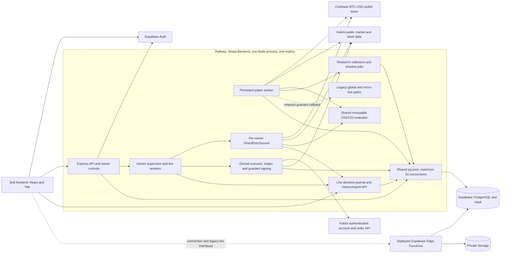
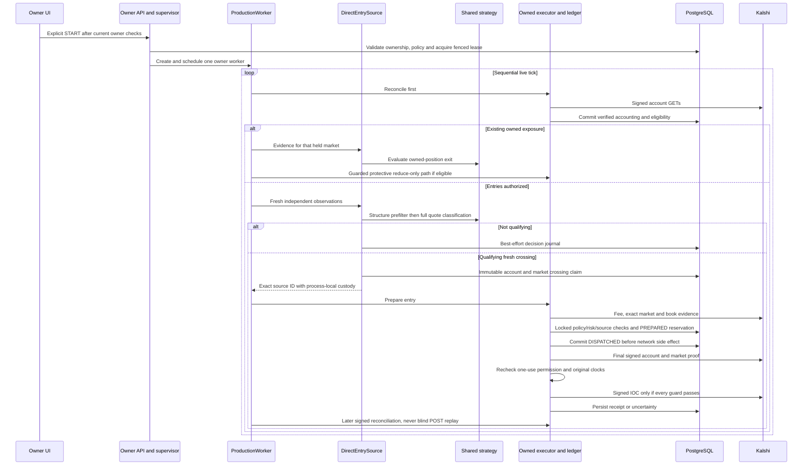
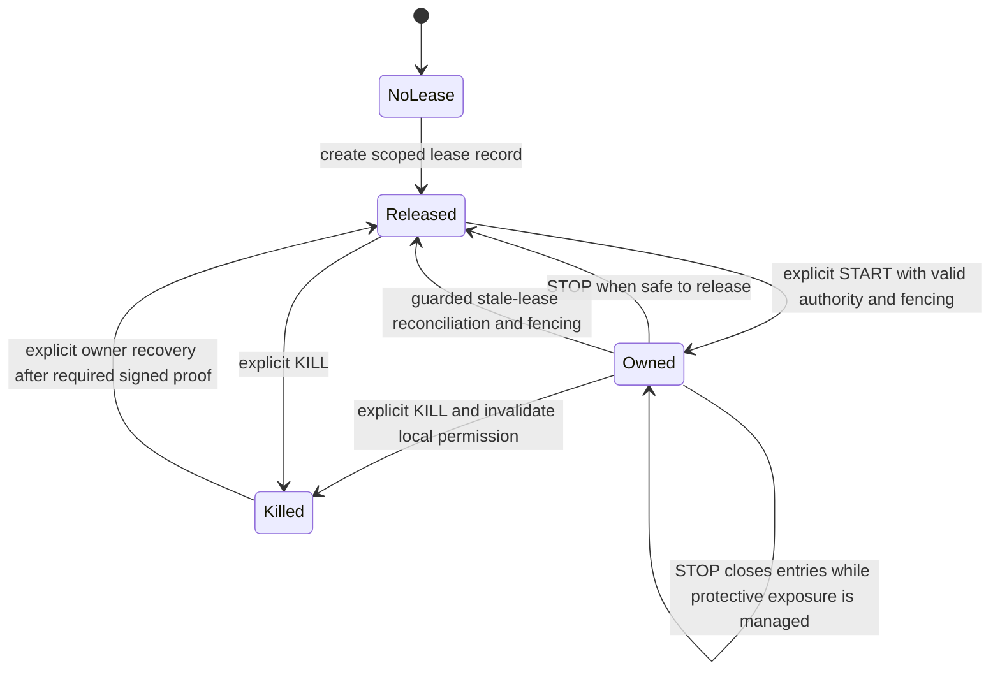
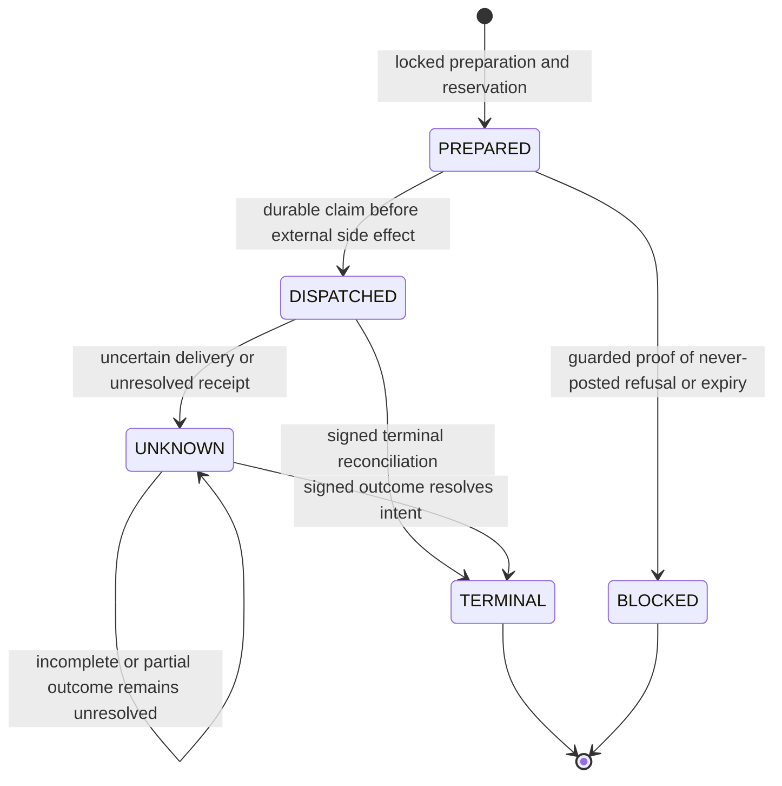
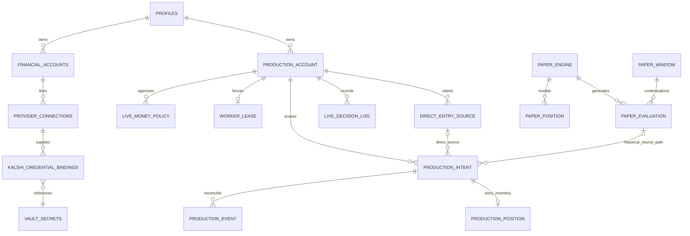
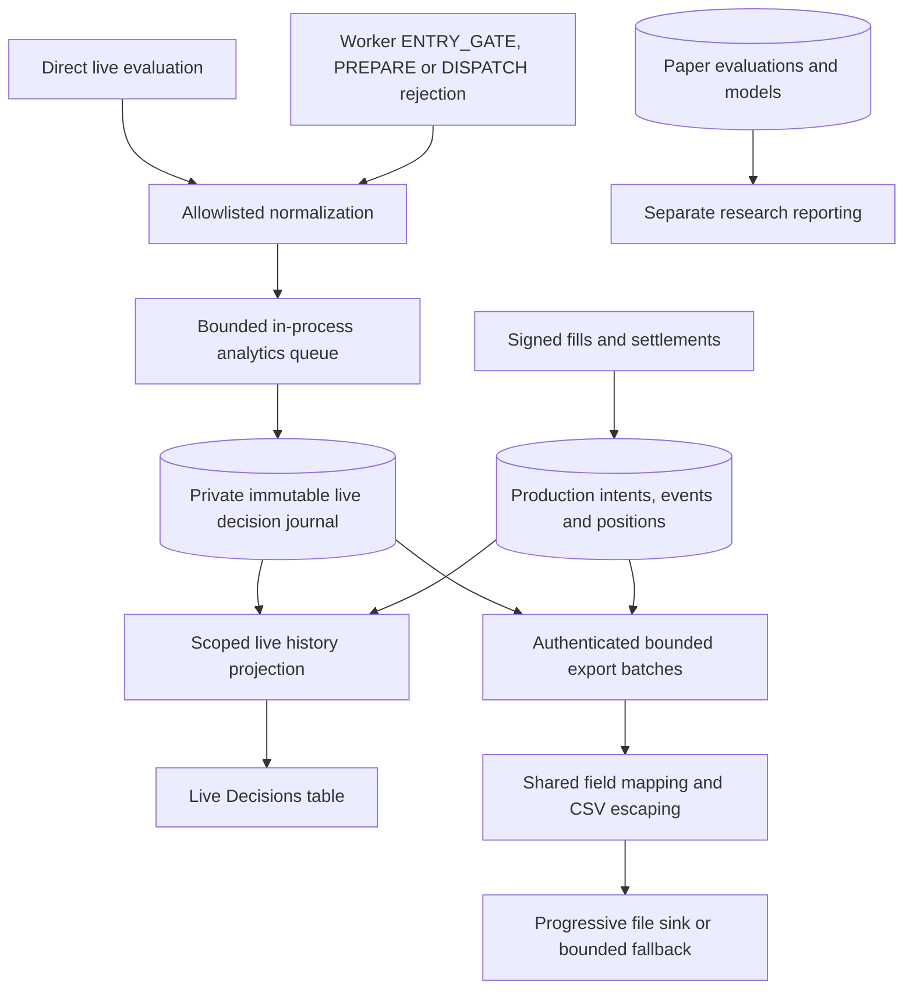

# STRATA System Architecture and Forensic Audit

**Evidence-based baseline • 25 November 2026 • Documentation only**

> This describes the inspected implementation and bounded runtime observations. It is not a replacement architecture, trading authorization, profitability claim, or certification that all defects have been excluded. Application source, strategy, financial state, worker controls, database definitions and production configuration were not changed by this audit. Recommendations require separate authorization.

## A. Document metadata and evidence discipline

### A.1 Audited identities

| Component | Audited source or deployment | Verification |
|---|---|---|
| Backend repository | `PatentFiles/Strata-Backend`, `main`, `ba95d5ba2fbc0c086da504535a307358c1f0b691` | Local clean QA checkout, GitHub main and Railway source pin agreed at the investigation baseline. Public repository. |
| Frontend repository | `Meta-UO/TradingApp`, `main`, `6f1757814e5d1d4e579cd81dd9367fc05b758109` | Local clean QA checkout and GitHub main agreed. Private repository; source links require authorized access. |
| Backend runtime | Railway project `Strata`, environment `production`, service `Strata-Backend` | Successful deployment `569a19c1-992b-476a-aa24-d856231c46ea`, created `2026-11-25T14:42:46.623Z`, pinned to the audited backend commit. |
| Backend public health | `/api/healthz` | `deployedGitSha` agrees with `ba95d5ba…`; embedded revision/tree provenance is unavailable. These are different observations. |
| Frontend public site | `https://strata.bolt.host/` | Published history asset contains the column-selector and unlimited-row streaming markers. Exact published Git SHA is not attested. |
| Supabase production | Project `wqsmfbzfbiilhtzpqbrb`, PostgreSQL `17.11` | Destination checked before bounded read-only catalog and consistency queries. |
| Local QA repositories | `~/Strata/Strata-Backend-QA` and `~/Strata/TradingApp-QA` on the authorized workstation | Original development working directories were not overwritten or reset. |

The commits above remain the **application baseline** after a documentation-only commit is merged. Do not promote a documentation commit into a qualified trading-release SHA or change release variables merely to match the latest GitHub commit.

### A.2 Scope and methods

The investigation inspected source/configuration entry points, material strategy/execution/accounting/authentication modules, deployed Edge Function source, database definitions and privileges, migration records, existing CI, production health/logs/metrics, and the supplied history/crossing artifacts. Section R links are pinned to application commits, not moving branches.

A static syntax/import/pattern inventory covered **1,174 backend script files / 211,401 lines** and **467 frontend script files / 85,794 lines**, including tests/tooling. Wider tracked inventories were 1,626 backend files and 522 frontend files. No script parser diagnostics were found. This is **not** a claim that every line was manually reviewed, every path executed, or absence of vulnerabilities proven.

Semantic tracing concentrated on startup, owner supervisor, strategy, independent source, market evidence, executor/ledger, protective routing, history/export and controls. Compatibility paths were traced to distinguish current reachability from historical code. Optional research algorithms and all transitive third-party dependencies were not exhaustively reviewed.

Production SQL used read-only transactions, three-second statement and 300-millisecond lock timeouts for bounded catalog/aggregate observations. No production test fixture, DDL, data repair, signed trading action, worker control or application startup command was run. The current validator was compiled **in memory**, without application/database initialization. Six public Kalshi GETs supported a fresh metadata check; no signed account read or order request was made.

### A.3 Evidence labels

- **CONFIRMED:** directly observed source/configuration/catalog behavior or safe reproducible result, limited to what it establishes.
- **STRONGLY SUPPORTED:** consistent source and incident evidence, with a missing historical link identified.
- **SUSPECTED:** plausible mechanism requiring measurements or reproduction.
- **NOT VERIFIED:** required evidence/access/test unavailable or outside scope.
- **EXPECTED BEHAVIOR:** intentional guard or documented behavior, not automatically a defect.

Implemented, intended, historically documented and currently observed behavior are distinguished. Root AGENTS files are the current product contract. Historical handoffs retain their original release limitations; they do not supersede current owner self-service. [S01] [S02] [S51] [S52]

### A.4 Confidentiality and limitations

No customer names, account/owner IDs, customer balances, credential fingerprints, JWTs, database connection strings, private keys or service-role values are included. Raw customer CSVs and full production logs are not committed. Public ticker/price inputs and anonymized incident times are retained only to explain failures.

No live order or production STOP/KILL/recovery flow was exercised. No fresh signed exchange account snapshot was independently collected. Existing tests are evidence of tested environments, not live acceptance. Current backup/PITR restoration, exhaustive historical logs, exact Bolt revision, database cron configuration and organization-wide supply-chain controls remain unverified.

## B. Executive system overview

STRATA has a separately hosted React/Vite frontend, **one Railway Node/Express backend deployment**, and Supabase PostgreSQL/Auth/Vault/Storage plus Edge Functions. The backend process handles APIs and starts persistent paper/research components. Owner live workers are created **inside the same process** through authenticated owner controls; they are not separate Railway services in this baseline. [S03] [S04] [S05] [S07]

The current owner live path is an **independent observed-market source**, selected by qualified owner scope and `STRATA_INDEPENDENT_LIVE_SOURCE_V1=true`. It shares the canonical C52/C53 strategy library with paper, but owns separate observation history, market claims, account authorization, leases, intents, fills and accounting. Its active independent branch does not consume paper evaluations or simulated paper fills. [S13] [S18] [S19] [S23] [S27]

This is logical separation within a shared runtime, not a hard process/credential boundary. API, paper, live and analytics share database/process resources. A historical paper-to-micro-live callback and privileged legacy global production path remain. Consider their actual entry restrictions before claiming either that paper drives current live execution or that paper code can never invoke trading-related modules. [S09] [S10] [S23] [S28] [S48]

The missing-`expiration_time` rejection is corrected in the deployed commit. The current validator accepted fresh public data from an active market during this audit. That establishes this particular metadata contract, not successful later risk/authorization/final-wire/exchange gates. No fresh qualified live trade under the new release was established.

## C. Verified architecture diagrams

### C.1 Runtime and authority map

Solid arrows are inspected dependencies. Dashed arrows are retained/conditional paths. The inner box is **one Node process**, not independently deployed API, paper and live services.

The browser prepares authenticated requests and displays readbacks; it does not hold the restricted execution private key or decide final exchange permission. Edge Functions are additional deployed components, not additional Railway trading services. [S38] [S39] [S40] [S59] [S60]

### C.2 Independent live execution sequence

Independent reads may overlap; this shows authority dependencies, not a claim that every GET is sequential. Final overlap/prefetch depends on the bound runtime path. Preparation can fail after a crossing claim and before an intent exists. [S13] [S19] [S23] [S24] [S30] [S31]

## D. Service responsibility matrix

### D.1 Material components

| Component | Startup/invocation | Inputs, outputs and owned state | Permission/failure boundary |
|---|---|---|---|
| Bolt frontend | Browser load | Supabase session, backend readbacks, explicit owner requests | No execution key. Errors/stale data are not success; owner/role changes remount history. [S59] [S60] [S63] [S66] [S69] |
| Express API | Railway package start | Authenticated controls, history/diagnostics, public health/market reads | Same environment and DB pool as workers; HTTP failure does not prove worker stopped. [S03] [S04] [S06] |
| Shared personal supervisor | Constructed once; owner START opens workers | Account-keyed workers/start-stop barriers and durable lease | Refuses overlapping lifecycle operations, foreign owners and stale owned leases; no queued auto-START behind STOP. [S18] [S19] |
| Independent `ProductionWorker` | Owner-qualified session | Reconciliation, held exits or new evaluations | Sequential ticks, repeated source/gate checks; no automatic resumption of deliberately stopped trading. [S23] |
| `DirectEntrySource` | Per-owner factory | Public BTC/market/book; private prior points/HMAC custody; durable source claim | Resets continuity on gaps; restart cannot adopt another process seal. [S13] |
| Owned executor/ledger/transport | Bound inside personal session | Exact source, policy/cash/depth/fees; intents, orders and events | Vault-derived restricted signer; account lock and one-use wire permission. Unknown POST is reconciled, not replayed. [S22] [S24] [S25] |
| Persistent paper worker | Backend startup with approved flags | `forward_test_*` lease/windows/evaluations/modeled positions | Own lease/epoch; same broad database process identity; errors are not actionable evaluations. [S10] [S11] |
| Optional research and collectors | Startup or bounded paper-cycle scheduling | Book snapshots, BRTI/triangulation, shadow records | Observational research is not live authority or automatic strategy promotion. [S03] [S10] [S49] |
| Legacy global production | Privileged routes; explicit controls | Legacy owner-null account and historical paper source contract | Current factory contains new live entries; not the normal personal account. [S28] [S29] |
| Historical micro-live bridge | Paper-cycle callback; startup reconciliation hook | Historical paper references/config/leases | Observed micro-live config had no rows and production-specific flag was absent; development-only trade gates remain. [S03] [S10] [S48] |
| Analytics/history/export | Enqueue or protected reads | Private live journal and retained financial ledger | Best-effort recording can drop rows; exports are bounded batches, not one atomic snapshot. [S42] [S43] [S44] [S45] |

### D.2 Deployed Edge Functions

Management APIs listed and returned source for all five functions below. Each was `ACTIVE`, gateway `verify_jwt=true`. These are platform `ezbr_sha256` bundle identities, not asserted Git commits. Their HTTP endpoints were not invoked.

| Function | Version | Observed purpose/authority | Bundle SHA-256 |
|---|---:|---|---|
| `connect-financial-account` | 4 | Auth identity + AAL2, Kalshi credential-format validation, owner-bound `register_kalshi_credential`; connection/credential writes, no order submission in inspected body. | `30d146bc9eb1e6bb3a9eddd054737fb3efb8dc1f35f3814393c8b97e268a2604` |
| `strata-official-fee-source` | 7 | Fixed-URL PDF egress, private content-addressed Storage, cooldown and capture ledger. **GET can write throttle/capture/storage records; it is not a read-only audit endpoint.** | `475f78c25d065eb71580660846a92bf922b6bd94efd10695e5ed642907bd4fd7` |
| `strata-fee-pending-audit` | 2 | Verified-user/admin fixed-object digest inspection; no approval/capture write. | `bb8b169fe07edd2191b9973b01ba5c41153653611cc7325fbce8dfe43d4a9853` |
| `strata-fee-operator-review` | 4 | Admin GET and explicit POST of non-authoritative human-source claims; no live policy/order permission. | `02a2400bb2673128bfbc9cab42335909cc3f5d40b04a83feabf13ee23446363e` |
| `strata-fee-release-candidate` | 3 | Historical two-reviewer candidate records, not live consent/commissioning authority. | `c25e0bffb0647053db2b30e8ed717a77a4de325c194920d4ee644f9ce9a412fe` |

Manual-upload mode and disabled recurring Railway capture/canary flags do not undeploy these functions. An active historical function does not prove normal onboarding depends on its independent-review workflow. Their admin helper uses the legacy private role registry; current backend roles use `profiles`. This merits compatibility review, not an assumed authorization bypass.

## E. Paper, API and live execution relationship

### E.1 Current path versus compatibility paths

The API imports the shared personal controls/supervisor. A validated owner START builds an account-scoped session, binds an independent live source and schedules its worker. On the independent branch, `ProductionWorker.tick` reconciles first, handles held positions, or captures a new direct entry; it returns before the historical paper-evaluation branch. A matching source ID and process-local custody, not a paper position, authorize the next preparation stage. [S07] [S18] [S19] [S22] [S23]

Paper and live use the same immutable evaluator package but **not the same observation sequence**. Paper persists BTC points and window state in `forward_test_*`; a direct live source keeps its own validated consecutive points in memory and writes `strata_direct_entry_source` only for eligible claims. Their clocks, lease timing, held positions and order-book reads can differ. A disagreement between independently timed decisions is not by itself classifier drift. [S10] [S12] [S13] [S14]

The paper worker emits committed-signal notifications and calls a historical micro-live integration hook. The generic worker also retains a paper-consumer branch. These are real dependencies, not dead text to remove without analysis. However, the current personal factory binds the independent source, the live-entry containment layer rejects inappropriate legacy entry use, and the inspected micro-live configuration contained no rows. The specific micro-live production enable flag was not present in the observed configuration. No evidence established this compatibility callback submitting orders in the audited current production interval. [S10] [S23] [S27] [S48]

The privileged global production interface uses a deliberately owner-null legacy account selector. Its original ledger has a single-global-policy assumption; the personal `OwnedAccountLedger.policy` overrides that method with account/owner/policy joins. It would be incorrect to report the base method's global approval check as a proven multi-customer blocker without following the override. [S22] [S25] [S28] [S29]

### E.2 Shared dependencies and interference assessment

| Dependency | Observed sharing | Assessment |
|---|---|---|
| Strategy implementation | Shared C52/C53 library | Intentional consistency boundary; not shared mutable trade state. |
| Node event loop, CPU and heap | API, paper, personal workers and optional jobs in one deployment | Confirmed shared failure/resource domain. No sampled CPU/memory exhaustion established. |
| PostgreSQL pool | Shared `@workspace/db` pool, maximum 10 | Potential contention; no isolated paper DB role/pool in this deployed baseline. |
| Database server | Paper/research/live tables in the same Supabase database | Expected implementation. Separate tables do not imply separate capacity. |
| Market providers and network egress | Public Kalshi and Coinbase reads | Public quota/network exposure may be shared; per-owner signed credentials do not prove independent public quotas. |
| Market observations/caches | Shared library code; paper singleton feeds versus per-direct-source factory; scoped metadata reuse in other paths | Do not infer shared evidence identity from a shared module. Direct receipts remain owner/lease/process bound. |
| Worker ownership | Paper engine lease/epoch versus personal account lease/fencing token | Different ownership records; no conflicting acquisition demonstrated. |
| Financial state | Personal production accounts/intents/events/positions versus paper models | No inspected path substitutes simulated paper fills for signed live fills. |
| Global safety | Platform live flags and master safety are intentionally common | A platform hold can affect multiple accounts by design; not a tenant-isolation defect by itself. |

Six-hour sampled Railway metrics showed maximum CPU approximately **0.449 vCPU** against an observed 8-vCPU limit and maximum memory approximately **0.636 GB** against 8 GB. A bounded database sample showed **20 sessions and zero lock waiters**. These do not exclude short event-loop stalls, checkout queues, per-query contention or provider throttling. There is no verified causal chain showing paper traffic caused the historical market-metadata rejection. That rejection has a schema-validation mechanism independent of such speculation. [S09] [S13] [S30] [S32]

Draft implementation PR #375 proposes a process split and other changes. Its head was `e08e7a4b675f0b6139df4354badb0369ea303c61`, not the audited application main. The proposal was inspected as proposed work only, not merged, deployed or used to describe current production.

## F. Trading strategy specification

### F.1 Identity and mathematical inputs

The live wrapper `evaluateV13Strategy` is locked to `V13_CHAMPION_PARAMETER_SET`; research uses a separate parameterized function. The approved identity is `v13-champion-2-c52-confirm53`, classifier `V1.3`, parameter hash `314e7b49f5cd9782175dbb88fb7a05bbf80bb4c5e1458d0d48a15348b35f6161`, entry-policy version `v13-first-qualifying-cross-v2`. [S14] [S15] [S16]

| Input or calculation | Exact implemented meaning |
|---|---|
| BTC price | Coinbase BTC-USD ticker price in the inspected public feed. |
| Target | Validated Kalshi market strike/target from market metadata; never fabricated on a missing/invalid field. |
| Signed distance/current buffer | `btcPrice - target`, USD. |
| Separation | `abs(btcPrice - target)`, USD. |
| Previous buffer | Prior validated observation's price minus the same market target, USD; not a volatility or fee allowance. |
| Velocity | `(latestPrice - oldestSelectedPrice) / ((latestReceiptMs - oldestReceiptMs) / 60000)`, USD/minute. The lookback is approximately 30 seconds of available observations, not a minimum 30-second warmup. |
| Fresh UP crossing | `previousBuffer <= 0 && currentBuffer > 0`. |
| Fresh DOWN crossing | `previousBuffer >= 0 && currentBuffer < 0`. |
| Zero handling | Arriving at zero is not a crossing; departing from a prior zero may be. |
| Quote units | Contract offers are dollar fractions, not displayed cents or integer micros. The UI converts only for presentation. |

The paper worker keeps a 120-second point retention window but selects its velocity reference using a 30-second cutoff. The direct source keeps validated recent points for 30 seconds and requires continuous, increasing provider/receipt timestamps with no gap exceeding five seconds. Rollovers, restart, repeated provider time or invalid data reset direct continuity. These implementations share the velocity concept but need not contain identical samples. [S10:86–93] [S12] [S13]

### F.2 Classification ordering

1. Missing ticker/target/BTC returns a waiting decision. Invalid signed-buffer freshness returns a data-error PASS.
2. Compute direction, crossing and separation. Compute whether velocity supports the crossing/current direction.
3. If a position is open, evaluate wrong-side recross and momentum-invalidated exits before flat-position entry decisions.
4. For a flat position, an eligible CONFIRM takes precedence over SCOUT. A qualifying entry requires a real candidate offer and its relevant ceiling.
5. Otherwise classify repriced/too-expensive or WATCH/near-target PASS. The worker separately applies crossing consumption, data, authorization, liquidity, fee and financial gates.

| Parameter | Value | Source/configurability |
|---|---:|---|
| SCOUT minimum separation | $8 | Immutable execution parameter. |
| SCOUT maximum separation | $15 | Immutable execution parameter. |
| CONFIRM minimum separation | $20 | Immutable execution parameter. |
| SCOUT maximum offer | $0.52 | Immutable execution parameter. |
| CONFIRM maximum offer | $0.53 | Immutable execution parameter. |
| Wrong-side recross | $8 | Immutable exit parameter. |
| Momentum-invalidated exit | Enabled | Immutable exit parameter. |
| Market interval checked by direct source | 900,000 ms | Source validation, not a research tuning control. |
| Original live evidence age | Five seconds | Direct-source ceiling; approved policy also constrains execution freshness. |
| Metadata observation age | 15 seconds | Exact-market fee metadata validation ceiling. |

SCOUT requires fresh directional crossing and supporting velocity inside the inclusive $8–$15 band. CONFIRM requires a fresh crossing with separation at least $20 and supporting directional velocity. The interval strictly above $15 and below $20 is not an entry band. Drifting farther from the strike after a nonqualifying crossing does not automatically create a new entry. [S14] [S16] [S51]

For an UP position, a buffer at or below -$8 or velocity at or below zero can request EXIT; DOWN uses buffer at or above +$8 or velocity at or above zero. Unavailable velocity does not invent a momentum exit. A first valid held observation may still establish wrong-side recross. Actual exit requires tradable held-market evidence and protective authority; the classifier does not itself sell. [S13] [S14]

### F.3 Execution economics and important non-equivalences

The generic IOC planner contains legacy 60/68-cent ceilings. **This does not establish that current personal live entries can exceed C52/C53.** `assertChampionSourceReference` independently reclassifies the exact stored source using the immutable champion and requires an identical entry offer. Planning/final dispatch then constrain price to the source reference. Source mutation or a wider generic helper alone is insufficient authority. [S17] [S24] [S35]

The whole-contract entry planner uses the authorized stake, available ask depth and an exact price/reference ceiling. A $5 approved budget may legitimately produce less than $5 gross because fractional budget remainders cannot buy another whole contract. The minimum approved/configured live ceiling is 500 cents; it is not a minimum actual fill value. Current risk also requires one maximum open position, IOC, full depth and the signal-reference limit source. [S35] [S36]

The approved general quadratic formula is `0.07 * multiplier * contracts * price * (1 - price)`, but actual reservation code uses integer/rational bounds for fill fragmentation, rounding, cash debit and exit reserve. Do not replace it with a floating-point formula or count a reserve as an already paid fee. Personal risk inputs are cents; ledger monetary values are integer microdollars; quantities use contract hundredths. [S25] [S34] [S37]

Stake/capital/loss budgets are owner-approved policy values, not strategy parameters. Entry must fit available capital, stake, all-in and remaining daily/total loss budgets. The wrong-side BTC threshold is not a dollar-loss stop; a minimum exit contract price is not a guaranteed liquidation price. [S36]

No calibrated probability or unconditional expected-profit guarantee is produced by the inspected classifier. No separate universal maximum-spread rule or time-adaptive C52/C53 threshold was established. Spread, depth, remaining time, fee bounds and expiry still affect evidence and execution. Avoid inventing an economic filter not present in the code.

Paper closes use the modeled executable bid or explicit published settlement result and round modeled `payout - stake` to cents. That gross modeled result is not fee-inclusive live P&L. Live accounting uses actual signed fills/settlements and integer fees/basis. Coinbase is a signal source, not settlement authority; Kalshi's documented market rules use CF Benchmarks BRTI averaging. The contemporaneous Coinbase/BRTI basis can matter, but changing the approved signal is outside this audit. [S10:95–133] [S12] [S25]

## G. Complete live execution lifecycle

### G.1 Stage and rejection map

| Stage | Implementation | Necessary evidence / rejection / downstream effect |
|---|---|---|
| Authenticate owner | `supabaseAuth.ts`, owner route | Verified signature/issuer/audience/expiry, subject, AAL2 and database role; refusal must precede control action. [S38] |
| Open session | `personalExecutionSupervisor.ts` | Current owner/account/credential/policy/qualified release and lease. Concurrent START is single-flight; STOP barriers prevent an automatic restart. [S19] |
| Reconcile before evaluation | `ProductionWorker.tick`, owned signed feeds, ledger | Signed cash/orders/current and historical fills/positions/settlements, complete pagination, exact account scope. Failed proof holds activity rather than guessing an empty account. [S23] [S25] [S34] |
| Select held versus flat path | Worker | Existing quantity goes to its own held-market supervisor. Flat entries additionally require open entry authority. Paper's open position is not consulted. [S23] |
| Capture observations | `DirectEntrySource.capture` | Current window, ticker/status/target, original timestamps, continuity and velocity. Invalid source throws/records ERROR; initialization produces a reasoned PASS. [S13] |
| Prefilter and quote | Direct source and shared evaluator | No entry-book request when price-independent conditions fail. Blank quote is therefore not proof of liquidity failure. Qualifying structure leads to fresh validated book and full classifier. [S13] [S14] |
| Claim opportunity | Direct source | Immutable `(account_id, crossing_key)` source row, digest and process-local HMAC; exact readback required. Existing claim prevents duplicate use. [S13] |
| Market evidence | `readOwnedEntryMarket`, gatherer, validator | Exact market/event/series, fee authority, lifecycle/schedules, signed book and original capture clocks. Any branch failure denies admission. [S30] [S31] [S32] [S34] |
| Prepare | `prepareEntryMeasured` | Source reclassification, policy hash/revision, account lock, duplicate detection, liquidity, cash model and budgets. Creates PREPARED reservation only if gates pass. [S24] |
| Claim submission | `dispatchWithPhases` | Locked PREPARED identity transitions to DISPATCHED and commits before a possible external side effect. Repeated dispatch of a non-PREPARED intent is a no-op, not another POST. [S24:480–499] |
| Final proof and wire | Executor, scoped exchange, guarded fetch | Policy/identity/capability unchanged, no other uncertain order, fresh signed account/market, current authority and one-use clock/connection fence after asynchronous work/signing. [S22] [S24] [S26] |
| Acknowledgment or uncertainty | Transport and ledger | Receipt is not a fill. Interrupted/ambiguous delivery remains recoverable uncertainty; never infer rejection from a client timeout or blindly resend. [S24] [S25] |
| Fills/positions | Ledger reconciliation | Idempotent event identity and digest; signed quantity, fees and cash; partial fills update owned basis/quantity. [S25] [S76] |
| Protective exit | Worker held path and reviewed exit dispatcher | Exact parent position/market/side/quantity and reduce-only request; original clocks and signed final checks. Entry STOP may retain protective management; KILL is stronger. [S19] [S22] [S23] |
| Settlement | Signed reconciliation | Explicit exchange settlement, payout and allocated basis/fees; no assumed win from the last Coinbase observation. [S25] |
| History | Journal plus financial read model | Distinct evaluation, stage rejection, intent and financial events; linked records are not additional orders. [S42] [S43] |

### G.2 Market evidence ownership and time

`gatherCompleteReadOnlyMarketEvidence` starts fee verification, book, series, exact-market and series-fee-change reads together. Only a matching market response unlocks event and event-fee-change reads. A first failure prevents unnecessary late fanout, and already started work is drained before return. It neither submits an order nor treats fee verification alone as a complete market bundle. [S30]

Metadata captures bind five exact paths, normalized/raw digests and original request/capture clocks. They do not manufacture a new timestamp on reuse. The oldest request bounds freshness. Phase-bound PREPARE, FINAL_MARKET and WIRE_FEE evidence are not interchangeable. Some performance options remain irrelevant when the independent factory does not bind that prefetch path. [S19] [S31] [S33]

The current fee validator requires valid future close/latest-expiration evidence, validates supplied optional expiration values, and checks fee schedules through the maximum relevant lifecycle bound. It checks market/series exchange identity, event relation, quadratic multiplier, overrides and bounded complete change lists. Missing optional legacy `expiration_time` is no longer an automatic refusal. [S32]

### G.3 Earliest historical divergence

The supplied 630-row export covers `2026-11-25T07:33:14.712Z` through `07:59:24.282Z` (about 26 minutes, not a full hour). It contains 629 observation records plus one preparation-rejection record: 627 PASS, one QUALIFIED, one ERROR and one BLOCKED. There were no submitted orders or fills. Do not count the linked qualified/rejection pair as two trades.

At `07:49:36.825Z`, market `KXBTC15M-26NOV250300-00` had BTC 58,714.11, target 58,725.42, current distance -11.31 USD, previous buffer +17.16 USD and approximately -63.773144 USD/min velocity. A DOWN SCOUT with a 0.50-dollar offer satisfied the recorded strategy conditions. The linked preparation rejection appeared 281 ms later with `production_event_fee_evidence_unverified`.

Retained prior incident evidence places the earliest divergence after source validation and fee-authority verification, in market-evidence preparation, before an order intent/submission. The old validator required the legacy field that current public responses omitted. Original incident response bytes are unavailable, so that exact individual historical predicate is **strongly supported**, not retrospectively proven from recovered bytes. The incompatibility itself was reproducible and is corrected in the deployed source. [S32] [S53] [S56]

The crossing claim precedes preparation. Therefore a no-send failure can consume the market's first qualifying opportunity without an intent. This is an implemented duplicate-prevention/availability tradeoff; the audit does not authorize clearing claims, replaying expired sources or automatically retrying orders. [S13] [S24]

## H. Worker lifecycle and state machines

### H.1 Three distinct kinds of state

Do not collapse the following into one `RUNNING` flag:

- **Persistent account authority:** commissioned, execution enabled, kill switch, policy and release/fee consent, reconciliation/holds.
- **Persistent personal lease:** `owned`, `released`, or `killed`, fencing token, owner/credential binding, arm request and heartbeat.
- **In-process supervisor:** scheduled worker, START/STOP promises, generation and entry eligibility. A browser ARM-readiness receipt is another short-lived UI preflight, not a durable `ARMED` lease enum.

A stale owned lease with `arm_requested=false` is not a healthy running worker. Current readback must consider freshness and process scheduling. At the audit observation there was one stale owned/unarmed lease and one released lease, with no fresh owned heartbeat. The audit did not operate any control to change them. [S19] [S20] [S21] [S63]

This diagram summarizes principal transitions, not a replacement enum. Failed recovery stays refused; it does not manufacture a transition. Account flags and release approvals remain additional guards. [S20] [S21]

### H.2 Control semantics and common apparent failures

| Operation / symptom | Verified interpretation |
|---|---|
| ARM | Readiness/preflight confirmation; owner constraints remain. It does not by itself schedule trading. |
| START | Rechecks eligibility, acquires/binds a lease and creates one scheduled personal worker. |
| STOP | Closes new entries. May keep a protective worker while owned exposure requires management. |
| DISARM | Revokes entry permission through the implemented control mapping; not an assumed independent global enum. |
| KILL / Reassert KILL | Strong stop, local permission/fence invalidation and persistent killed state; reassertion is not recovery. |
| Reconcile bot cache | Requires real owner/account proof and state-dependent eligibility; not an unconditional browser reset. |
| Existing `owned` lease | Factory refuses to steal it merely because heartbeat is old. Fenced recovery is required. |
| New deployed SHA | Existing exact-release fee/execution approval may require an owner review; build health is not consent. |
| Disabled button | Can represent in-flight action, stale readiness, unavailable evidence, MFA/review mode or a genuine guard. Historical screenshots alone do not establish which current guard fired. |
| Browser logout/refresh | Does not prove the backend worker stopped. Conversely a cached running label does not prove a fresh lease. |

The supervisor's `starts`, `stops` and `ownerStops` maps serialize lifecycle operations. It will not queue a new START behind STOP/KILL, and stale cleanup cannot erase a newer registered generation. `stopOne` distinguishes entry stop with protected exposure from complete KILL. [S19:175–287] [S19:978–1011]

The scanned application startup did not reveal centralized SIGTERM/SIGINT orchestration for every owner supervisor and analytics drain. This is a restart/recovery risk, not a demonstrated duplicate-order incident. Do not add shutdown behavior during an audit. [S03] [S23] [S42]

### H.3 Persisted order-intent states

The actual schema enum is **PREPARED / DISPATCHED / UNKNOWN / TERMINAL / BLOCKED**. Acknowledgment and partial-fill evidence are not invented extra enum states. This diagram is a principal lifecycle summary; exact cleanup eligibility remains in its source guards. Position inventory and a terminal order's filled quantity are separate: a completed entry can leave an open position. [S24] [S25] [S76]

## I. Database architecture

### I.1 Material object responsibilities

| Objects | Principal writers/readers | Important invariants |
|---|---|---|
| `profiles`, financial accounts, provider connections | Auth/profile and credential/account setup | Server-owned role, owner-bound connection; authenticated profile writes limited to display name/timezone in inspected grants. |
| `private.kalshi_connection_credentials`, Vault | Credential lifecycle and verified server consumers | Role, fingerprint, verification/revocation and owner/provider/account binding. No direct authenticated access to decrypted secrets established. |
| `v13_live_money_policy`, `strata_configured_stake` | Explicit owner policy/stake flows; executor reads | Approved hash/version and account identity, integer limits. |
| `v13_production_account` | Scoped financial/control transactions | Account identity, available/reserved cash, reconciliation and safety flags. |
| `private.kalshi_account_worker_lease` | Personal lifecycle and heartbeat | One account-keyed lease, positive fence and owner/credential identity; killed/released/owned states. |
| `strata_direct_entry_source` | Independent producer, exact source readers | Immutable evidence, account-wide crossing uniqueness, source digest and original time. |
| `v13_production_intent` | Executor and guarded recovery | Unique client order identity, one source type for ENTRY, parent for EXIT, bounded unresolved-exit uniqueness. |
| `v13_production_event` | Signed reconciliation | Unique account/event key and payload digest; cash/P&L updates cannot silently reinterpret duplicate events. |
| `v13_production_position` | Ledger reconciliation | Actual owned quantity/basis/realized P&L, not paper holdings. |
| `v13_production_observation` | Reconciliation and diagnostics | Signed read evidence, held-source receipts and never-posted reasons. |
| `private.strata_live_decision_log_v1` | Bounded independent analytics writer | Immutable allowlisted observations and execution-stage refusal records. |
| `forward_test_engine`, `_windows`, `_btc_points`, `_evaluations`, `_positions` | Persistent paper worker | Paper lease/window/points/models; not live balances or fills. |
| Fee publication/model/release and recovery tables | Explicit admin publication and owner/recovery flows | Original bytes/digest, distinct attestation versus issuer provenance, exact account/release and revocation guards. |

Names in this conceptual diagram abbreviate the actual table names above. Edges describe inspected logical relationships; not every edge is asserted to be a physical FK. In particular, journal owner/account equality is enforced by insertion/read joins, and the historical paper-source edge does not describe current independent personal entry production. [S13] [S22] [S42] [S43] [S76]

### I.2 Constraints, indexes and transaction boundaries

Catalog inspection confirmed production account monetary/nonnegative checks, account identity restrictions, policy linkage, lease identity constraints, source uniqueness and immutability, intent state/source/parent constraints, unique event identity and deferred cash-recovery fencing. The executor holds account `FOR UPDATE` and policy `FOR SHARE` locks through critical checks. The implementation uses explicit transactions and row locks; do not label every transaction SERIALIZABLE when it uses plain `BEGIN`. [S20] [S25] [S76]

The following history indexes were all `indisvalid=true` and `indisready=true`: `strata_observation_proven_not_posted_lookup_v1`, `strata_history_intent_account_time_v1`, `strata_history_intent_time_v1`, and `strata_history_event_intent_v1`. They were installed before this audit. Their operational DDL is documented separately; this audit executed none. [S47]

Recorded migrations included the direct source (`0046`), owner technical setup (`0047`), owner connection isolation (`0048`), platform capture (`0049`), uploaded schedule (`007`), decision journal (`0050`) and terminal lease renewal (`008`), with latest observed terminal-renewal record `20261125041512`. A migration-history entry is not a complete proof that every historical schema object matches every repository candidate.

### I.3 Read-only financial consistency

Across five retained production account records, the aggregate inspection found zero failures of:

1. `cash = initial_cash + sum(event cash_delta)`.
2. `cash + sum(position basis) = initial_cash + sum(event pnl)`.
3. `sum(position realized_pnl) = sum(event pnl)`.
4. `reserved_cash = sum(intent reserved_cash)`.

No unresolved intents or exposed positions were reported at that observation. These checks establish internal consistency of retained records, **not** independently current exchange truth, completeness of all possible missing events, or a tested backup restoration. [S25]

## J. Frontend and API contract mapping

| Frontend feature | Actual contract / authority | Important qualification |
|---|---|---|
| Owner wallet and bot settings | `GET /api/strata/me/wallet`, `GET /api/strata/me/bot-settings` | Owner-scoped database/exchange readbacks; distinguish stale, unavailable and confirmed values. Verify exact endpoint constants before changing clients. [S59] [S61] |
| Personal bot controls | `POST /api/strata/me/control` through `controlMyBot` | Protected owner control; UI cannot certify authority from a local flag. [S59] [S61] [S63] |
| Signed cash reconciliation | `POST /api/strata/me/cash/reconcile` | No transfer, but can record reconciliation state. It was **not** invoked as a read-only audit test. [S59] |
| Live Decisions & Trades | `GET /api/strata/live-history` | AAL2, own/all-authorized-account scope, current DB-role check for all-account reads, exact account filters. [S43] [S45] [S66] |
| Full live export | `GET /api/strata/live-history/export-batch` | AAL2 on each bounded batch; account/filter/cursor checks; no screen-page or record-count cap. [S44] [S45] [S59] [S68] |
| Overview and Trades tabs | `ProductionTradesView` calls `production.getTrades`, mapped to `/api/strata/production/trades` | Privileged **legacy global-account** production history, not the same scope as personal Live Decisions. [S29] [S61] [S64] [S65] |
| Performance, Execution and Risk reporting | Generic reports service and `ENDPOINTS.trades` | The inspected generic trade-history endpoint has no mapped path; the shared client returns unsupported rather than real data. Do not mistake this for a failed personal worker. [S59] [S60] [S62] [S64] |
| Generic trade-set export | `ENDPOINTS.exportTrades` | No mapped path in this baseline; different from the implemented live-history exporter. [S59] |
| Paper/research status | Forward-test APIs and paper engine state | Separate paper lease, model positions and freshness. Personal running status is not paper running status. [S10] [S61] |
| Public release health | `/api/healthz` plus release/compatibility checks | Healthy HTTP and compatibility markers do not establish exact bundle identity, current owner authority, fresh worker heartbeat or financial readiness. [S03] [S70] |

The inconsistent history-tab scopes are a confirmed reporting problem (F04). It does **not** prove that personal trades were deleted or that global historical trades were executed by the currently selected owner. Generic unsupported reporting should be represented as unavailable, not silently replaced with paper data or zeros.

`LiveHistoryView` mounts only for an authenticated AAL2 user outside review mode and remounts on user/role changes. It rejects returned scope/date/account mismatches. The updated table prominently displays recorded reasons, BTC price, target, signed distance, previous buffer and velocity, with a selector for every CSV field. The selector is presentation only; all retained exported fields use the shared mapping. [S66] [S67]

Control readiness is transient: stale observations, changed release authorization, pending controls or unresolved account evidence can disable actions legitimately. An account being commissioned is not equivalent to execution enabled, a live lease, or a currently admitted order. A normal UI review must trace `KalshiBotControlPanel` to the exact owner readback and server guard rather than infer a recovery sequence from a historical screenshot. [S19] [S21] [S63]

## K. Infrastructure and deployment

### K.1 Actual deployment configuration

Railway exposes one backend service in the inspected production environment, one replica in `us-west2`, no attached volume and no Railway-hosted database service. Supabase is the external database/auth/secret platform. Build/start commands and health path are recorded in A.1. The package entry point starts the API and process-owned background components. A separate paper process described by an unmerged draft is not current infrastructure. [S03] [S05] [S75]

The declared source is `PatentFiles/Strata-Backend`, branch `main`, **pinned commit `ba95d5ba…`**. The connected source tool's contract explicitly states that a commit pin prevents branch pushes from deploying until the source is reconnected without that pin. The configuration was read, not changed. No pending production patch was observed.

The `.railway/railway.ts` file is a repository infrastructure description, not proof that all its values are the deployed configuration. Actual observed Railway configuration takes precedence for this baseline. For example, use the management-reported build command rather than assuming the longer repository bootstrap command ran. Restart policy, drain/overlap timing and exact per-replica process utilization were not exposed by the inspected configuration response; no defaults are invented.

### K.2 Relevant configuration references

Only non-secret allowlisted values were inspected. Credential variable names are mentioned without values.

| Configuration | Observed value / purpose |
|---|---|
| `NODE_ENV` | `production`. |
| `FORWARD_TEST_PRODUCTION_WORKER_ENABLED` | `true`; paper startup still checks the approved entry-policy runtime identity. |
| `V13_ENTRY_POLICY_RUNTIME_APPROVED` | `v13-first-qualifying-cross-v2`. |
| `V13_PRODUCTION_EXECUTION_ENABLED`, `LIVE_EXECUTION_ENABLED` | `true`; necessary platform settings, not sufficient owner/order permission. |
| `STRATA_INDEPENDENT_LIVE_SOURCE_V1` | `true`; personal independent source still requires qualified account/release scope. |
| `STRATA_PUBLIC_SELF_SERVICE_ENABLED` | `true`. |
| `STRATA_PUBLIC_SELF_SERVICE_QUALIFIED_SHA` | Matches the pinned deployed backend commit. |
| `STRATA_OWNER_SETTLED_CASH_RECOVERY_SHA` | Matches the pinned deployed backend commit. |
| `STRATA_PROTECTIVE_EXIT_SIGNED_RELEASE` | `true`; does not bypass per-position and final-wire protections. |
| `STRATA_LIVE_DECISION_ANALYTICS_ENABLED` | `true`; recording remains bounded/best-effort. |
| `STRATA_PLATFORM_FEE_UPLOAD_ENABLED` | `true`. |
| `STRATA_PLATFORM_FEE_CAPTURE_ENABLED`, `STRATA_FEE_BRIDGE_CANARY_ON_BOOT` | `false`; recurring Railway issuer retrieval/canary is disabled in the observed manual-publication mode. |
| Public metadata prefetch, final public prefetch, final account snapshot overlap, bounded history reads | Enabled flags were present; actual activation is conditional on bound execution mode/source. |
| Shadow evaluation, autonomous learning, BRTI shadow and triangulation flags | `true`; research outputs do not authorize a new live strategy. |
| Automatic/manual withdrawal flags | `false` at inspection. |
| Unknown-entry protective recovery feature flag | Not set in the allowlisted environment read; do not assume this optional recovery path is active. |
| `DATABASE_URL` | External pooled database connection. Never printed or committed. Observed URL mode was `sslmode=require`. |
| `SUPABASE_URL`, `STRATA_WEB_ORIGIN` | Platform/frontend connection references; no assertion about uninspected Edge Function environment overrides. |
| Kalshi signing/provisioning/verifier variable names and owner Vault references | Server-only material. Shared legacy variables are not automatically the personal owner's signer. |

Exact-release qualification and owner-consent references are distinct. A new commit can leave old account approval legitimately ineligible even if the platform qualification flag matches. Do not edit those references to claim consent or automatically resume stopped execution. [S01] [S19] [S21]

### K.3 Production parity and documentation publication safety

GitHub main, clean local application trees, Railway pin and public `deployedGitSha` agreed for the backend. The full embedded build manifest did not: `revision`, `tree` and provenance were unavailable, with a default `dirty=true`. This is a provenance gap, **not proof that someone edited the running container**. The published frontend showed new history/export markers, but no exact published Git commit was attested. [S70]

Existing release checks were reread, not rerun: backend PR #374 had 15 successful checks, its postmerge safety run had three successful jobs, frontend PR #242 had eight successful checks including four PostgreSQL/browser integration jobs, and frontend main had three successful postmerge workflows. Those results do not demonstrate a live exchange fill on the currently deployed release.

Before documentation publication, every backend workflow was parsed and its branch/path rules tested against this document path. No push/PR/workflow-run candidate matched the sole documentation file. No deployment workflow was found for it. The explicit Railway source pin supplies the separate production-deployment boundary. Recheck both immediately before publication; do not infer that documentation is always safe to merge in future configurations.

The inspected repository branch-protection API returned no protection for main and the applicable-rules response was empty. The root engineering contract calls for protected qualification/merges. The audit uses a normal documentation PR regardless; it does not create protections or bypass controls. [S01] [S54] [S55]

## L. Financial and security architecture

### L.1 Authority chain

Backend authentication verifies the Supabase token's signature and claims, then resolves current role from database-owned profile data. User-editable metadata is not the inspected source of administrative role authority. AAL2 requirements for protected financial/control reads and writes are independent of whether login MFA is optional for a user. Browser review mode suppresses dispatch rather than granting simulated production success. [S38] [S60] [S69]

Credential registration and lifecycle use owner/account/provider/role references with Vault storage. Server readers match verification state, revocation state and fingerprint before constructing a signer. A public frontend credential card or a masked key ID is not access to decrypted execution material. Account-scoped exchange requests pin the expected identity and final capability. [S39] [S40] [S41] [S22]

The single backend database connection is configured with the `postgres` role. Catalog evidence showed `BYPASSRLS`, `CREATEDB` and `CREATEROLE`, though not superuser. Application SQL and guarded owner joins therefore provide essential isolation even where table RLS is enabled. Paper and API modules do not have separate database-enforced credentials in this deployment. This is a least-privilege weakness, not a demonstrated cross-account exploit. [S09]

Public material trading tables had RLS and no direct anonymous/authenticated access in the inspected grants. Public schema had 53 tables with RLS on all 53; private schema had 63 tables with RLS on 62. The exception, `private.strata_member_read_budget`, had no anonymous/authenticated access. Its absent RLS alone does not establish public exposure. Profile role writes were not granted to authenticated users; inspected owner update policy required the appropriate identity/assurance.

### L.2 Monetary integrity and idempotency

Production account locks serialize critical financial changes. Unique account/event identifiers and payload checks prevent a known event being silently processed twice or with different content. Intent client IDs, crossing/source uniqueness and final one-use transport permission address different duplicate hazards; none is interchangeable with the others. [S13] [S24] [S25] [S76]

An order's acknowledged, partially filled and terminal states are reconciled from provider evidence. Signed page completeness and row identity are mandatory; missing or contradictory data cannot be interpreted as zero exposure. Unknown outcomes remain uncertain and block unsafe new activity. A failed local request after dispatch is not proof of no exchange order. [S22] [S25] [S34]

Protective handling retains the parent position's market and exact remaining quantity. Rollover discovery cannot switch an owned exit to a newer contract. Market closure leads to settlement reconciliation rather than a fabricated tradable exit. STOP can preserve management of existing exposure; KILL intentionally removes stronger authority. [S13] [S19] [S23]

Fee-inclusive planned entry and exit reserves are conservative admission amounts, not necessarily realized fees. Net P&L is derived from distinct recorded financial events and allocated basis/fees. The read model keeps decision rows financially null rather than treating PASS as a zero-profit completed trade. [S25] [S37] [S43]

### L.3 Security concerns and boundaries of proof

The pool's handling of the observed `sslmode=require` configures TLS without certificate verification (`rejectUnauthorized=false`). Encryption alone does not supply verified server identity. This deserves a separately tested CA/hostname-validation plan, not an unreviewed production connection-string edit. [S09]

Pino redaction covers authorization/cookie headers and the application request serializer limits request details. That is useful defense, not proof every ad-hoc log path is safe. No secret-exfiltration test, credential scan against external services, role impersonation, authentication bypass or production security mutation was performed. [S04] [S50]

Legacy Edge admin functions resolve a private email/role-assignment helper while the current backend resolves profiles. Their inspected bodies label claims/candidates as non-authoritative. Role-registry divergence and older optional CORS defaults are compatibility risks to investigate; there is no evidence here that a routine customer must complete a legacy independent-review flow or that those candidates directly enable orders.

## M. Historical data, PASS analytics and research

### M.1 Evidence pipeline

`normalizeLiveDecision` permits bounded known facts and fixed stage/outcome/reason metadata. It does not persist arbitrary caught exception text or untrusted secret-shaped fields as facts. The journal is immutable; historical PASS records missing before activation are not reconstructed from paper data. [S42] [S46]

The queue has a 256-item bound, 64-item batches and approximately one-second scheduling, with short SQL/lock deadlines. Overflow and failed batches can be dropped, with bounded diagnostics, so analytics cannot block the execution critical path indefinitely. This explicitly means **not exactly-once and not complete coverage**. No audit result establishes that no rows were ever dropped. [S42]

### M.2 Field provenance and gaps

| Requested evidence | Where it is retained / displayed | Limitation |
|---|---|---|
| BTC, target, signed distance, previous buffer, velocity | Observation facts; shared table/CSV field mapping | Older records or non-observation stages may lack them. Never backfill invented observations. |
| Current buffer | Same mathematical value as signed distance for the recorded BTC/target | No additional independent price source is implied. |
| Market/open/close/freshness | Facts and source evidence; stage-specific timing logs | Local receipt time is not an exchange-origin quote timestamp. |
| Direction, signal, qualifying trigger | Observation and source records | QUALIFIED is not order submission. |
| Reasons and rejection stage | Journal `stage`, `reason_code`, `reason_detail` | Technical failures can have a machine code with no narrative; PREPARE/DISPATCH records can omit original facts. |
| Source/intent/order relationships | Direct source ID, evaluation ID, intent and parent references | A source can exist without an intent; the table does not automatically copy every source fact into each rejection row. |
| Actual fills, fees, settlement and P&L | Distinct production ledger events/read model | Paper estimates are not substituted. |
| Execution provenance | Record type, release/strategy/policy metadata and mode-specific stores | No universal row is proof that every stage completed. |

Future AI analysis should join linked stages by exact identifiers, preserve original timestamps, distinguish modes and missing data, and count independent opportunities rather than every poll as a separate trade. The 630-row supplied sample had no fills; its classifier agreement cannot establish profitability or protective-exit behavior under exposure.

### M.3 Pagination, export and scale limits

The screen uses bounded cursor pages (25/50/100 in the UI), a maximum 100-row request and a bounded date range. The account selector is bounded separately. These limits are not the export's total-record limit. [S43] [S66]

The export endpoint scans at most 1,000 items per bounded batch, rechecks authenticated scope/current role and binds continuation to filters and a recording watermark. It exports **decisions first, then ledger intents**, reverse-ordered within those phases; it is not one globally chronological combined file. Filtered empty ledger batches still advance so later matches are not silently truncated. Microsecond timestamp ties retain a secondary identifier. [S44] [S57]

The cursor is encoded continuation data with consistency checks, not a secret authorization token. Authorization is re-derived on every request. Separate read-only transactions avoid a giant long-lived production snapshot, but mutable ledger outcomes can change during an export; late commits/backdated observations remain a completeness consideration. Do not label the file an atomic exchange/account snapshot. [S44]

The frontend stream applies backpressure and validates page shape, scope, watermark, sequence and row IDs without retaining the entire output. Native save-file support writes progressively; a browser without it has an explicit 64 MiB fallback budget and must refuse rather than silently truncate. CSV retains original recorded precision and protects textual formula injection while preserving canonical signed numeric values. Device storage and importing software remain practical limits. [S67] [S68]

Prior release evidence records a 10-million-row synthetic CSV serialization test into a counting/hash sink (approximately 6.58 GB, peak JavaScript heap 72 MiB). It was not a production ten-million-row database download and was not repeated during this read-only audit. The existing stress script documents its mode. [S73]

## N. Findings register: defects and execution blockers

The audit established no P0 finding. That is not a security certification. Historical fixed findings remain listed because they explain the reported behavior; current latent defects and unverified production effects are explicitly separated.

### F01 — Legacy expiration field caused false market-evidence refusal

- **Severity / evidence:** P1; implementation incompatibility CONFIRMED historically, exact original incident predicate STRONGLY SUPPORTED. **Corrected in audited deployed source.**
- **Affected path:** Personal live preparation and consumers of shared fee-metadata validation; not a strategy-price rejection.
- **Source / identity:** `verifyOwnedFeeMetadata`, `ownedMarketFeeMetadata.ts`; old release `f9682ec14cc514affa4488d4a7da9cd6378c77ce`, current `ba95d5ba…`. [S32] [S53] [S56]
- **Evidence / root cause:** Old code required all expiration fields, including one omitted by current responses. The linked historical signal reached PREPARE and failed `market_evidence`. Original exact response bytes were not retained in the supplied incident evidence.
- **Impact / trigger:** An otherwise qualifying signal could not reach an intent/order. A persisted source claim could remain consumed afterward.
- **Current verification:** At `2026-11-25T15:33:59.320Z`, unmodified current validator accepted active market `KXBTC15M-26NOV251045-45` without legacy expiration; six public GETs, 289 ms evidence interval, numeric fee multiplier 1, no account/order request.
- **Recommendation:** Preserve the current lifecycle-compatible validator; independently validate subsequent complete live execution under separate authorization. Do not replay the consumed incident.
- **Regression risk / proposed verification:** Optional-field compatibility must not weaken required latest expiry, schedule coverage, malformed supplied values, identity, freshness or final-wire checks. Retain positive/negative schema cases and actual scoped execution fixtures.

### F02 — Historical blocked-reason lookup caused pathological history-query work

- **Severity / evidence:** P1 historical availability issue; query-plan mechanism CONFIRMED in retained investigation, attribution of each historical HTTP 503 to that timeout STRONGLY SUPPORTED. **Required indexes present and valid now.**
- **Affected path:** History API/database/read model; not necessarily trading-worker liveness.
- **Source:** `HISTORY_PROJECTION_SQL` / `readLiveHistory`, blocked-observation lateral lookup and operations index script at `ba95d5ba…`. [S43] [S47]
- **Evidence / root cause:** The former plan repeatedly scanned production observations for blocked reasons; HTTP failures clustered near the four-second query deadline. The prior repair added a partial `(account, payload id, observation time, id)` lookup. This audit confirmed all four history-support indexes valid/ready without modifying them.
- **Impact / trigger:** History showed backend unavailable even while observations were being saved.
- **Recommendation:** Preserve the index definitions and qualify migration/restore parity; measure larger filtered history/summary queries independently.
- **Regression risk / verification:** Avoid blocking online DDL, increasing timeouts to conceal inefficient plans, or removing account filters. Use isolated representative data, plans and bounded production read observations, not a load test on live execution.

### F03 — Equivalent fee multiplier text is accepted then rejected downstream

- **Severity / evidence:** P2; conditional implementation inconsistency CONFIRMED. Current-provider occurrence NOT VERIFIED.
- **Affected path:** Owned market evidence used for live preparation/final checks, potentially protective consumers sharing the validator.
- **Source:** `verifyOwnedFeeMetadata` accepts `1`, `"1"`, `"1.0"`; `ownedMarketEvidence` subsequently requires `String(series.fee_multiplier) === "1"`. Current `ba95d5ba…`. [S32] [S34]
- **Root cause / trigger:** Two validation layers disagree on representation of the same multiplier. A `"1.0"` response passes one and fails the next.
- **Evidence / impact:** Safe in-memory predicate checks reproduce the disagreement. The fresh inspected provider response used numeric 1, so this is not proven to explain the historical or current production incident.
- **Recommendation:** Separately review canonical normalization shared across both layers; retain rejection of malformed, unexpected and changed monetary terms.
- **Regression risk / verification:** Do not broaden accepted fee economics. Exercise full owned evidence and final paths for numeric/string equivalents, invalid text, other multipliers and changed schedules. No repair was made.

### F04 — History tabs do not share an authoritative account scope

- **Severity / evidence:** P2; CONFIRMED reachable contract/reporting mismatch.
- **Affected services:** Frontend history and backend legacy/global versus personal read APIs.
- **Source:** `HistoryPerformancePage`, `ProductionTradesView`, reports/production services and endpoint map at frontend `6f175781…`; `legacyGlobalAccountSelector` at backend `ba95d5ba…`. [S29] [S59] [S61] [S62] [S64] [S65]
- **Root cause:** The new Live Decisions view is owner-aware, but Overview/Trades use the privileged owner-null legacy account; generic report endpoints remain unmapped.
- **Impact / trigger:** Users can see different or unavailable results across tabs and incorrectly infer no trades, wrong performance or worker failure. This is not evidence that personal ledger records were deleted.
- **Recommendation:** Define and visibly label each supported reporting scope, then qualify an explicitly approved contract alignment. Do not silently reinterpret legacy records as personal results.
- **Regression risk / verification:** Preserve historical attribution, administrator visibility and tenant isolation. Test ordinary/admin users, multiple accounts, linked decisions/intents and all tab denominators.

### F05 — Analytics is intentionally lossy and stage failures have incomplete context

- **Severity / evidence:** P2 observability limitation; implementation CONFIRMED, amount of historical loss NOT VERIFIED.
- **Affected services:** Independent source/worker journal, history and AI analysis.
- **Source:** `enqueueLiveDecision`/batch writer, `ProductionWorker.tick` stage audit, read-model projection at `ba95d5ba…`. [S23] [S42] [S43]
- **Root cause:** Bounded asynchronous queue drops overflow/failed batches; rejection-stage writes may carry only source reference/reason rather than all original facts.
- **Impact / trigger:** A complete-looking CSV is not proof of every evaluation; isolated rejection rows may be hard to analyze without joining their source. Process/database faults amplify the gap.
- **Recommendation:** Document coverage and counters and design any durable telemetry improvement separately. Preserve trading isolation from analytics failure.
- **Regression risk / verification:** Synchronous logging or unlimited queues can impair trading. Test queue failure, overload, restart, joins and account isolation in disposable environments; do not fabricate missing records.

### F06 — Build identity cannot be fully attested from published health/markers

- **Severity / evidence:** P2; CONFIRMED observability/provenance gap.
- **Affected services:** Backend release health and published frontend.
- **Source/evidence:** Public health agrees on deployed Git SHA but reports embedded revision/tree/provenance unavailable; frontend canary explicitly does not attest exact published commit. Backend `ba95d5ba…`, frontend expected `6f175781…`. [S03] [S70]
- **Root cause / impact:** Deployment identity and bundle build-manifest identity are not the same evidence. A compatibility marker can pass without proving the exact frontend commit.
- **Recommendation:** Separately qualify immutable build metadata and publish-time identity verification. Do not treat `dirty=true` with unavailable metadata as proof of malicious/container edits.
- **Regression risk / verification:** Do not let a new marker grant execution authority or rotate owner consent. Verify exact release manifests and compatible/unknown/mismatched cases without changing strategy hashes.

### F07 — Shared runtime database role has a large privilege scope

- **Severity / evidence:** P2; CONFIRMED least-privilege weakness, compromise/cross-account abuse NOT VERIFIED.
- **Affected services:** API, paper, live, analytics and shared database access.
- **Source/evidence:** `@workspace/db` shared connection, observed runtime connection username and PostgreSQL role catalog: `postgres` with BYPASSRLS/CREATEDB/CREATEROLE, not superuser. [S09]
- **Root cause / impact:** Logical isolation depends on correct privileged application queries; RLS does not constrain this runtime role as it would an unprivileged tenant role. A reachable application flaw has a wider potential blast radius.
- **Recommendation:** Produce a separately authorized privilege/dependency plan before changing roles or process boundaries.
- **Regression risk / verification:** Unplanned restriction can break Vault, recovery, ledger functions or protective exits. Derive actual grants, test all signed/owner/recovery paths in disposable environments and establish rollback before any change.

### F08 — Database TLS encryption is configured without certificate verification

- **Severity / evidence:** P2; CONFIRMED configuration/code interaction, interception NOT VERIFIED.
- **Affected path:** Backend-to-database connection.
- **Source/evidence:** Pool SSL handling plus observed `sslmode=require` results in `rejectUnauthorized=false`. [S09]
- **Root cause / impact:** Encrypted transport lacks the intended certificate trust/hostname validation at this client boundary.
- **Recommendation:** Review supported Supabase CA/hostname verification and connection-pool compatibility under separate authorization.
- **Regression risk / verification:** A certificate change can disconnect execution/reconciliation. Test valid trust, bad certificate/hostname refusal, pooler routing and rollback without production credential exposure.

### F09 — Protected-main intent is not enforced by observed GitHub rules

- **Severity / evidence:** P2; CONFIRMED at inspection.
- **Affected services:** Repository release governance, indirectly production qualification.
- **Evidence/source:** Backend main protection endpoint reported branch not protected; applicable branch rules were empty. AGENTS requires protected qualification/merges. [S01]
- **Root cause / impact:** Required review/check ordering is process convention rather than the inspected repository enforcement. A successful direct merge is not proof all optional checks finished first.
- **Recommendation:** Separately approve suitable branch rules/required checks and exceptions. This audit changes no repository settings.
- **Regression risk / verification:** Misconfigured required checks can deadlock documentation-only PRs or safe rollback. Test path-filtered/no-check cases, stale heads, normal PRs and documented emergency procedures.

## O. Potential risks, intentional safeguards and unresolved questions

| ID | Evidence classification / priority | Question and boundary |
|---|---|---|
| R01 | SUSPECTED / P2 | Shared pool/event-loop/public-provider capacity could interfere under load. No causal paper-to-live contention incident was demonstrated. Need scoped queue/latency/quota evidence, not a theoretical process split. |
| R02 | STRONGLY SUPPORTED availability tradeoff / P2 | A durable first-market claim can survive pre-intent refusal. Determine documented recovery semantics before any retry design; never reset an unknown or consumed claim casually. |
| R03 | STRONGLY SUPPORTED risk / P2 | No central graceful owner-worker/analytics shutdown was found in inspected startup; stale owned lease after restart requires fenced handling. Exact cause of each stale lease is unverified. |
| R04 | NOT VERIFIED / release acceptance | No fresh successful owner entry/fill/protective exit under the currently deployed commit was established. Current metadata success and prior isolated tests are insufficient substitutes. |
| R05 | NOT VERIFIED / recovery | Current production backup/PITR retention and restore drill were not demonstrated. Historical development restoration is not a current production restore point. |
| R06 | CONFIRMED limitation / P2 | Batched export is not one atomic financial snapshot; mutable ledger or late commits can change the set/outcomes. Current UI discloses this; completeness must be measured separately. |
| R07 | SUSPECTED / P2 | High-volume summary reads and many concurrent exports may compete with live work despite bounded pages. Ten-million-row serialization proof does not measure this database workload. |
| R08 | NOT VERIFIED / P2 | Legacy Edge role registries/origins and dormant fee routes may create confusing administrative paths; actual ordinary-flow dependence was not found. |
| E01 | EXPECTED BEHAVIOR | KILL, deliberate STOP, stale lease, missing exact-release owner consent, stale prices and unresolved signed exposure must refuse unsafe entry. Automation is not permission to clear them. |
| E02 | EXPECTED BEHAVIOR | Most PASS rows in the supplied sample reflect no new crossing or unqualified structure, not missed proven profit. No-quote prefilter rows are not liquidity diagnoses. |
| E03 | EXPECTED BEHAVIOR | Legacy generic planner ceilings do not override exact-source champion classification in the current personal path. |
| E04 | EXPECTED BEHAVIOR | Research parameter generation is not live strategy promotion; paper gross P&L is not signed live net P&L. |

No finding establishes that paper, API and live must be independently deployed to function correctly. No observed same-account duplicate worker, double fill, double settlement, cross-customer order or simulated-fill contamination was demonstrated. These are bounded audit conclusions, not exhaustive absence claims.

## P. Recommended remediation and verification plan

**Documentation only: none of these recommendations was implemented in this audit.** Existing safeguards remain authoritative.

| Order | Proposed work | Prerequisite and acceptance evidence | Main regression risk |
|---|---|---|---|
| 1 | Establish an observed, exact-release owner execution baseline | Separately authorize any necessary owner actions; verify current signing/account/release identity and signed reconciliation, trace a genuinely qualifying source through intent, final send, acknowledgment, fill and later exit/settlement. Never manufacture an opportunity or relax a guard to obtain a trade. | Confusing diagnostic success with execution permission; accidental duplicate/forced order. |
| 2 | Resolve reporting scope inconsistency (F04) | Product decision about personal versus privileged legacy views; account-labelled denominators; real owner/admin isolation and historical attribution tests. | Misattributed historical P&L or exposure of another owner's records. |
| 3 | Normalize equivalent multiplier representations (F03) | Pin provider contract; exercise both primary and secondary evidence validators, preparation and final-wire refusal cases. | Accepting changed/unknown fee economics rather than only equivalent representation. |
| 4 | Specify coverage and stage correlation (F05/R02) | Define durable event identity, expected loss/counters and source-to-intent/no-send linkage before changing recording or retry behavior. | Analytics latency, unbounded memory, duplicate claims or unsafe retry of uncertain orders. |
| 5 | Improve release provenance and merge enforcement (F06/F09) | Reproducible build metadata, exact published frontend identity, normal PR controls that handle documentation-only paths. | Wrong qualification SHA, owner authorization churn or blocked emergency rollback. |
| 6 | Qualify least privilege and verified TLS (F07/F08) | Enumerated application/Vault/function grants, trusted certificate setup, migration and rollback rehearsals; all recovery/protective paths tested. | Loss of database access during exposure or inadvertently weakening owner isolation. |
| 7 | Measure before changing process/pool architecture (R01/R03/R07) | Event-loop delay, checkout wait, query latency, provider budget and worker cadence correlated by stage; disposable overload and crash/restart experiments. | Splitting dependencies that are required, introducing additional leases or duplicate workers. |
| 8 | Demonstrate current recovery and lifecycle durability (R05) | Separately approved backup/PITR restore rehearsal and failure-injection plan with no live orders. | Overwriting newer financial records or treating development backup as production evidence. |

Do not roll unrelated historical PRs into these remediations. In particular, a process-separation proposal and a multiplier compatibility repair have different validation/rollback requirements. Preserve original source evidence, immutable journal/history and first-cross semantics until a specific behavior change is approved.

### P.1 Safe future test design

A future implementation suite should prove: two ordinary owners cannot affect one another; all original source ages survive asynchronous work; fee changes and identity mismatches refuse before send; one client order identity cannot be posted twice; ambiguous submissions are reconciled; partial fills and settlement conserve money/quantity; STOP retains only authorized protection and KILL cannot be silently undone; stale generation/lease completions cannot overwrite newer state; and analytics/export failure cannot masquerade as a trade or block the critical execution loop indefinitely.

Use fresh disposable databases with credential-stripped environments, blocked external transport and explicit local destination checks. Native database and fake-exchange tests should retain their labels. Production observation can verify actual runtime identity and signed data only within separately authorized limits. A new release's successful test run is neither a signed exchange receipt nor an owner approval.

## Q. Future developer and AI-agent reference

### Q.1 Where to start

| Investigation | Start here, then follow actual callers |
|---|---|
| What launches in production? | `src/index.ts`, `src/app.ts`, package scripts and actual Railway config. [S03] [S04] [S05] |
| Is this a personal or legacy/global control? | `routes/strata.ts`, shared personal controls, `userScopeDatabase`, global selector. [S07] [S18] [S21] [S29] |
| Why was there a PASS? | Direct source prefilter and shared classifier, then exact observation facts. [S13] [S14] |
| Why was a QUALIFIED opportunity not sent? | `ProductionWorker.tick` source/prepare/dispatch stages, `prepareEntryMeasured`, market bundle, policy and final-wire logs. [S23] [S24] [S30] [S31] |
| Why does a stopped/killed account not restart? | Account flags, current lease/fence, shared supervisor barriers, signed recovery and exact-build consent. Do not reset from SQL. [S19] [S20] [S21] |
| Where are balances/fills/P&L authoritative? | Signed provider evidence and production ledger transactions/events; not paper models or browser cache. [S22] [S25] [S34] |
| Why does a history tab disagree? | Verify endpoint, owner/global scope and mapped contract before interpreting amounts. [S59] [S61] [S62] [S64] [S65] |
| How are CSV/table fields related? | Shared `historyField` mapping and export stream, then backend batch projection. [S43] [S44] [S67] [S68] |
| Which fee source is current? | Approved account policy, exact source/publication/digest and selected supervisor verifier; Edge legacy candidates are not automatically active authority. [S19] [S31] [S32] |
| Are credentials isolated? | Owner/provider/role/fingerprint bindings, Vault reads and scoped exchange construction. Never print the underlying values. [S22] [S39] [S40] [S41] |

### Q.2 Non-negotiable invariants

1. Keep real-time source, strategy parameters, worker entry policy, financial policy, release qualification and owner consent distinct. Matching one hash does not prove the others.
2. Never infer exact source equivalence from independent paper/live timestamps or from shared function names. Never promote research outcomes or modeled fills to production events.
3. Preserve all original source clocks, market/account/position identities, fence tokens, one-use permissions and account locks through every asynchronous boundary.
4. A claim is not an intent; an intent is not submission; submission/acknowledgment is not a fill; a terminal order can leave a held position; a position is not settled until authoritative evidence says so.
5. Preserve immutable historical identities and financial events. Never relabel old records as current champion results, backfill missing observations as real, or clear uncertainty based on a timeout alone.
6. Treat NULL/unavailable/stale distinctly from zero. Record reference prices and actual execution prices separately, with units.
7. Do not merge/deploy all outstanding branches to fix one incident. Inspect reachability, source identity and dependencies, preserve behavior, then seek specific change authorization.
8. A healthy API, scheduled timer or stale owned lease cannot prove a functioning order path. A denied entry does not imply protective exits are denied for the same reason.
9. Read-only is semantic, not an HTTP verb: the legacy official-fee-source GET may write capture/storage/throttle state; reconciliation POSTs can persist evidence without transferring money. Inspect before invoking.
10. Documentation pushes must be evaluated against actual deploy triggers. The commit pin observed today is not a permanent guarantee for future configurations.

### Q.3 Trace a rejected opportunity without changing it

Record the precise deployed application SHA and owner/account scope privately. Identify the observation time, ticker, stage, reason, direct source/evaluation ID and any linked intent. Compare the original BTC/target/previous-buffer/velocity inputs with the exact shared classifier, using original units and clocks. Locate the earliest refusal in source and logs. Determine whether a source claim already exists, whether an intent exists, and whether the network boundary was reached. If an intent is uncertain, use only the authorized signed-reconciliation path; do not submit a substitute order to test it.

For evidence failures, enumerate market, series, event, fee schedule, book, account and release predicates separately. Preserve the raw/current field presence when permitted. A current public response can reproduce a schema defect but cannot prove the byte-for-byte historical response. For UI failures, trace the endpoint and actual response before concluding the entire backend is unavailable.

### Q.4 Operations requiring separate authorization

Source fixes, strategy changes, database/schema/privilege operations, environment/release-variable changes, deployment/scaling/restarts, credential operations, owner-consent actions, ARM/START/STOP/KILL/recovery, exchange orders/cancellations, transfers and financial repair are not authorized by this audit. Any future live experiment needs deliberate owner authorization and bounded risk; this document does not supply it.

## R. Evidence, coverage and source index

### R.1 Evidence observations retained in this baseline

| Evidence | What it establishes | What it does not establish |
|---|---|---|
| Read-only request and current AGENTS | Audit-only scope, current owner self-service intent, preservation of strategy and financial history | Permission to implement recommendations. |
| Clean exact-SHA source reads and static inventory | Material implementation/call relationships and syntax inventory | Exhaustive semantic review or executed coverage of every line. |
| Railway configuration/deployment, public health, bounded logs/metrics | Pinned backend identity, shared process/service, sampled resource observations | End-to-end order success, exact frontend bundle SHA, absence of every transient fault. |
| PostgreSQL catalogs and bounded consistency queries | Observed constraints/privileges/index validity and four retained-ledger invariants | Fresh exchange reconciliation, comprehensive migration equivalence or restoration capability. |
| Management-read Edge Function source | Five deployed functions, versions, bundle identities and visible operations | Their actual request frequency, all environment overrides or exact Git parity. |
| Supplied history/crossing artifacts | Recorded historical observations and linked rejection | Every missing event, profit counterfactuals, or original unretained provider response bytes. |
| Current pure validator checks | Optional legacy expiry accepts; missing latest/malformed optional/stale/wrong identity/overlapping schedule refuses; equivalent multiplier inconsistency is reproducible | Order permission or any production change. |
| Fresh active-market public GET check | Current `ba95d5ba…` metadata validator accepts the observed current response in 289 ms | A signed account snapshot, order submission, fill or protective exit. |
| Existing CI and release evidence | Listed checks succeeded for their exact historical candidate/main heads | A new production execution qualification performed by this audit. |

The original supplied history CSV's SHA-256 is `1a7dcbf4c3dd5344e56859f09d52d00ac31861e66b66f0be5c99cd80eea9f8fc`. It is retained privately with the user, not copied into this public repository. Customer identifiers, financial balances and raw log exports are intentionally absent here.

### R.2 Existing release evidence links

- Backend [PR #374](https://github.com/PatentFiles/Strata-Backend/pull/374), candidate `fabf179a1ff6d7d0f33d189dd412618bb64233f3`, merge/application baseline `ba95d5ba2fbc0c086da504535a307358c1f0b691`.
- Backend [postmerge safety run 45581954053](https://github.com/PatentFiles/Strata-Backend/actions/runs/45581954053): three successful jobs, including PostgreSQL 16/17 safety.
- Backend [two-source fee regression run 45581954094](https://github.com/PatentFiles/Strata-Backend/actions/runs/45581954094): success for the baseline commit.
- Frontend [PR #242](https://github.com/Meta-UO/TradingApp/pull/242), candidate `30667be5959ff94a9845cd89afe24d57ed6ccbed`, merge/application baseline `6f1757814e5d1d4e579cd81dd9367fc05b758109`: eight successful checks.
- Frontend [main pre-live run 45583730207](https://github.com/Meta-UO/TradingApp/actions/runs/45583730207), [owner-authorization run 45583730326](https://github.com/Meta-UO/TradingApp/actions/runs/45583730326) and [compatibility-marker run 45583730230](https://github.com/Meta-UO/TradingApp/actions/runs/45583730230): success; marker verification is not exact frontend commit attestation.

### R.3 Publication and change boundary

This reference is created through a documentation-only branch/PR. The document publication commit and merge outcome are recorded in that PR and the audit handoff. A documentation merge must not update the deployed backend source pin or financial qualification variables. Application SHA references above intentionally remain pinned to the inspected implementation.

The only authorized repository change is this Markdown document. Application/strategy code, API contracts, database records/schema/policies, Railway settings, worker controls, owner authorization and live financial operations were not modified by the audit. Production services may continue their own normal background activity while being observed; that is not a promise that all runtime state remains frozen in time.

### R.4 Permanent source references

The following links pin every referenced implementation to its audited commit. Frontend links are private. File references establish the inspected implementation; current observations and historical incident claims retain their separate evidence qualifications above.

| Reference | Repository | Pinned source |
|---|---|---|
| [S01] | B | `AGENTS.md` |
| [S02] | F | `AGENTS.md` |
| [S03] | B | `artifacts/api-server/src/index.ts` |
| [S04] | B | `artifacts/api-server/src/app.ts` |
| [S05] | B | `artifacts/api-server/package.json` |
| [S06] | B | `artifacts/api-server/src/routes/index.ts` |
| [S07] | B | `artifacts/api-server/src/routes/strata.ts` |
| [S08] | B | `artifacts/api-server/src/routes/strataRouter.ts` |
| [S09] | B | `lib/db/src/index.ts` |
| [S10] | B | `artifacts/api-server/src/lib/forwardTestWorker.ts` |
| [S11] | B | `artifacts/api-server/src/lib/forwardTestStartupGate.ts` |
| [S12] | B | `artifacts/api-server/src/lib/forwardTestFeeds.ts` |
| [S13] | B | `artifacts/api-server/src/lib/v13-production/directEntrySource.ts` |
| [S14] | B | `lib/v13-strategy/src/index.ts` |
| [S15] | B | `lib/v13-strategy/src/parameters.ts` |
| [S16] | B | `lib/v13-strategy/src/entryPolicy.ts` |
| [S17] | B | `artifacts/api-server/src/lib/v13-production/sourceReference.ts` |
| [S18] | B | `artifacts/api-server/src/lib/strata/sharedPersonalTradingControls.ts` |
| [S19] | B | `artifacts/api-server/src/lib/strata/personalExecutionSupervisor.ts` |
| [S20] | B | `artifacts/api-server/src/lib/strata/accountScopedExecution.ts` |
| [S21] | B | `artifacts/api-server/src/lib/strata/userScopeDatabase.ts` |
| [S22] | B | `artifacts/api-server/src/lib/strata/accountProductionSession.ts` |
| [S23] | B | `artifacts/api-server/src/lib/v13-production/worker.ts` |
| [S24] | B | `artifacts/api-server/src/lib/v13-production/executor.ts` |
| [S25] | B | `artifacts/api-server/src/lib/v13-production/ledger.ts` |
| [S26] | B | `artifacts/api-server/src/lib/v13-production/transport.ts` |
| [S27] | B | `artifacts/api-server/src/lib/v13-production/liveEntryContainment.ts` |
| [S28] | B | `artifacts/api-server/src/lib/v13-production/liveControl.ts` |
| [S29] | B | `artifacts/api-server/src/lib/v13-production/legacyGlobalAccountSelector.ts` |
| [S30] | B | `artifacts/api-server/src/lib/strata/gatherReadOnlyMarketEvidence.ts` |
| [S31] | B | `artifacts/api-server/src/lib/strata/ownedEntryMarketRead.ts` |
| [S32] | B | `artifacts/api-server/src/lib/strata/ownedMarketFeeMetadata.ts` |
| [S33] | B | `artifacts/api-server/src/lib/strata/metadataCapture.ts` |
| [S34] | B | `artifacts/api-server/src/lib/strata/personalExchangeRead.ts` |
| [S35] | B | `artifacts/api-server/src/lib/v13ExecutionPlanner.ts` |
| [S36] | B | `artifacts/api-server/src/lib/v13LiveMoneyRisk.ts` |
| [S37] | B | `artifacts/api-server/src/lib/microLiveEntryFees.ts` |
| [S38] | B | `artifacts/api-server/src/lib/strata/supabaseAuth.ts` |
| [S39] | B | `artifacts/api-server/src/lib/strata/accountCredentialStore.ts` |
| [S40] | B | `artifacts/api-server/src/lib/strata/accountCredentialControls.ts` |
| [S41] | B | `artifacts/api-server/src/lib/strata/accountCredentialLifecycle.ts` |
| [S42] | B | `artifacts/api-server/src/lib/v13-production/liveDecisionAnalytics.ts` |
| [S43] | B | `artifacts/api-server/src/lib/strata/liveHistoryReadModel.ts` |
| [S44] | B | `artifacts/api-server/src/lib/strata/liveHistoryExport.ts` |
| [S45] | B | `artifacts/api-server/src/routes/liveHistoryRouter.ts` |
| [S46] | B | `lib/db/drizzle/0050_strata_live_decision_history.sql` |
| [S47] | B | `docs/operations/live-history-export-indexes.sql` |
| [S48] | B | `artifacts/api-server/src/lib/microLive.ts` |
| [S49] | B | `artifacts/api-server/src/lib/autonomousShadowSchedule.ts` |
| [S50] | B | `artifacts/api-server/src/lib/logger.ts` |
| [S51] | B | `docs/c52-first-qualifying-cross-handoff.md` |
| [S52] | B | `docs/phase5/BRIT-C52-53-RELEASE-HANDOFF.md` |
| [S53] | B | `docs/operations/market-lifecycle-history-export.md` |
| [S54] | B | `.github/workflows/chatgpt-v13-diagnostics.yml` |
| [S55] | B | `.github/workflows/live-decision-history.yml` |
| [S56] | B | `artifacts/api-server/src/lib/strata/ownedMarketFeeMetadata.test.ts` |
| [S57] | B | `artifacts/api-server/src/lib/strata/liveHistoryReadModel.postgres.test.ts` |
| [S58] | B | `artifacts/api-server/src/lib/strata/personalExecution.integration.test.ts` |
| [S59] | F | `src/api/endpoints.ts` |
| [S60] | F | `src/api/client.ts` |
| [S61] | F | `src/services/production.ts` |
| [S62] | F | `src/services/reports.ts` |
| [S63] | F | `src/components/automation/KalshiBotControlPanel.tsx` |
| [S64] | F | `src/pages/HistoryPerformancePage.tsx` |
| [S65] | F | `src/components/production/ProductionTradesView.tsx` |
| [S66] | F | `src/components/production/LiveHistoryView.tsx` |
| [S67] | F | `src/lib/liveHistory.ts` |
| [S68] | F | `src/lib/liveHistoryExport.ts` |
| [S69] | F | `src/auth/SupabaseAuthProvider.tsx` |
| [S70] | F | `scripts/verify-bolt-publication.mjs` |
| [S71] | F | `scripts/live-history.test.mjs` |
| [S72] | F | `scripts/onboarding-integration/live-history.mjs` |
| [S73] | F | `scripts/live-history-stream-stress.mjs` |
| [S74] | F | `.github/workflows/wallets-native-integration.yml` |
| [S75] | B | `.railway/railway.ts` |
| [S76] | B | `lib/db/src/schema/v13Production.ts` |

B = public backend; F = private frontend. Source content was checked locally at the pinned commits; private access requirements are not broken-link claims.

[S01]: https://github.com/PatentFiles/Strata-Backend/blob/ba95d5ba2fbc0c086da504535a307358c1f0b691/AGENTS.md
[S02]: https://github.com/Meta-UO/TradingApp/blob/6f1757814e5d1d4e579cd81dd9367fc05b758109/AGENTS.md
[S03]: https://github.com/PatentFiles/Strata-Backend/blob/ba95d5ba2fbc0c086da504535a307358c1f0b691/artifacts/api-server/src/index.ts
[S04]: https://github.com/PatentFiles/Strata-Backend/blob/ba95d5ba2fbc0c086da504535a307358c1f0b691/artifacts/api-server/src/app.ts
[S05]: https://github.com/PatentFiles/Strata-Backend/blob/ba95d5ba2fbc0c086da504535a307358c1f0b691/artifacts/api-server/package.json
[S06]: https://github.com/PatentFiles/Strata-Backend/blob/ba95d5ba2fbc0c086da504535a307358c1f0b691/artifacts/api-server/src/routes/index.ts
[S07]: https://github.com/PatentFiles/Strata-Backend/blob/ba95d5ba2fbc0c086da504535a307358c1f0b691/artifacts/api-server/src/routes/strata.ts
[S08]: https://github.com/PatentFiles/Strata-Backend/blob/ba95d5ba2fbc0c086da504535a307358c1f0b691/artifacts/api-server/src/routes/strataRouter.ts
[S09]: https://github.com/PatentFiles/Strata-Backend/blob/ba95d5ba2fbc0c086da504535a307358c1f0b691/lib/db/src/index.ts
[S10]: https://github.com/PatentFiles/Strata-Backend/blob/ba95d5ba2fbc0c086da504535a307358c1f0b691/artifacts/api-server/src/lib/forwardTestWorker.ts
[S11]: https://github.com/PatentFiles/Strata-Backend/blob/ba95d5ba2fbc0c086da504535a307358c1f0b691/artifacts/api-server/src/lib/forwardTestStartupGate.ts
[S12]: https://github.com/PatentFiles/Strata-Backend/blob/ba95d5ba2fbc0c086da504535a307358c1f0b691/artifacts/api-server/src/lib/forwardTestFeeds.ts
[S13]: https://github.com/PatentFiles/Strata-Backend/blob/ba95d5ba2fbc0c086da504535a307358c1f0b691/artifacts/api-server/src/lib/v13-production/directEntrySource.ts
[S14]: https://github.com/PatentFiles/Strata-Backend/blob/ba95d5ba2fbc0c086da504535a307358c1f0b691/lib/v13-strategy/src/index.ts
[S15]: https://github.com/PatentFiles/Strata-Backend/blob/ba95d5ba2fbc0c086da504535a307358c1f0b691/lib/v13-strategy/src/parameters.ts
[S16]: https://github.com/PatentFiles/Strata-Backend/blob/ba95d5ba2fbc0c086da504535a307358c1f0b691/lib/v13-strategy/src/entryPolicy.ts
[S17]: https://github.com/PatentFiles/Strata-Backend/blob/ba95d5ba2fbc0c086da504535a307358c1f0b691/artifacts/api-server/src/lib/v13-production/sourceReference.ts
[S18]: https://github.com/PatentFiles/Strata-Backend/blob/ba95d5ba2fbc0c086da504535a307358c1f0b691/artifacts/api-server/src/lib/strata/sharedPersonalTradingControls.ts
[S19]: https://github.com/PatentFiles/Strata-Backend/blob/ba95d5ba2fbc0c086da504535a307358c1f0b691/artifacts/api-server/src/lib/strata/personalExecutionSupervisor.ts
[S20]: https://github.com/PatentFiles/Strata-Backend/blob/ba95d5ba2fbc0c086da504535a307358c1f0b691/artifacts/api-server/src/lib/strata/accountScopedExecution.ts
[S21]: https://github.com/PatentFiles/Strata-Backend/blob/ba95d5ba2fbc0c086da504535a307358c1f0b691/artifacts/api-server/src/lib/strata/userScopeDatabase.ts
[S22]: https://github.com/PatentFiles/Strata-Backend/blob/ba95d5ba2fbc0c086da504535a307358c1f0b691/artifacts/api-server/src/lib/strata/accountProductionSession.ts
[S23]: https://github.com/PatentFiles/Strata-Backend/blob/ba95d5ba2fbc0c086da504535a307358c1f0b691/artifacts/api-server/src/lib/v13-production/worker.ts
[S24]: https://github.com/PatentFiles/Strata-Backend/blob/ba95d5ba2fbc0c086da504535a307358c1f0b691/artifacts/api-server/src/lib/v13-production/executor.ts
[S25]: https://github.com/PatentFiles/Strata-Backend/blob/ba95d5ba2fbc0c086da504535a307358c1f0b691/artifacts/api-server/src/lib/v13-production/ledger.ts
[S26]: https://github.com/PatentFiles/Strata-Backend/blob/ba95d5ba2fbc0c086da504535a307358c1f0b691/artifacts/api-server/src/lib/v13-production/transport.ts
[S27]: https://github.com/PatentFiles/Strata-Backend/blob/ba95d5ba2fbc0c086da504535a307358c1f0b691/artifacts/api-server/src/lib/v13-production/liveEntryContainment.ts
[S28]: https://github.com/PatentFiles/Strata-Backend/blob/ba95d5ba2fbc0c086da504535a307358c1f0b691/artifacts/api-server/src/lib/v13-production/liveControl.ts
[S29]: https://github.com/PatentFiles/Strata-Backend/blob/ba95d5ba2fbc0c086da504535a307358c1f0b691/artifacts/api-server/src/lib/v13-production/legacyGlobalAccountSelector.ts
[S30]: https://github.com/PatentFiles/Strata-Backend/blob/ba95d5ba2fbc0c086da504535a307358c1f0b691/artifacts/api-server/src/lib/strata/gatherReadOnlyMarketEvidence.ts
[S31]: https://github.com/PatentFiles/Strata-Backend/blob/ba95d5ba2fbc0c086da504535a307358c1f0b691/artifacts/api-server/src/lib/strata/ownedEntryMarketRead.ts
[S32]: https://github.com/PatentFiles/Strata-Backend/blob/ba95d5ba2fbc0c086da504535a307358c1f0b691/artifacts/api-server/src/lib/strata/ownedMarketFeeMetadata.ts
[S33]: https://github.com/PatentFiles/Strata-Backend/blob/ba95d5ba2fbc0c086da504535a307358c1f0b691/artifacts/api-server/src/lib/strata/metadataCapture.ts
[S34]: https://github.com/PatentFiles/Strata-Backend/blob/ba95d5ba2fbc0c086da504535a307358c1f0b691/artifacts/api-server/src/lib/strata/personalExchangeRead.ts
[S35]: https://github.com/PatentFiles/Strata-Backend/blob/ba95d5ba2fbc0c086da504535a307358c1f0b691/artifacts/api-server/src/lib/v13ExecutionPlanner.ts
[S36]: https://github.com/PatentFiles/Strata-Backend/blob/ba95d5ba2fbc0c086da504535a307358c1f0b691/artifacts/api-server/src/lib/v13LiveMoneyRisk.ts
[S37]: https://github.com/PatentFiles/Strata-Backend/blob/ba95d5ba2fbc0c086da504535a307358c1f0b691/artifacts/api-server/src/lib/microLiveEntryFees.ts
[S38]: https://github.com/PatentFiles/Strata-Backend/blob/ba95d5ba2fbc0c086da504535a307358c1f0b691/artifacts/api-server/src/lib/strata/supabaseAuth.ts
[S39]: https://github.com/PatentFiles/Strata-Backend/blob/ba95d5ba2fbc0c086da504535a307358c1f0b691/artifacts/api-server/src/lib/strata/accountCredentialStore.ts
[S40]: https://github.com/PatentFiles/Strata-Backend/blob/ba95d5ba2fbc0c086da504535a307358c1f0b691/artifacts/api-server/src/lib/strata/accountCredentialControls.ts
[S41]: https://github.com/PatentFiles/Strata-Backend/blob/ba95d5ba2fbc0c086da504535a307358c1f0b691/artifacts/api-server/src/lib/strata/accountCredentialLifecycle.ts
[S42]: https://github.com/PatentFiles/Strata-Backend/blob/ba95d5ba2fbc0c086da504535a307358c1f0b691/artifacts/api-server/src/lib/v13-production/liveDecisionAnalytics.ts
[S43]: https://github.com/PatentFiles/Strata-Backend/blob/ba95d5ba2fbc0c086da504535a307358c1f0b691/artifacts/api-server/src/lib/strata/liveHistoryReadModel.ts
[S44]: https://github.com/PatentFiles/Strata-Backend/blob/ba95d5ba2fbc0c086da504535a307358c1f0b691/artifacts/api-server/src/lib/strata/liveHistoryExport.ts
[S45]: https://github.com/PatentFiles/Strata-Backend/blob/ba95d5ba2fbc0c086da504535a307358c1f0b691/artifacts/api-server/src/routes/liveHistoryRouter.ts
[S46]: https://github.com/PatentFiles/Strata-Backend/blob/ba95d5ba2fbc0c086da504535a307358c1f0b691/lib/db/drizzle/0050_strata_live_decision_history.sql
[S47]: https://github.com/PatentFiles/Strata-Backend/blob/ba95d5ba2fbc0c086da504535a307358c1f0b691/docs/operations/live-history-export-indexes.sql
[S48]: https://github.com/PatentFiles/Strata-Backend/blob/ba95d5ba2fbc0c086da504535a307358c1f0b691/artifacts/api-server/src/lib/microLive.ts
[S49]: https://github.com/PatentFiles/Strata-Backend/blob/ba95d5ba2fbc0c086da504535a307358c1f0b691/artifacts/api-server/src/lib/autonomousShadowSchedule.ts
[S50]: https://github.com/PatentFiles/Strata-Backend/blob/ba95d5ba2fbc0c086da504535a307358c1f0b691/artifacts/api-server/src/lib/logger.ts
[S51]: https://github.com/PatentFiles/Strata-Backend/blob/ba95d5ba2fbc0c086da504535a307358c1f0b691/docs/c52-first-qualifying-cross-handoff.md
[S52]: https://github.com/PatentFiles/Strata-Backend/blob/ba95d5ba2fbc0c086da504535a307358c1f0b691/docs/phase5/BRIT-C52-53-RELEASE-HANDOFF.md
[S53]: https://github.com/PatentFiles/Strata-Backend/blob/ba95d5ba2fbc0c086da504535a307358c1f0b691/docs/operations/market-lifecycle-history-export.md
[S54]: https://github.com/PatentFiles/Strata-Backend/blob/ba95d5ba2fbc0c086da504535a307358c1f0b691/.github/workflows/chatgpt-v13-diagnostics.yml
[S55]: https://github.com/PatentFiles/Strata-Backend/blob/ba95d5ba2fbc0c086da504535a307358c1f0b691/.github/workflows/live-decision-history.yml
[S56]: https://github.com/PatentFiles/Strata-Backend/blob/ba95d5ba2fbc0c086da504535a307358c1f0b691/artifacts/api-server/src/lib/strata/ownedMarketFeeMetadata.test.ts
[S57]: https://github.com/PatentFiles/Strata-Backend/blob/ba95d5ba2fbc0c086da504535a307358c1f0b691/artifacts/api-server/src/lib/strata/liveHistoryReadModel.postgres.test.ts
[S58]: https://github.com/PatentFiles/Strata-Backend/blob/ba95d5ba2fbc0c086da504535a307358c1f0b691/artifacts/api-server/src/lib/strata/personalExecution.integration.test.ts
[S59]: https://github.com/Meta-UO/TradingApp/blob/6f1757814e5d1d4e579cd81dd9367fc05b758109/src/api/endpoints.ts
[S60]: https://github.com/Meta-UO/TradingApp/blob/6f1757814e5d1d4e579cd81dd9367fc05b758109/src/api/client.ts
[S61]: https://github.com/Meta-UO/TradingApp/blob/6f1757814e5d1d4e579cd81dd9367fc05b758109/src/services/production.ts
[S62]: https://github.com/Meta-UO/TradingApp/blob/6f1757814e5d1d4e579cd81dd9367fc05b758109/src/services/reports.ts
[S63]: https://github.com/Meta-UO/TradingApp/blob/6f1757814e5d1d4e579cd81dd9367fc05b758109/src/components/automation/KalshiBotControlPanel.tsx
[S64]: https://github.com/Meta-UO/TradingApp/blob/6f1757814e5d1d4e579cd81dd9367fc05b758109/src/pages/HistoryPerformancePage.tsx
[S65]: https://github.com/Meta-UO/TradingApp/blob/6f1757814e5d1d4e579cd81dd9367fc05b758109/src/components/production/ProductionTradesView.tsx
[S66]: https://github.com/Meta-UO/TradingApp/blob/6f1757814e5d1d4e579cd81dd9367fc05b758109/src/components/production/LiveHistoryView.tsx
[S67]: https://github.com/Meta-UO/TradingApp/blob/6f1757814e5d1d4e579cd81dd9367fc05b758109/src/lib/liveHistory.ts
[S68]: https://github.com/Meta-UO/TradingApp/blob/6f1757814e5d1d4e579cd81dd9367fc05b758109/src/lib/liveHistoryExport.ts
[S69]: https://github.com/Meta-UO/TradingApp/blob/6f1757814e5d1d4e579cd81dd9367fc05b758109/src/auth/SupabaseAuthProvider.tsx
[S70]: https://github.com/Meta-UO/TradingApp/blob/6f1757814e5d1d4e579cd81dd9367fc05b758109/scripts/verify-bolt-publication.mjs
[S71]: https://github.com/Meta-UO/TradingApp/blob/6f1757814e5d1d4e579cd81dd9367fc05b758109/scripts/live-history.test.mjs
[S72]: https://github.com/Meta-UO/TradingApp/blob/6f1757814e5d1d4e579cd81dd9367fc05b758109/scripts/onboarding-integration/live-history.mjs
[S73]: https://github.com/Meta-UO/TradingApp/blob/6f1757814e5d1d4e579cd81dd9367fc05b758109/scripts/live-history-stream-stress.mjs
[S74]: https://github.com/Meta-UO/TradingApp/blob/6f1757814e5d1d4e579cd81dd9367fc05b758109/.github/workflows/wallets-native-integration.yml
[S75]: https://github.com/PatentFiles/Strata-Backend/blob/ba95d5ba2fbc0c086da504535a307358c1f0b691/.railway/railway.ts
[S76]: https://github.com/PatentFiles/Strata-Backend/blob/ba95d5ba2fbc0c086da504535a307358c1f0b691/lib/db/src/schema/v13Production.ts

[S10:86–93]: https://github.com/PatentFiles/Strata-Backend/blob/ba95d5ba2fbc0c086da504535a307358c1f0b691/artifacts/api-server/src/lib/forwardTestWorker.ts#L86-L93
[S10:95–133]: https://github.com/PatentFiles/Strata-Backend/blob/ba95d5ba2fbc0c086da504535a307358c1f0b691/artifacts/api-server/src/lib/forwardTestWorker.ts#L95-L133
[S24:480–499]: https://github.com/PatentFiles/Strata-Backend/blob/ba95d5ba2fbc0c086da504535a307358c1f0b691/artifacts/api-server/src/lib/v13-production/executor.ts#L480-L499
[S19:175–287]: https://github.com/PatentFiles/Strata-Backend/blob/ba95d5ba2fbc0c086da504535a307358c1f0b691/artifacts/api-server/src/lib/strata/personalExecutionSupervisor.ts#L175-L287
[S19:978–1011]: https://github.com/PatentFiles/Strata-Backend/blob/ba95d5ba2fbc0c086da504535a307358c1f0b691/artifacts/api-server/src/lib/strata/personalExecutionSupervisor.ts#L978-L1011
